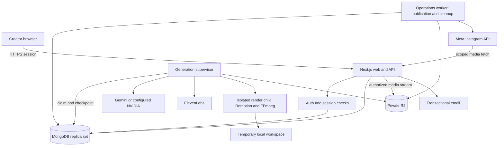
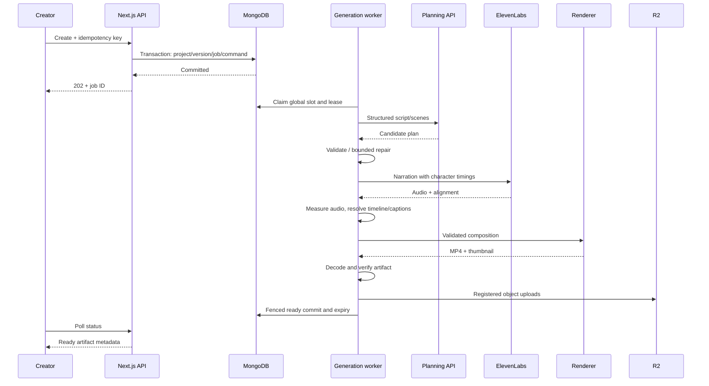

# ChitraBodh — Dashboard and Application System Design

**Version:** 1.0  
**Date:** 31 October 2026  
**Status:** Proposed implementation design for the internal team pilot; not a claim that these services are deployed.  
**Audience:** Product owner, frontend/backend engineers, infrastructure engineer, and QA.

**Detailed implementation contracts:** [API design](ChitraBodh-API-Design.md), [OpenAPI specification](api/chitrabodh.openapi.json), and [database design](ChitraBodh-Database-Design.md). These refine authentication facade routes, consistent revision fields, stable list pagination, guard transactions, deletion jobs, and uncertain-publication duplicate prevention from this architecture.

## 1. Purpose and source of truth

Build a durable application around the working video-generation engine. A creator should still experience only **idea → generation → preview/share**. Authentication, queueing, revisions, expiration, and publishing are system responsibilities, not extra storyboard approval steps.

This document implements the [V1 PRD](ChitraBodh-V1-PRD.md), incorporates the [motion update](ChitraBodh-V1-Motion-Update.md), and extends the earlier [technical design](ChitraBodh-Technical-Design.md). It is the application-layer implementation reference. The [pipeline specification](ChitraBodh-Pipeline-Specification.md) remains useful background; where it conflicts with the updates below, follow this document and the current shared contracts.

### 1.1 Reconciled decisions

| Subject | Design baseline |
|---|---|
| Audience | Self-registering creators, each with private projects; no shared organization workspace |
| Duration | Aim for 60–90 seconds; accept complete lessons of **40–90 seconds**. This supersedes the PRD's strict 60-second minimum, following the subsequent product decision and implemented policy |
| Output | Vertical 1080 × 1920, 30 fps, H.264/AAC MP4; optional burned-in captions |
| Visuals | AI chooses narration, examples, objects, diagrams, labels, and actions through validated scene data. Application-owned SVG/Remotion primitives execute it; no arbitrary generated code |
| Generation | One outstanding generation-related job per user; one executing generation globally; other users wait FIFO |
| Retention | First ready output starts a two-hour availability window. Reused dependencies and caption variants cannot extend it |
| Publishing | Explicit Instagram publish-now and scheduling within the retention window; download for manual Shorts upload |
| Stack | Next.js/React/TypeScript, Node.js workers, MongoDB, private Cloudflare R2, existing Remotion engine |
| AI | Preserve current Gemini Interactions adapter and configured model fallback; NVIDIA remains an operator-selectable alternative, not a required second service |
| Narration | ElevenLabs timestamped speech; curated accessible voices. Adam is a test voice, not fulfillment of the Indian male/female launch catalog |
| Excluded | Billing, credit wallets, behavioral analytics, brand customization, timeline editor, compulsory script review, YouTube API publishing, and multi-agent orchestration |

**Working defaults, not newly confirmed requirements:** Indian-accented English only; Better Auth with email/password sign-up and sign-in; one always-on host; scheduling buffers and operational targets below. Hindi/Hinglish, host vendor, budget, and final voice catalog remain implementation gates, not blockers to this design.

### 1.2 Current implementation versus proposed work

| Capability | Current repository | Application work required |
|---|---|---|
| Planning/speech/rendering | TypeScript pipeline, provider adapters, Zod validation, ElevenLabs alignment, React/Remotion, FFmpeg/FFprobe | Extract reusable engine interfaces; retain working behavior |
| UI/server | Local Node HTTP portal; in-memory latest-job status | Next.js dashboard and authenticated APIs |
| Jobs | Local manifest, filesystem global lock, bounded requests | MongoDB admission, durable checkpoints, leases, recovery, user ownership |
| Storage | `.local-runs` with local cleanup | R2 object registry, authenticated access, durable deletion |
| Preferences/revisions | Per-generation voice/caption selection | Saved preferences, immutable versions, revision commands and caption variants |
| Brainstorming | Not a complete persisted application flow | Small bounded idea-assistance endpoint and draft state |
| Instagram | Not implemented | OAuth connection, publisher, scheduler, outcome reconciliation |
| Access control | Localhost/origin checks; no user accounts | Email/password accounts, sessions, ownership, token protection |

Do not expose the existing localhost server as the team application. This document does not require rewriting the renderer or changing provider keys.

## 2. Requirements traceability

| PRD requirement | Main implementation responsibility | Release evidence |
|---|---|---|
| FR-01 accounts | Auth boundary, registration/sign-in, session checks | Registration, invalid credentials and cross-user tests |
| FR-02 dashboard | Project queries and independent job/media/publication states | Reload/restart restores accurate cards |
| FR-03/04 ideas | Composer, draft autosave, brainstorm service | Select suggestion and generate without copy/paste |
| FR-05–08 production | Durable worker and existing engine | Valid narrated, explanatory 40–90-second output |
| FR-09/10 captions/voices | Variant jobs, catalog and preference snapshots | Export matches chosen variant; voices tested |
| FR-11 revisions | Immutable versions and dependency reuse | Failed revision preserves previous unexpired output |
| FR-12 download | Authorized range-capable media route | Exact selected artifact plays/downloads |
| FR-13–15 Instagram | Connection, publish job, scheduler | Authorized live test plus race/expiry tests |
| FR-16 recovery | Leases, checkpoints, error taxonomy | Crash/failure tests recover or fail truthfully |
| FR-17 lifecycle | Tombstones, object registry, cleanup | Immediate access denial; verified deletion |

## 3. Architecture and deployment boundaries

Use a modular monolith in one repository. Run the web application and background processes independently on one always-on machine for the pilot. MongoDB and R2 are shared durable services. No Redis, Kubernetes, event bus, separate Express backend, or workflow framework is required initially.



### 3.1 Runtime responsibilities

| Runtime | Responsibility | Resource/failure boundary |
|---|---|---|
| Next.js | Pages, auth, input validation, transactional commands, read projections, media streaming | Never performs rendering or waits for a full generation in an HTTP request |
| Generation supervisor | One global generation slot, provider calls, checkpointing, budgets, render child lifecycle | Separate process; CPU-heavy work in a child process/container |
| Operations worker | Publication polling, due scheduling, token maintenance, cleanup and reconciliation | Separate from generation so a render cannot block expiry or scheduling |
| MongoDB replica set | Auth/product metadata, queues, transactions, leases, object registry | Required for proposed multi-document invariants; not a standalone MongoDB deployment |
| R2 | Private generated objects and checkpoints | No public bucket; no user-generated media backups |
| Reverse proxy | HTTPS, request size/time limits, streaming, rate-limit perimeter | Public ports only 80/443; databases and worker controls remain private |

Database jobs are the queue and durable command record. Committing a job makes it discoverable by workers; no separate queue publish can be lost after a database commit.

### 3.2 Suggested repository organization

```text
apps/web/                 Next.js App Router, route handlers, dashboard components
apps/worker/              generation supervisor and render-child entry point
apps/operations/          publishing, cleanup, reconciliation loops
packages/contracts/      Zod requests, scene/timeline schemas, states, video policy
packages/engine/         existing planning, speech, timing, render, validators
packages/database/       MongoDB repositories, indexes, transactions, migrations
packages/storage/        R2 client, object registry, range streaming
packages/auth/           server-only auth configuration
packages/publishing/     Meta adapter and publication state transitions
packages/observability/  structured redacted logs, health metrics
tests/                   unit, integration, browser, visual, recovery fixtures
```

Move incrementally: retain `src/providers.ts`, `src/timing.ts`, visual components, validators, and CLI as a working baseline until shared-engine tests pass. The layout is a target, not a reason for a large preliminary refactor. Pin compatible package versions and the renderer/browser image at implementation time; Next.js/auth dependencies are not currently installed.

## 4. Dashboard and user flows

### 4.1 Routes and screen contract

| Route | Contents and actions | Critical states |
|---|---|---|
| `/sign-in` | Email/password sign-in and registration | Registration, invalid credentials, duplicate account, rate limit |
| `/dashboard` | Private project cards; create button; voice shortcut; all/scheduled filters | Empty, loading, queued, generating, ready, failed, expired, scheduled, published |
| `/create` | One topic box, optional idea helper, narrator, captions | Defaults loaded, draft saving, invalid input, existing active job |
| `/projects/[id]` | Progress or vertical preview; download, revise, version selector, share | Previous version remains usable during a revision; expiry countdown |
| `/settings` | Voice/caption defaults, timezone, Instagram connect/disconnect, account deletion | Unavailable voice, reconnect required, saving/conflict |

Publishing is a panel on preview, not a mandatory fourth creation screen. Show the selected video, account identity, post description, exact schedule/timezone, and expiry before the explicit final action. No AI model names, JSON, API keys, or credits appear in creator settings.

### 4.2 Create and return later

1. Load saved preferences; creator enters an idea or selects an AI suggestion.
2. Client submits one idempotent command; API commits project/version/job before returning `202`.
3. Navigate to project progress. Browser may close; server execution continues.
4. Poll job state and show **Queued → Planning → Creating narration → Animating → Finishing**. Use real stages, not invented percentages.
5. On success, show the validated artifact and its available-until time. Generation never publishes.

Poll active jobs every 3 seconds while the tab is visible, back off to 15 seconds on network errors, and refresh immediately on focus. Poll inactive dashboard data less often or on navigation. Return `serverNow` and `stateRevision`; ignore out-of-order updates. A local countdown is explanatory only: server access checks are authoritative.

### 4.3 Drafts and brainstorming

Autosave draft text after a short debounce with optimistic revision checks; show save failures without discarding text. Keep unsaved text in tab memory, not persistent browser storage by default. Server topic limit is **2,000 characters** from the PRD; update the prototype's 1,000-character limit and shared UI/schema together.

Brainstorming returns up to three concise suggestions and an optional short question. Proposed bounds: six recent message pairs, 8,000 total input characters, one request in flight per user, six requests per minute. Retain brainstorm history with the draft for at most 24 hours of inactivity, then keep only the selected idea. This is a proposed privacy default. Store temporary conversation data outside backed-up durable metadata. Brainstorm requests have their own bounded budget and cannot enqueue a video without Create.

### 4.4 Revision and caption variants

Every revision creates an immutable version with `parentVersionId`, instruction, and settings snapshot. Successful output becomes selected; failure does not alter the previous selection. The scheduler always holds an explicit artifact ID and never follows the project's current selection.

For a visual-only revision, AI may propose updated visuals, but the application must prove that the canonical narration and speech settings are identical before reusing audio. Otherwise synthesize fresh narration. Reuse of audio/timeline inherits its earliest expiry. If the dependency expires while queued or rendering, stop and offer a fresh generation; do not silently synthesize or extend retention.

Caption toggling selects or generates `captions_on`/`captions_off` for the same version. This is a render job, not a browser-only overlay. Until that variant is ready, download/post remain tied to the visible ready variant or disabled for the requested variant. Variant generation counts toward the user's one outstanding job. Repeated requests for the same pending variant return that job.

### 4.5 Accessibility and responsive behavior

Use semantic forms, keyboard-accessible controls, visible focus, labeled voice samples, readable contrast, and status text independent of color. Announce stage changes through a polite live region, not every poll. Respect reduced-motion preferences in the dashboard; exported teaching animation remains intentional. Provide normal video controls, no autoplay audio, and responsive stacked controls on phones. Test caption and diagram readability on an actual small screen.

## 5. Identity, authorization, and secrets

### 5.1 Application authentication

Use Better Auth with MongoDB and email/password authentication. Its documented MongoDB adapter and email/password support this direction. Pin and integration-test the selected release rather than hand-writing password storage or authentication. [MongoDB adapter](https://better-auth.com/docs/adapters/mongo), [email/password authentication](https://www.better-auth.com/docs/authentication/email-password)

Self-service registration accepts a normalized email and a 12–128 character password. Better Auth stores the password hash; application code never stores, logs, or returns a password. Rate-limit registration and sign-in by IP and normalized email. Use secure HttpOnly cookies and a seven-day absolute session; sign-out revokes the current session.

Use the auth library's supported CSRF/origin protections plus same-origin checks on cookie-authenticated mutation routes. Auth handlers are server-only. Restrict post-login redirects to same-origin relative routes. There is no V1 organization/role-management UI.

### 5.2 Ownership rule

Every object lookup includes `ownerId` from the verified session. Never trust a client-provided owner. For a version/artifact/publication also verify its linked project, connection, and deletion state. Return `404` for another user's private resource. Validate ownership before issuing media access or resolving an idempotency record. Server components and route handlers share the same authorization helpers.

### 5.3 Secret lifecycle

Provider credentials and storage keys live in server/host secret configuration, never `NEXT_PUBLIC_*`, browser bundles, plans, or logs. Instagram tokens are encrypted with authenticated encryption, unique nonces, and a key version; bind owner/connection IDs as associated data. Keep encryption keys outside MongoDB and its backups. Support key rotation by decrypting with old keys and re-encrypting with the active key.

Separate web, generation, and publishing secrets where practical. Use scoped bucket permissions and a least-privilege database user. Production uses one documented credential precedence policy instead of relying on workstation `.env` reload behavior. Model/provider settings are snapshotted per job; rotating a secret must not silently change the selected voice or provider contract.

## 6. Data design

Use UTC BSON dates internally and ISO 8601 UTC strings in APIs; store IANA timezone separately. Use opaque IDs, explicit `schemaVersion`, `createdAt`, `updatedAt`, and integer `revision` on mutable records. Validate at API, worker, and persistence boundaries.

### 6.1 Collections

| Collection | Important fields | Lifetime/invariant |
|---|---|---|
| Auth-owned collections | User, session, verification/account records managed by auth library | Auth lifecycle; do not duplicate session handling |
| `preferences` | ownerId, voiceCatalogId, captions, language, timezone | One per user; only affects new work |
| `voiceCatalog` | id, providerVoiceId, name, language, accent, genderLabel, tone, previewRef, modelCompatibility, enabled, lastValidatedAt | No false accent claims; inaccessible voices disabled |
| `projects` | ownerId, title, originalIdea, selectedVersionId, nextVersionNumber, revision, deletedAt | Minimal durable draft/project metadata |
| `versions` | ownerId, projectId, number, parentVersionId, settingsSnapshot, planRef, timelineRef, schema/template/prompt versions, content hashes, state, readyAt, expiresAt | Content immutable after ready; generated payloads only in temporary object storage |
| `generationJobs` | ownerId, projectId, versionId, kind, active, state, stage, attempts, requestCounters, checkpointRefs, nextRunAt, deadlineAt, leaseOwner, leaseUntil, fence, cancelRequested, safeError | Active uniqueness per user; terminal states retain minimal status |
| `generationSlot` | singleton ID, jobId, workerId, leaseUntil, fence, childIdentity | Global execution admission |
| `artifacts` | ownerId, versionId, variant, objectId, thumbnailId, SHA-256, byteSize, duration, dimensions, codecs, validation, readyAt, expiresAt, state | Exact downloadable/publishable media |
| `objects` | ownerId, versionId, jobId, key, kind, checksum, bytes, state, provisionalDeadline, expiresAt, deleteAttempts, lastError | Register before upload; covers all generated objects/checkpoints |
| `instagramConnections` | ownerId, accountId, displayIdentity, encryptedToken, keyVersion, tokenExpiresAt, scopes, status, revision | One connection/user; immutable identity during in-flight publish |
| `publishJobs` | ownerId, projectId, artifactId, connectionId, connectionRevision, descriptionRef, descriptionHash, dueAt, timezone, deadlineAt, state, revision, lease/fence, containerId, mediaId, permalink, publishedAt, safeError | Exact payload and account; local deduplication, external reconciliation |
| `commands` | ownerId, commandType, idempotencyKey, requestHash, resourceId, responseStatus, purgeAt | Proposed 24-hour replay window; no raw request payload |
| `operationalEvents` | jobId, stage, category, time, elapsedMs, correlationId | Redacted diagnostics, seven-day proposed retention |

Temporary narrative/revision payloads, brainstorm history, and post descriptions use a separate non-backed-up ephemeral collection or registered R2 objects, with explicit expiry. Store only hashes/references in durable job records. Remove generated plan/timeline references at expiry while preserving safe tombstones and deletion evidence. An expired version is not a permanent script archive.

### 6.2 Required indexes

```text
preferences:           unique(ownerId)
projects:              (ownerId, deletedAt, updatedAt desc, _id desc)
versions:              unique(projectId, number)
generationJobs:        unique(ownerId) WHERE active = true
generationJobs:        (active, state, nextRunAt, createdAt, _id)
generationJobs:        (active, leaseUntil)
artifacts:             unique(versionId, variant), (state, expiresAt)
objects:               unique(key), (state, expiresAt), (jobId)
instagramConnections: unique(ownerId)
publishJobs:           (state, nextRunAt, dueAt), (ownerId, createdAt desc)
publishJobs:           unique(ownerId, artifactId, connectionId) WHERE active = true
commands:              unique(ownerId, commandType, idempotencyKey)
commands/events:       TTL on purgeAt (metadata cleanup only)
```

MongoDB single-document conditional writes are atomic; multi-document changes need transactions in this design. Unique indexes enforce admission, rather than a race-prone read-then-insert. [MongoDB atomicity](https://www.mongodb.com/docs/manual/core/write-operations-atomicity/)

### 6.3 Transaction boundaries

- **Create/revise/variant:** insert command, allocate version number if needed, create version/job, set `active:true`, and update project in one transaction. Duplicate active-owner conflict returns existing authorized job; same idempotency key/different hash returns conflict.
- **Claim generation:** update singleton slot and job lease/fence together. Do not call providers inside a transaction.
- **Ready:** verify current fence, unexpired dependencies, live project, validated objects, and no cancellation; update artifact/version/project, mark job terminal and release slot together.
- **Schedule:** verify owned artifact/connection, insert command and immutable publish payload/job together. Check time constraints again immediately before dispatch.
- **Delete/disconnect:** tombstone project or connection and cancel eligible pending jobs transactionally; an already-dispatched external call is reconciled rather than declared cancelled.

R2 and external APIs cannot participate in MongoDB transactions. Use registered intended objects, checkpoints, idempotent cleanup, and reconciliation for those boundaries.

## 7. API contracts

All application APIs are under `/api/v1`; auth library handlers remain under `/api/auth/*`. JSON responses are private/no-store. Validate content type, finite numbers, string lengths, enums, and unknown fields; reject oversized bodies before parsing. Proposed body cap: 32 KiB for normal commands. Lists use stable cursor pagination, default 20/max 50, ordered by timestamp plus ID.

### 7.1 Routes

| Method and path | Request / result | Important behavior |
|---|---|---|
| `GET /me` | Identity, preferences, serverNow | No secrets |
| `PATCH /me/preferences` | voiceCatalogId, captions, timezone, revision | Validate enabled voice/timezone; conflict on stale revision |
| `GET /voices` | Curated available voices and sample access | Do not expose provider marketplace or credential errors |
| `GET /projects` | cursor, filter → cards, nextCursor | Owner-filtered; separate media/job/publish states |
| `POST /projects` | topic → draft | Idempotent; no provider work |
| `GET/PATCH/DELETE /projects/:id` | Read, rename/edit draft, delete | Revision guard on changes; tombstone before cleanup |
| `POST /ideas/brainstorm` | draftId, message → short answer/suggestions | Bounded temporary history; explicit user selection |
| `POST /generations` | topic or projectId, voiceCatalogId?, captions? | `202` with projectId/versionId/jobId; snapshot defaults |
| `POST /projects/:id/revisions` | sourceVersionId, instruction, settings? | New version, instruction ≤1,000 characters |
| `POST /versions/:id/variants` | captions boolean | Return matching ready artifact or queued render job |
| `POST /projects/:id/selection` | versionId, revision | Select owned ready/unexpired version |
| `GET /jobs/:id` | state/stage, safeError, stateRevision, serverNow | Sanitized status; no raw plan/provider response |
| `POST /jobs/:id/cancel` | Empty command | Idempotent cancellation intent |
| `POST /jobs/:id/retry` | Empty command | New job/attempt after terminal failure; dependency checks |
| `GET /versions/:id` | Version/variant metadata, expiresAt | No indefinite access to expired generated payloads |
| `GET/HEAD /artifacts/:id/media` | optional download=true | Authenticated range stream; `410` for owned expired media |
| `POST /instagram/connect` | returnPath → authorizationUrl | CSRF-protected; state bound to user/session |
| `GET /instagram/callback` | provider code/state | Verify state, exchange server-side, return to saved screen |
| `GET/DELETE /instagram/connection` | Safe status / disconnect | Never return access token; cancel pending schedules |
| `POST /publications` | artifactId, connectionId, description, mode, dueAt?, timezone? | Explicit publish intent; dedupe; `202` |
| `GET /publications/:id` | status, schedule, mediaId/link if confirmed | Unknown outcome is distinct from failure |
| `PATCH /publications/:id` | expectedRevision, time/description/artifact | Only before dispatch; invalidate prepared container on payload change |
| `POST /publications/:id/cancel` | expectedRevision | Conflict if dispatch already won |
| `DELETE /me` | Explicit account deletion command | Revoke sessions, cancel work, disconnect, purge owned data |

The Meta media-fetch endpoint described in Section 10 is separately token-authorized; it does not accept an application session or arbitrary object key.

### 7.2 Example create command and result

```http
POST /api/v1/generations
Content-Type: application/json
Idempotency-Key: <client-generated UUID retained until response is known>

{"topic":"Explain linear search","voiceCatalogId":"test-adam","captions":true}
```

```json
{
  "projectId": "opaque-project-id",
  "versionId": "opaque-version-id",
  "jobId": "opaque-job-id",
  "state": "queued",
  "statusUrl": "/api/v1/jobs/opaque-job-id",
  "serverNow": "2026-10-31T10:00:00Z"
}
```

Mutation retries reuse the same key and normalized payload. Keep command hashes after deleting a project until the replay window closes, so a delayed duplicate cannot recreate deleted work. Replaying a deleted result returns an unavailable/tombstoned response, not a new generation. User-requested retry after a terminal failure gets a new command key and new request budget.

### 7.3 Errors and UI recovery

```json
{"error":{"code":"ACTIVE_JOB_EXISTS","message":"Your video is already being created.","retryable":false,"jobId":"opaque-job-id","requestId":"correlation-id"}}
```

| HTTP | Examples | UI action |
|---|---|---|
| 400/422 | INVALID_INPUT, UNSUPPORTED_LANGUAGE, SCHEDULE_OUTSIDE_WINDOW | Inline correction; preserve input |
| 401 | SESSION_REQUIRED | Sign in and return to project |
| 404 | NOT_FOUND | Generic missing/access-denied screen |
| 409 | ACTIVE_JOB_EXISTS, REVISION_CONFLICT, DISPATCH_STARTED, IDEMPOTENCY_CONFLICT | Open existing job or reload current state |
| 410 | MEDIA_EXPIRED, DEPENDENCY_EXPIRED | Regenerate from retained idea |
| 429 | REQUEST_LIMITED | Respect Retry-After; no automatic key rotation |
| 503 | SERVICE_UNAVAILABLE | Preserve draft; retry later |

Asynchronous job failures retain specific safe codes: STORYBOARD_INVALID, DURATION_INVALID, ALIGNMENT_INVALID, VOICE_UNAVAILABLE, PROVIDER_UNAVAILABLE, PROVIDER_QUOTA, RENDER_FAILED, STORAGE_FAILED, TIMEOUT, CANCELLED. User-facing errors distinguish invalid AI output from bad credentials; only operators receive sanitized configuration diagnostics.

## 8. Durable generation and timing design

### 8.1 Flow



### 8.2 Provider and engine contracts

Keep provider adapters behind `planVideo`, `narrate`, and typed errors. Pin prompt/schema/template/config versions on the job. Current Gemini Interactions sends explicit context and `store:false`, parses only completed final text output, then applies local validation. It does not generate trusted executable code. `store:false` is not a promise about all provider data retention. Model IDs remain configuration rather than product/UI contracts.

AI chooses examples and visual objects. The engine validates allowed shapes, coordinates, labels, references, supported actions, exact narration phrases and occurrences. Keep the existing binary-search operation validator; generic illustrations, including current linear-search scenes, do not yet have equivalent algorithm-semantic verification. Add such validators incrementally without hardcoding the AI's example values. Schema correctness alone does not establish scientific correctness.

Narration text and aligned characters must match under the supported normalization rules. Derive scene boundaries, visual action onsets, and captions from the same audio alignment. Use seconds in the canonical timeline and a single frame conversion at 30 fps. Missing or mismatched alignment fails rather than inventing timestamps.

Current duration policy stays centralized in `src/video-policy.ts` or its extracted shared module: 100–240 narration words are a preflight estimate, narration must measure 40–89.8 seconds, and final encoded video must be 40–90 seconds subject only to the existing tiny numeric tolerance. Aim for roughly 75 seconds; repair by improving explanation, never silence padding or abrupt truncation.

### 8.3 States, admission, and leases

```text
queued → planning → narrating → aligning → rendering → validating → uploading → succeeded
active stage → retry_wait → valid checkpoint
active stage → cancel_requested → cancelled
active stage → failed

Version/media separately: pending → ready → expired → deleting → deleted
```

Queued requests create no generated objects. Start the 20-minute execution deadline when the worker begins, not when a user joins the queue. Proposed queue wait ceiling: 60 minutes, then a retryable QUEUE_TIMEOUT. Queue position is advisory; do not promise completion times before benchmarks.

Start with 90-second leases and 20-second heartbeats. Every write/commit includes job ID, lease owner, and monotonically increasing fence. Renew the job and global slot together. On lease loss, abort provider work where possible, stop the render child, and prohibit commits. A fence blocks stale results but cannot stop an old process consuming CPU: the supervisor must prove the old child/process group is terminated before granting execution to a replacement. If it cannot, pause generation and alert instead of violating concurrency.

On restart: reconcile the slot, terminate identified orphan render children, inspect durable checkpoints, remove invalid outputs, and resume eligible jobs. Keep publication and cleanup running while generation is paused. Terminal transitions atomically clear `active` and release the slot. A reconciler repairs stale active records without creating a second job.

### 8.4 Checkpoints and retry budgets

Checkpoint after validated plan, validated speech/alignment, timeline, and validated uploaded output. Store stage input hashes and object checksums. Resume only if dependencies match, objects exist and are unexpired, and schema/template versions are compatible. Ready artifacts are immutable. Temporary render files are deleted after upload.

| Work | Initial policy |
|---|---|
| Planning, including fallback/repairs | Four total API calls per generation job across planning providers |
| Narration, including retries/key fallback | Three total ElevenLabs calls per generation job |
| Renderer | One initial attempt plus one retry for a transient process failure, within the same execution deadline |
| R2 upload | Up to three attempts for transient failures; same registered key/checksum and deadline |
| Backoff | Bounded exponential delay with jitter; respect Retry-After and remaining deadline |

Increment provider counters durably **before** sending a request, including after worker recovery. Do not multiply stage retries by provider retries. Preserve current Gemini fallback conditions and ElevenLabs backup-key behavior: only explicit quota exhaustion permits the configured narration backup; not auth, paid-voice restriction, abuse protection, or generic rate limiting.

Persist request-start and request-reference metadata. A lost speech response may mean paid synthesis occurred; if no lookup/recovery mechanism exists, a bounded retry can incur duplicate work. Record that uncertainty and keep the cap; do not claim exactly-once provider billing. Terminal failures purge generated content; user Retry may reuse checkpoints only if they still exist and are eligible, otherwise it starts from the saved idea.

## 9. Storage, media access, and expiration

### 9.1 Object registry and ready commit

Use keys such as `generated/{ownerId}/{projectId}/{versionId}/{attemptId}/{kind}/{opaqueName}`. Never accept client-supplied storage paths. Register an intended key before uploading, then record checksum/size and committed state. This makes uploads discoverable after a crash between R2 success and database commit. Aborted multipart uploads and local directories also require cleanup ownership records or a safely scoped sweep.

For entirely new work, first ready commit sets `expiresAt = readyAt + 2 hours`. All associated plans, audio, alignment, timeline, thumbnails, and variants share that deadline. During execution they have a provisional deadline tied to the job. For reused content:

```text
effectiveExpiry = min(newReadyAt + 2 hours, expiry of every reused generated dependency)
```

Never reset expiry by copying, re-rendering captions, viewing, scheduling, or restoring a version. Reject a ready commit if its effective expiry has already passed. If an upload succeeded but commit failed, it remains inaccessible and is reconciled or deleted. All essential objects must be verified present before marking ready.

### 9.2 Browser and Meta access

Use an authenticated backend streaming route for pilot playback/download. It checks ownership, tombstones, readiness, and expiry **on every request**, then streams from R2 with backpressure and bounded memory. Support HEAD, one byte range, `206`, `416`, accurate content length/type, and sanitized download filename. Set private/no-store caching and avoid logging media credentials. Authorize thumbnails in the same way.

This intentionally adds web bandwidth but allows new requests to be denied immediately on manual deletion, unlike an already-issued direct storage URL. Already downloaded bytes or an established stream cannot be recalled. R2 supports scoped presigned URLs; they are an alternative for future scaling, with lifetime capped by expiry and an explicitly accepted revocation delay. [R2 presigned URLs](https://developers.cloudflare.com/r2/api/s3/presigned-urls/)

Meta cannot send the user's session cookie. Issue an opaque random media-fetch token bound to **one publish job, one artifact, and an expiry no later than media expiry**. Store its hash, never the token. The HTTPS fetch route rechecks publication authorization, tombstones, and expiry, supports repeated HEAD/range/GET requests during processing, and streams only the pinned MP4. It is a bearer capability, not a public bucket or one-use link. Redact its URL from proxy logs; rate-limit without blocking legitimate provider retries. Verify live Meta compatibility before release.

### 9.3 Cleanup and metadata

The operations worker scans due objects at least once a minute. Expiry access checks do not depend on that scan: at `now >= expiresAt`, deny new access and reuse even if deletion is delayed. Mark deletion pending, delete R2/local objects and incomplete uploads, verify completion, then retain only minimal tombstones. Object-not-found is successful deletion. Retry failures with backoff and alert if more than five minutes overdue.

R2 lifecycle expiration is a backstop, not the application's precise two-hour timer. Use explicit deletion and monitor it. [R2 lifecycle documentation](https://developers.cloudflare.com/r2/buckets/object-lifecycles/)

| Data | Proposed retention |
|---|---|
| Generated script/scenes/audio/timings/video/thumbnail | Two hours from first ready, or earlier dependency expiry |
| Failed/cancelled execution objects | Immediate purge request; retry cleanup until confirmed |
| Local render intermediates | Delete on completion/failure; startup sweep for abandoned work |
| Selected idea, project title, settings, minimal statuses | Until user/account deletion |
| Brainstorm history and transient revision input | At most 24 hours unless earlier deletion; omit from backups |
| Post description payload | Until terminal publication or artifact expiry, whichever comes first; keep only hash thereafter |
| Operational logs | Seven days; no topics/scripts/tokens/media URLs |
| Auth/connection records | Their own security lifecycle; removed/revoked on disconnect/account deletion |

Do not put generated content into MongoDB snapshots, telemetry, crash dumps, permanent render caches, or media backups. Built-in fonts/shapes are application assets and may be cached. Third-party provider retention, a user's download, and Instagram's published copy are outside local deletion control.

## 10. Instagram connection and publishing

### 10.1 Integration boundary and verification gate

Prefer the PRD's Instagram Login route, with only identity and publishing access. Do not mix Facebook Login permissions/tokens/endpoints with Instagram Login. Meta's official collection documents professional-account publishing and the container/publish workflow; the directly hosted Instagram Login publishing page was inaccessible during this design review. Therefore exact Graph API version, scopes, token exchange/refresh details, account eligibility, rate limits, and container expiry must be checked against the chosen route and actual team accounts before integration is called complete. [Meta official collection](https://www.postman.com/meta/instagram/documentation/6yqw8pt/instagram-api?entity=request-23987686-1ff01566-3509-48bd-a0f4-8571a91ccfdf), [publishing reference to verify](https://developers.facebook.com/docs/instagram-platform/instagram-api-with-instagram-login/content-publishing)

Connection flow: create short-lived one-use OAuth state bound to owner/session and allowlisted return path; authorize; verify callback; exchange code server-side; retrieve identity/permissions; encrypt tokens; save connection. Use PKCE if required/supported by the chosen flow. Cancelled OAuth returns to the original project. Store granted scope and token-expiry snapshots; refresh ahead of expiry according to the verified route. Refresh failure marks needs_reconnection. Reconnection must match the pinned account before resuming a pending post; switching accounts never retargets an existing authorization.

### 10.2 Scheduling rules

Keep these PRD defaults configurable and server-enforced:

```text
scheduledAt >= commandNow + 10 minutes
scheduledAt <= artifact.expiresAt - 15 minutes
publishNow requires artifact.expiresAt - commandNow >= 5 minutes
dispatchDeadline = min(scheduledAt + 15 minutes, artifact.expiresAt)
publishNowDeadline = min(createdAt + 15 minutes, artifact.expiresAt)
```

Store the UTC instant, IANA timezone, and selected offset. Reject nonexistent local times; require a choice for ambiguous daylight-saving times. Changing profile timezone does not move existing posts. The UI displays a server-calculated allowable interval and available-until timestamp. Expiry is never extended for scheduling.

Poll due jobs every 10 seconds with indexed scans. Preparation may start up to five minutes early if provider container lifetime permits, but the final publish dispatch must never occur before `dueAt`. Buffers reduce risk; they do not guarantee provider completion. After deadline, do not send a new publish attempt. Reconcile already-sent requests even after expiry without recreating media.

### 10.3 Publication state machine and sequence

```text
scheduled / queued_now → preparing → ready_to_publish → publishing → published
scheduled / preparing / ready_to_publish → cancelled (only before dispatch wins)
preparing → retry_wait / needs_reconnection / failed / expired
publishing → outcome_unknown → published / failed_confirmed / needs_attention
scheduled past lateness deadline → missed
```

```mermaid
sequenceDiagram
    participant U as Creator
    participant A as API
    participant D as MongoDB
    participant P as Publisher
    participant M as Meta
    U->>A: Explicit Post/Schedule exact artifact/account
    A->>D: Commit immutable intent
    A-->>U: Publication job ID
    P->>D: Claim current revision and lease
    P->>M: Create container with scoped media URL
    M-->>P: Container ID
    P->>D: Persist container ID
    P->>M: Poll processing status
    M-->>P: Ready
    P->>D: At/after due: CAS state to publishing
    P->>M: Publish pinned container
    alt Confirmed
      M-->>P: Media ID
      P->>D: Published + media ID; fetch permalink separately
    else Response lost
      P->>D: outcome_unknown
      P->>M: Reconcile known container/publication evidence
    end
```

Immediately before dispatch, transactionally recheck job revision, connection status/identity, artifact expiry, cancellation, and lease; set `publishing` and dispatch intent. From that point, cancellation reports that publication may be underway. If a process dies after intent but before recording a response, treat the outcome as uncertain until reconciled; a local flag cannot prove whether Meta accepted a call.

Persist container IDs immediately. Poll with bounded backoff and provider limits. Do not blindly create a new container or republish after an ambiguous publish timeout. If available evidence cannot establish the result, show needs_attention and require an explicit informed decision; never fabricate Published or promise exactly-once external delivery. A confirmed media ID is sufficient for Published; permalink lookup may complete later.

Edits use revision-based compare-and-set before dispatch. Changing artifact/description invalidates prior prepared containers and fetch tokens. Duplicate clicks with the same command key return the same job; an active job for the same artifact/account blocks another. Reposting after success requires a new explicit intent. Disconnect cancels pending work and removes tokens; already-sent work may remain unverifiable. Local deletion never claims to remove an Instagram post.

## 11. Failure and race handling

| Scenario | Required system response |
|---|---|
| Two tabs click Generate | Unique active-owner index admits one job; return existing job for the other |
| Two users generate | Both may queue; global slot executes one at a time |
| API commits but response is lost | Same idempotency key returns committed resource; no duplicate provider work |
| AI repeatedly returns invalid motion/script | Shared bounded repairs; safe validation error; retain idea |
| Provider 503/429 or quota | Distinguish transient unavailable, quota, auth, and invalid output; bounded retry/fallback |
| Voice is paid-only or removed | Disable catalog entry for new requests; do not silently substitute another voice |
| Bad alignment or out-of-range duration | Repair within existing budget or fail; no guessed timestamps/silence padding |
| Worker dies after synthesis | Recover checkpoint if stored and valid; otherwise record uncertain cost before bounded retry |
| Worker loses database access | Stop new provider calls/commits when lease cannot renew; terminate child safely |
| R2 write or ready commit fails | Keep candidate inaccessible; reconcile registered objects; no false Ready |
| Delete races with upload | Tombstone wins; fenced commit rejected; late objects registered for deletion |
| Old dependency expires during revision | Abort reuse; previous output remains expired; offer fresh generation |
| Caption variant requested twice | Unique version/variant record and active job deduplicate |
| Schedule expires while render consumes CPU | Separate operations process enforces expiry and dispatch deadlines |
| Cancel races with dispatch | Atomic state transition decides winner; after dispatch show uncertainty, not Cancelled |
| Meta publishes but response is lost | Reconcile existing provider identifiers; never blindly repeat |
| Scheduler is offline past deadline | Mark Missed; no silent late posting or regeneration |
| Token revoked/account changed | Require reconnection and explicit resume; do not retarget payload |
| Cleanup/storage outage | Deny access at expiry; keep deletion-pending evidence and alert |
| Browser clock wrong/tab sleeps | ServerNow and authoritative API checks determine validity |
| Corrupt metadata/missing object | Fail closed; show unavailable, reconcile storage; do not expose arbitrary paths |

## 12. Security and privacy controls

Treat topic text, provider output, and post descriptions as untrusted data. Escape UI text; validate JSON with bounded arrays/strings; never execute generated JS/HTML or fetch arbitrary model-supplied URLs. Renderer assets come from a local allowlist. Restrict render-child networking and filesystem access to required assets/workspace; do not pass provider secrets into compositions. Download only from configured providers/storage hosts, preventing SSRF through scene content.

Use HTTPS, secure cookies, Content Security Policy compatible with the application, CSRF protections, request limits, and per-user/IP rate limits. Proposed create-command admission limit: ten/minute in addition to active-job uniqueness; add an operator-configurable daily provider-call ceiling without a customer credit UI. Use shared database-backed limits where multiple web processes could otherwise bypass them.

Generated-media access and ownership checks fail closed if the database is unavailable. Keep private responses out of CDN caches. Sanitize filenames and `Content-Disposition`; do not log authorization headers, cookies, OAuth codes, provider responses, or fetch tokens. Review crash-reporting defaults before enabling any service. Security/operational metrics are permitted; behavioral analytics and session replay are not.

Account deletion revokes access first, cancels eligible work/schedules, removes tokens, queues object deletion, then removes owned metadata after reconciliation. Explain any in-flight publication uncertainty. Database restore must replay deletion/expiry policy before reopening access; a backup must not resurrect a deleted account or dispatch old schedules automatically.

## 13. Operations, performance, and cost

### 13.1 Deployment

Use a reproducible Linux image with supported Node.js, pinned Remotion/browser dependencies, FFmpeg/FFprobe, and bundled licensed fonts. Run web, generation, and operations as separately supervised processes/containers. Allocate renderer CPU/memory limits and temporary-disk quotas so web and cleanup remain responsive. Disable automatic scaling of generation until global-slot recovery is tested.

A **4-vCPU/8-GB host is a starting benchmark candidate, not a measured sizing guarantee**. Measure peak RSS, disk, render time, and stream throughput before choosing a paid plan. Provision MongoDB as a transaction-capable replica set and private R2 separately. No claim that the complete always-on system is free; quotas, email, licensing, compute, and narration rights must be checked for the actual deployment.

Environments: local development, isolated staging, internal production. Use separate databases, buckets, callback URLs, and secrets. Provider configuration, Graph API version, template/schema versions, and video policy are explicit configuration. Startup checks validate required secret presence without printing values, database indexes, storage access, codecs, and browser availability.

### 13.2 Capacity model and proposed targets

With one worker, maximum execution throughput is approximately `60 / average_generation_minutes` videos/hour; queue delay rises with arrivals. Rendering concurrency inside one video is separate from user/job concurrency. Choose Remotion frame concurrency from benchmarks rather than exposing it to creators.

Temporary storage planning: `recent_ready_jobs × mean_artifact_bundle_bytes + active_job_peak_bytes + safety_margin`. Two hours bounds retained-ready bundles, not provider costs. Include audio, both caption variants, checkpoints, failed attempts, and cleanup backlog. Measure upload/stream bandwidth and bound request concurrency.

| Target | Pilot acceptance goal, not measured claim |
|---|---|
| Generation acknowledgement | p95 ≤2 seconds; no provider work on request path |
| Typical generation | p50 ≤5 min, p95 ≤10 min after execution starts; 20-minute deadline |
| Progress freshness | ≤5 seconds while tab is active |
| Export compliance | Every ready output passes dimensions, audio/video decode, and 40–90-second contract |
| Speech/cue sync | ≥95% of sampled cues within ±250 ms of intended onset |
| Scheduled dispatch | Never early; ≥95% start within 60 seconds when system/provider healthy |
| Retention | Deny new access at expiry; target deletion within the next one-minute sweep |
| Integrity | No cross-user access or false Published state in acceptance tests |

### 13.3 Observability and runbooks

Emit structured request/job IDs, stage durations, queue wait, retry counts, model identifier, safe provider status, render exit code, and cleanup lag. Use aggregate operational measurements, not click tracking. Health endpoints report process liveness; private readiness checks cover DB/storage and worker heartbeats. Do not make public health depend on spending an AI request.

Alert on absent worker heartbeat, orphan render process, growing queue, disk pressure, repeated provider rejection, expired-token backlog, unknown publication outcomes, and overdue deletion. Proposed log retention is seven days. Record audit events for explicit publish/cancel/disconnect/delete intent without raw media or descriptions.

| Incident | Operator procedure |
|---|---|
| Generation stuck | Inspect safe job stage/lease, confirm child termination, recover checkpoint or fail job; never blindly release slot |
| Provider rejects credentials | Pause new provider work, update secret, run a bounded smoke test; preserve drafts |
| Render memory/disk failure | Terminate owned process, purge temporary work, adjust measured resource limits, retry within budget |
| Deletion overdue | Keep access denied, restore R2 connectivity, retry registered deletes and orphan scan, verify backlog clears |
| Unknown publication | Inspect stored container/media evidence; reconcile before any new publish intent |
| Host/DB restore | Keep dispatch disabled, sweep expiries/deletions, reconcile active leases and ambiguous publications, then resume |

Back up only permitted durable metadata, encrypted connection records, and configuration; exclude generated/ephemeral payloads. Proposed metadata recovery targets: daily backup, ≤24-hour data loss and ≤4-hour restore for the internal pilot, subject to selected host testing. A restored schedule is not automatically safe to dispatch: reconcile with external outcomes first. Loss of expired media is intentional; it is not restored.

## 14. Testing and acceptance

Preserve current engine tests; add application tests around real invariants rather than UI implementation details. Use injected clock/provider/storage adapters for deterministic failures, plus a transaction-capable test MongoDB. Test the actual lease/index behavior, not only mocked repository methods.

| Layer | Required coverage |
|---|---|
| Unit/property | Duration boundaries, caption/cue alignment, state transitions, schedule/DST bounds, expiry inheritance, request hashes, safe error mapping |
| Database integration | Concurrent admission, unique indexes, fencing, transaction rollback, terminal slot release, stale revision rejection |
| Storage integration | Range/HEAD, expired/manual-delete denial, interrupted upload, orphan cleanup, repeated delete, no public access |
| Provider contract | Structured output, malformed plans, 429/503, invalid voice, bounded counters across restart, response loss |
| Browser E2E | Sign-in, draft, brainstorm selection, generation return-after-refresh, revision, caption variant, preview/download, settings, expiry |
| Publishing integration | OAuth state replay, token revoke, schedule/edit/cancel races, no early/late dispatch, lost response and reconciliation |
| Fault injection | Kill render/supervisor, DB/R2 outage, process pause beyond lease, lost ready commit, host restart with overdue schedules |
| Content review | Water/nitrogen cycles, binary/linear search, comparison and pronunciation topics; narration/visual agreement and meaningful motion |
| Live acceptance | Actual selected voices, Gemini model/endpoint, R2 media fetch, and an explicitly authorized team Instagram test post |

Use the PRD's 20-topic benchmark before calling the full pilot ready; do not treat valid JSON or successful FFmpeg decode as proof of explanation accuracy. Inspect frames at motion checkpoints and listen to narration. Serious factual errors block the affected supported topic/template until fixed. Export remains a linear MP4, not an interactive clickable lesson.

Release gates: all FR-01–17 scenarios covered; two-user privacy and concurrency proven; expiry/deletion verified with simulated time and real storage; duplicate/unknown publish outcomes handled; final voice catalog accessible; operator can restore service safely. Mock tests alone cannot establish Meta account access or narration licensing.

## 15. Implementation plan and migration

| Phase | Deliverable | Exit condition |
|---|---|---|
| A. Preserve engine contracts | Extract shared job input/output, video policy and schemas; keep CLI working | Existing provider/timing/render tests pass; no visual regression |
| B. Secure application foundation | Next.js shell, email/password auth, MongoDB schema/indexes, owned drafts/preferences | Two users cannot access each other's data; draft and preferences survive restart |
| C. Durable generation and R2 | Admission/worker leases/checkpoints, object registry, media streaming, cleanup | Browser-independent generation and crash/expiry tests pass |
| D. Complete creator dashboard | Project cards/progress, brainstorm, revision/version selection, caption variants | Three-stage workflow satisfies FR-02–12; exact selected export |
| E. Instagram pilot | Verify chosen Meta route, connect, post now, schedule/cancel, reconcile | Authorized live post and failure/race/expiry tests pass |
| F. Operate internal V1 | Always-on deployment, monitoring, backups/runbooks, benchmark review | Full acceptance gate and team walkthrough complete |

Validate Meta eligibility early during Phase B so access problems do not appear only after the dashboard is finished. Build provider-independent dashboard/storage tests before spending narration credits. No historical `.local-runs` import is required by default: they are temporary unowned prototype outputs. Start private application projects fresh; retain the CLI as a developer tool.

Roll out with self-service registration protected by credential rate limits. Stop generation admission and drain or cancel jobs before changing incompatible engine schemas. Deploy backward-compatible database additions first, then workers/web, and remove old fields only after all active jobs are compatible. Rollback must preserve schema compatibility; fail or migrate incompatible queued jobs explicitly rather than interpreting them with a different renderer. Keep an operator kill switch for new generation and separate one for publication; neither disables cleanup.

## 16. Architecture decisions and outstanding gates

| Decision | Reason | Revisit when |
|---|---|---|
| Modular monolith, separate processes | Simple codebase with render/cleanup isolation | Measured resource or team boundaries require services |
| MongoDB durable queue | Already required database; avoids extra queue service | Queue scale/operational burden exceeds this pilot |
| One global generation slot | Matches low-volume pilot and predictable resource use | Product explicitly accepts concurrent generation |
| Auth library + email/password | Individual secure accounts without organization UI | Organization or different identity requirements |
| Private backend media stream | Immediate authorization/expiry checks and no public bucket | Bandwidth cost warrants explicitly designed signed access |
| Immutable versions/artifacts | Revisions cannot silently alter scheduled output | Retained as a core invariant |
| Audio-derived timeline | One timing source for captions and motion | A tested alternative alignment requirement emerges |
| App cleanup plus lifecycle backstop | Two-hour retention needs explicit enforcement | Retention policy itself changes |

Before deployment, settle: host/domain and spend cap; MongoDB hosting/backups; email sender/vendor; authentication library version; actual accessible Indian male/female voices and usage rights; English-only launch confirmation; selected Meta flow, API version, permissions and authorized team profiles; Remotion/license eligibility; acceptance of proposed queue/timeouts, metadata retention, and scheduling buffers. These choices do not change the architecture or require additional creator steps.

**Next implementation slice:** Phase A/B, then one authenticated user creates a video through a durable MongoDB job, streams it from R2, and sees it expire correctly. That vertical slice proves the application foundation before expanding revisions and Instagram publishing.
