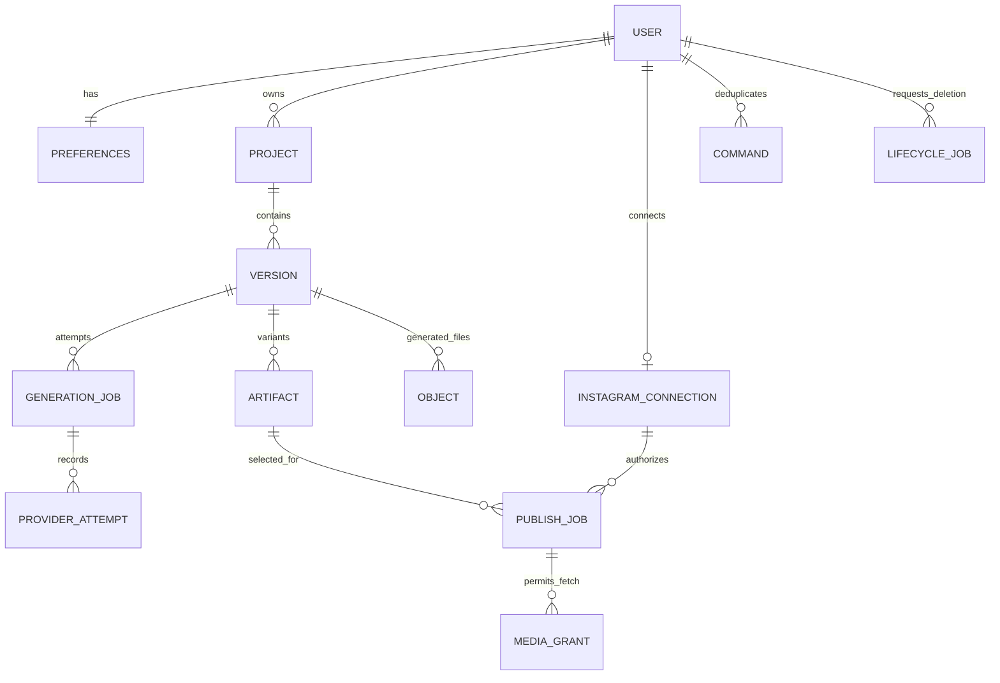

# ChitraBodh — V1 Database Design

Version 1.0 · 31 October 2026 · **Proposed implementation specification. No database migration has been applied.**

References: [PRD](ChitraBodh-V1-PRD.md), [system design](ChitraBodh-Dashboard-System-Design.md), [API design](ChitraBodh-API-Design.md), [OpenAPI](api/chitrabodh.openapi.json). MongoDB is the metadata/queue database; private Filebase holds generated payloads. Better Auth manages identity/session mechanics. There is no billing schema or behavioral tracking collection.

## 1. Persistence conventions and invariants

Use a transaction-capable MongoDB replica set. Domain `_id` values are UUID strings; `ownerId` is an opaque auth-user string, never assumed to be UUID. Foreign keys are explicit references, not automatic MongoDB constraints. Use BSON Date for all instants, nonnegative BSON integer counters, doubles for finite measured durations, and explicit enums. JSON APIs map `_id` to `id` and Dates to UTC strings.

Every application document has `_id`, `schemaVersion:1`, `createdAt`, `updatedAt`; mutable documents additionally have `revision` starting at 1. Job DTO maps its revision to `stateRevision`. Optional fields are absent, not inconsistently null. The exceptions are library-owned auth documents, which follow the pinned adapter schema.

Enforce per-collection `$jsonSchema` with validationLevel strict and validationAction error once seeded/migrated. Include `_id` and all allowed common fields if using additionalProperties false. Specify required fields, bsonType, enums, array limits and numeric bounds. API Zod checks mirror these, but cross-record checks and state transitions belong to repository transactions. A schema validator alone does not establish ownership, foreign-key integrity, chronological relationships, or legal transitions.

Global invariants:

1. Every owned reference resolves to the same owner and a live authorized parent at admission/commit.
2. At most one `generationJobs.active=true` per owner, counting queued jobs, variants, retries and cancellation pending termination.
3. One global generation slot; fence equality and unexpired lease required for commits; old process must actually stop before another executes.
4. Ready content is immutable; publication references one exact artifact/account/payload revision.
5. No generated content is accessible at/after its expiry, regardless of cleanup lag.
6. Copying/reusing/variant rendering never extends a dependency's deadline.
7. `published` requires provider confirmation; ambiguous outcomes retain a duplicate-prevention block.
8. Job budgets are persisted before requests, survive restart, and cannot reset during automatic retry.
9. Tombstones/revocation win over late provider responses and uploads.
10. Expiry/deletion workflows keep their registry records until object removal is verified; TTL never erases cleanup obligations.

## 2. Relationships

VERSION optionally references one parent VERSION. Shared generated dependencies use `dependencyObjectIds` plus immutable source hashes; no cross-user cache. Project.selectedVersionId must reference its own version. Each artifact variant points to an object and thumbnail (thumbnail may be absent until ready). Filebase keys are never foreign keys supplied by a browser.

Deleting a parent is logical first. Cascades are application-managed, bounded, resumable lifecycle jobs; never one unbounded transaction over all a user's history. References may point to tombstones for history, but cannot grant access or new work. Reconciliation scans detect broken refs and fail closed.

## 3. Collections and field-level requirements

Notation: `!` required; `?` optional. Common fields from Section 1 apply unless stated. `Ref` means validated domain UUID, `Date` BSON Date, `Int` nonnegative integer. Content limits match API. Public DTOs are separate from these persistence shapes.

### 3.1 Identity and preferences

| Collection | Fields | Checks |
|---|---|---|
| Auth collections | Pinned library user/session/account schema | Self-service email/password account; library-managed password hash and session secrets; library migrations/indexes; no hand-designed password records |
| `userGuards` | `_id=authSubject!`, status! active/deleting/deleted, normalizedEmail!, securityEpoch! Int, deletionRequestedAt? Date | Shared transaction write point for account deletion and authorization; no passwords or tokens |
| `preferences` | ownerId!, voiceCatalogId! string≤80, captions! bool, language! `en-IN`, timezone! string≤100 | One/user; enabled compatible voice checked when saving and generating |
| `voiceCatalog` | `_id` curated string≤80, providerVoiceId!, name!, language!, accent!, genderLabel! male/female/other/unspecified, tone!, enabled!, compatibleModels! bounded array, sampleObjectKey?, lastValidatedAt? | Catalog metadata truthful; sample licensed; disable inaccessible voices; provider ID server-only |

Proposed auth defaults: a 12–128 character password and seven-day absolute session. Better Auth owns password hashing and comparison. Passwords, credentials, and session secrets must never enter operationalEvents.

### 3.2 Projects and versions

`projects`:

- `ownerId!`, `title!` 1–120, `originalIdea!` 1–2,000, `status!` active/deleting/deleted.
- `selectedVersionId?`, `nextVersionNumber!` Int starting 1, `admissionEpoch!` Int, `deletedAt?`, `purgedAt?`.
- Selection may be absent for a draft or failed first run. Do not embed versions/jobs in growing arrays. API topic edits allowed only before any version exists. Rename never changes generation input snapshots.

`versions`:

- `ownerId!`, `projectId!`, `number!` Int≥1, `parentVersionId?`, `kind!` initial/revision/regeneration.
- `state!` pending/ready/failed/cancelled/expired/deleting/deleted, `settingsSnapshot!` {voiceCatalogId, providerVoiceId, voiceModel, captions, language}, `engineSnapshot!` {provider, model, promptVersion, sceneSchemaVersion, templateVersion, policyVersion}.
- `planObjectId?`, `timelineObjectId?`, `audioObjectId?`, `alignmentObjectId?`, `dependencyObjectIds!` bounded array≤64; `narrationHash?`, `compositionHash?`, `readyAt?`, `expiresAt?`, `revisionPayloadId?`.
- Ready requires valid plan/audio/timing/artifact evidence and at least one ready artifact. Snapshot settings, hashes, and content refs immutable after ready except retention removes generated refs. Store no generated script or plan inline. Full fresh generation gets its own window; derivative expiry is min(all dependency deadlines, first-ready+2h).

### 3.3 Generation queue, slot, and attempts

`generationJobs`:

- `ownerId!`, `projectId!`, `versionId!`, `kind!` initial/revision/regeneration/variant, `variant?` captions_on/captions_off, `sourceJobId?`.
- `state!` from Section 5, `active!` bool, `stage!` queued/planning/narrating/aligning/rendering/validating/uploading, `resumeStage?`, `nextRunAt!`, `queueDeadlineAt!`, `startedAt?`, `deadlineAt?`, `finishedAt?`.
- `leaseOwner?` string, `leaseUntil?` Date, `fence!` Int, `cancelRequested!` bool, `cancelRequestedAt?`, `checkpointRefs!` bounded array {stage, objectIds, inputHash, checksum, schemaVersion}.
- `requestCounters!` {planning:Int 0..4, narration:Int 0..3}, `renderAttempts!` Int 0..2, `uploadAttempts!` Int 0..3, `safeError?` {code,message,retryable,stage?}, `commandId!`, `inputPayloadId!` referencing the temporary input snapshot.
- Active is true until termination is confirmed, not just when cancel is requested. Queued/retry_wait remains active. No percentage field. Snapshot required input in an ephemeral request payload; store retained original idea in project for fresh regeneration.

`generationSlot`: singleton `_id="global"`, `fence!` monotonically increasing, `jobId?`, `workerId?`, `leaseUntil?`, `childIdentity?` {hostId,bootId,pid,startTime}, `status!` idle/held/recovery_required. Never delete/recreate the singleton to reset fencing. PID alone is insufficient to identify an old render process.

`providerAttempts`: jobId!, ownerId!, provider!, operation! plan/narrate, ordinal! Int, state! reserved/sent/succeeded/failed/unknown, requestHash!, startedAt!, endedAt?, providerRequestId?, safeStatusCode?, errorCategory?, purgeAt?. Increment durable budget and insert reserved attempt atomically before network send. Crashes after reservation may consume budget conservatively even if no request went out. No prompts, raw responses or API keys. Keep attempts while job is unresolved, then seven days.

### 3.4 Artifacts, objects, and cleanup

`artifacts`: ownerId!, projectId!, versionId!, variant! captions_on/captions_off, state! pending/ready/failed/expired/deleting/deleted, generationJobId!, objectId?, thumbnailObjectId?, readyAt?, expiresAt?, validatedAt?, sha256?, byteSize?, durationSeconds?, width?, height?, fps?, videoCodec?, audioCodec?, accessEpoch! Int.

One artifact slot per `(versionId,variant)`; failures/retries update pending slot, but a ready artifact's media never changes. Ready checks: checksum 64 hex chars, positive size, width1080/height1920/fps30, H.264/AAC, finite duration40..90 with only defined decoder rounding tolerance, decoded streams and registered committed objects. Failed new variant cannot alter a previously ready variant.

`objects`: ownerId!, projectId!, versionId!, jobId!, key! string, kind! plan/audio/alignment/timeline/video/thumbnail/checkpoint, state! reserved/uploading/committed/delete_pending/deleted, provisionalDeadline! Date, expiresAt? Date, nextDeleteAt? Date, multipartUploadId?, checksum?, byteSize?, deletedAt?, deleteAttempts! Int, safeDeleteError?. Keys include unique attempt/object IDs. Registry exists before upload; committed is storage state, not user-access permission. Local paths are derived from trusted IDs and bounded workspace, not user data.

`lifecycleJobs`: ownerId!, targetType! project/account/connection, targetId!, state! queued/running/retry_wait/completed/needs_attention, phase! string, cursor?, nextRunAt!, leaseOwner?, leaseUntil?, fence! Int, deleteAttempts! Int, safeError?, requestedAt!, completedAt?, commandId!. Small transactions process bounded batches (e.g.100 refs), persist cursor, retry idempotently. Receipt ID is returned by delete commands; project/account access is blocked before receipt. A deletion receipt is acceptance, not proof every byte disappeared.

### 3.5 Instagram and publication

`instagramConnections`: ownerId!, accountId! string, username!, status! connected/needs_reconnection/disconnecting/disconnected, credentialRevision! Int, dispatchEpoch! Int, tokenCiphertext?, tokenNonce?, tokenTag?, encryptionKeyVersion?, tokenExpiresAt?, scopes! bounded string array, checkedAt?, disconnectedAt?. Encrypt authenticated data bound to owner/connection ID. Stable account identity must match a pending authorization. Reconnecting a different account cannot mutate old publish-job account snapshots. Partial unique index limits one live connection per owner while allowing historical disconnected records.

`publishJobs`:

- ownerId!, projectId!, artifactId!, connectionId!, accountIdSnapshot!, connectionRevision!, commandId!, descriptionPayloadId?, descriptionHash!.
- mode! now/schedule, dueAt! Date (now uses accepted server time), timezone! IANA zone, mediaExpiresAt! Date, deadlineAt! Date, nextRunAt!, state! Section5, active! bool, duplicateBlocked! bool, revision!.
- leaseOwner?, leaseUntil?, fence! Int, containerId?, containerPayloadRevision?, dispatchIntentAt?, publishedAt?, mediaId?, permalink?, safeError?, reconciliationNextAt?, fetchGrantId?.
- Pre-dispatch payload edits increment revision and invalidate container/grant. `duplicateBlocked` remains true for publishing/outcome_unknown/needs_attention even if automatic work pauses; one ambiguous post cannot permit another blindly. Published/confirmed terminal failure/cancelled clears the block. Media expiry does not clear an uncertain outcome block.

`oauthStates`: ownerId!, sessionBindingHash!, stateHash!, returnPath!, expiresAt!, consumedAt?, flow! instagram, pkceVerifierCiphertext? only if chosen flow requires it. One-use compare-and-set before code exchange, bounded10minute lifetime; secrets not logged. If exchange outcome is uncertain, do not accept callback replay as a second code exchange; restart authorization safely.

`mediaGrants`: ownerId!, publishJobId!, artifactId!, tokenHash!, payloadRevision!, expiresAt!, revokedAt?. Random token≥256bits, store only SHA-256/HMAC hash; bound expiry≤artifact expiry. Repeated provider HEAD/GET/range allowed before expiry; not one-use. New grants revoke old ones when payload changes. Index by hash, but auth additionally checks live job/connection/project state and pinned payload revision.

### 3.6 Commands, ephemeral payloads, and events

`commands`: ownerId!, type!, key! UUID, requestHash! SHA256, state! accepted/completed/failed, targetId?, resourceId?, resourceType?, responseStatus?, safeError?, expiresAt!, purgeAt?; no raw body. Command creation/linked work is atomic. Unique `(ownerId,type,key)` persists through tombstone and all unresolved work. `purgeAt` is set only after work terminal AND no unresolved publication ambiguity, at least24hours after acceptance. For synchronous external brainstorming, persist command reservation first; resolve via attempt/result ref. Never hold DB transaction open during inference.

`ephemeralPayloads`: ownerId!, kind! generation_input/revision_input/brainstorm/post_description, parentId!, payload! type-validated bounded object, expiresAt!, purgeAt!. This separate database/namespace is excluded from backups, exports, telemetry, and snapshots. Explicit sweeper denies reads at expiry and deletes; TTL is eventual fallback. Initial generation/revision input lasts at most 24 hours and is removed sooner on deletion; generated content is still purged immediately after failure. Keeping only the bounded user instruction temporarily permits an explicit retry. Brainstorm history has at most six recent user/assistant pairs and expires after 24 hours of inactivity; post description is removed at terminal outcome or media expiry. Generated plan/audio/timing are in Filebase instead, never payload backups.

`operationalEvents`: ownerId? (only when necessary), jobId?, requestId?, category!, stage?, at!, elapsedMs?, safeCode?, purgeAt! = at+7days. No raw topic, script, post text, provider response, fetch URL or IP-based behavior profile. `schemaMigrations`: unique name!, checksum!, appliedAt!, state!, operator/buildRef!.

## 4. Index catalog and query plans

Use named indexes in versioned migrations. Examples use mongosh-style notation; they are design recipes, not executed migrations.

| Collection | Index definition | Purpose |
|---|---|---|
| userGuards | built-in `_id`; `{normalizedEmail:1}` unique | User guard and email integrity |
| preferences | `{ownerId:1}` unique | One preference record |
| projects | `{ownerId:1,status:1,createdAt:-1,_id:-1}` | Stable dashboard keyset pagination |
| versions | `{projectId:1,number:1}` unique; `{ownerId:1,projectId:1,createdAt:-1,_id:-1}` | Allocate/version lists |
| versions | `{state:1,expiresAt:1}` | Expiry projection updates |
| versions | `{ownerId:1,dependencyObjectIds:1}` multikey | Find derivatives affected by source deletion |
| generationJobs | `{ownerId:1}` unique, partial `{active:true}` | One outstanding job/user |
| generationJobs | `{active:1,state:1,nextRunAt:1,createdAt:1,_id:1}` | Eligible-job scan; bounded FIFO selection |
| generationJobs | `{active:1,leaseUntil:1}`; `{active:1,queueDeadlineAt:1}` | Recovery/queue timeout |
| providerAttempts | `{jobId:1,operation:1,ordinal:1}` unique; TTL purgeAt | Durable request accounting |
| artifacts | `{versionId:1,variant:1}` unique; `{state:1,expiresAt:1}` | Variant slots/expiry |
| objects | `{key:1}` unique; `{state:1,expiresAt:1}`; `{state:1,provisionalDeadline:1}` | Object integrity/expiry |
| objects | `{state:1,nextDeleteAt:1}`; `{jobId:1}`; `{ownerId:1,projectId:1,_id:1}` | Retry cleanup/cascades |
| instagramConnections | `{ownerId:1}` unique partial `{status:{$in:["connected","needs_reconnection","disconnecting"]}}` | One live connection; disconnected history retained |
| publishJobs | `{ownerId:1,artifactId:1,accountIdSnapshot:1}` unique partial `{duplicateBlocked:true}` | Prevent active/ambiguous duplicate posting even after reconnect |
| publishJobs | `{state:1,nextRunAt:1,dueAt:1}`; `{state:1,leaseUntil:1}` | Scheduler/lease recovery |
| publishJobs | `{ownerId:1,createdAt:-1,_id:-1}`; `{ownerId:1,projectId:1,createdAt:-1,_id:-1}` | History lists |
| publishJobs | `{ownerId:1,state:1,createdAt:-1,_id:-1}`; `{connectionId:1,state:1}` | Filtered lists/disconnect sweep |
| commands | `{ownerId:1,type:1,key:1}` unique; TTL purgeAt | Idempotency replay |
| oauthStates | `{stateHash:1}` unique; TTL expiresAt | Callback lookup/cleanup |
| mediaGrants | `{tokenHash:1}` unique; `{publishJobId:1}`; TTL expiresAt | Fetch lookup/revocation |
| lifecycleJobs | `{state:1,nextRunAt:1}`; `{ownerId:1,targetType:1,targetId:1}` | Durable deletion work |
| ephemeralPayloads | `{ownerId:1,parentId:1,kind:1}`; TTL purgeAt | Private temporary content |
| operationalEvents | `{jobId:1,at:1}`; TTL purgeAt | Diagnostics |
| schemaMigrations | `{name:1}` unique | Repeatable deployment |

MongoDB partial unique indexes enforce uniqueness only for matching documents; queries should include matching predicates to benefit from partial indexes. [Partial indexes](https://www.mongodb.com/docs/manual/core/index-partial/)

TTL indexes use `{expireAfterSeconds:0}` on Date fields and delete asynchronously. Never use TTL to dispatch posts, deny access exactly on time, release worker slots, or delete object registries before Filebase cleanup. Always check expiry in application logic. [TTL indexes](https://www.mongodb.com/docs/manual/core/index-ttl/)

FIFO selection chooses oldest eligible queued job `(createdAt,_id)` while only one global slot is idle; the eligibility scan may require a small in-memory sort of a bounded pilot candidate set. Benchmark `explain("executionStats")`; do not claim the nextRunAt index alone optimizes both range and FIFO sort. Scheduled-project filter may join active publishJobs or use a transactionally maintained projection; for the pilot use bounded aggregation and measure before denormalizing. Do not add unbounded regex/full-text search to V1.

## 5. State transitions

All transitions use expected revision, owner/parent guards, and current fence where applicable. Invalid transitions are 409 at public boundaries; workers stop/reconcile rather than force updates. `nextRunAt` is scheduling metadata, not a permission to skip state checks.

### 5.1 Generation jobs

| From | Allowed next | Guard/effect |
|---|---|---|
| queued | planning (initial/revision/regeneration), rendering (variant), cancelled, failed | Claim slot first; validate dependency/deadline; cancellation before claim can terminate immediately |
| planning | narrating, rendering (proven compatible visual-only reuse), retry_wait, cancel_requested, failed | Plan/schema/semantic/word checks; reuse requires unchanged narration/settings and live dependencies |
| narrating | aligning, planning, retry_wait, cancel_requested, failed | Duration rewrite may return planning within shared budget |
| aligning | rendering, retry_wait, cancel_requested, failed | Matching alignment/timeline, all cues valid |
| rendering | validating, retry_wait, cancel_requested, failed | Render process exited successfully |
| validating | uploading, retry_wait, cancel_requested, failed | Decode/profile/duration checks passed |
| uploading | succeeded, retry_wait, cancel_requested, failed | All necessary object uploads verified; ready transaction |
| retry_wait | saved resumeStage, cancel_requested, failed | Valid lease/checkpoints, due time and deadline; budget not reset |
| cancel_requested | cancelled, failed | Stop owned child/provider activity as far as possible; late results cannot commit |
| succeeded/failed/cancelled | none | User retry creates new job; succeeded media can expire independently |

Active=true for all nonterminal states. Execution20minutes from first claim; queue60minutes from acceptance. Lease90seconds/heartbeat20seconds. Automatic recovery does not reset deadline. A retained checkpoint is reusable only before its deadline and matching hashes.

### 5.2 Media and versions

Version: pending→ready|failed|cancelled|deleting; ready→expired|deleting; expired/failed/cancelled→deleting; deleting→deleted. Artifact: pending→ready|failed|deleting; failed→pending only for a new retry job of the same not-yet-ready variant; ready→expired|deleting; expired/failed→deleting; deleting→deleted. No ready→pending overwrite. Object: reserved→uploading→committed; any nondeleted state→delete_pending→deleted; delete_pending may stay while retrying. Never transition deleted object to committed after late upload; delete that upload again.

### 5.3 Publication

| From | Allowed next | Guard/effect |
|---|---|---|
| scheduled/queued_now | preparing, cancelled, needs_reconnection, missed, expired, failed | Current intent/connection/artifact eligible; no final publish before dueAt |
| preparing | ready_to_publish, retry_wait, needs_reconnection, cancelled, expired, failed | Persist container ID; bounded processing checks |
| ready_to_publish | publishing, preparing (edited payload), cancelled, needs_reconnection, missed, expired | At/after due and strictly before deadline/expiry; atomic dispatch authorization |
| retry_wait | preparing, ready_to_publish, cancelled, needs_reconnection, missed, expired, failed | Only safe retry; previous stage known |
| needs_reconnection | scheduled/queued_now (explicit resume), cancelled, expired | Same account restored; retained payload/live media; renewed explicit timing |
| publishing | published, outcome_unknown, failed_confirmed | Provider evidence; no blind reset to queued |
| outcome_unknown | published, failed_confirmed, needs_attention | Reconcile stored provider IDs; expiry does not imply not published |
| needs_attention | published, failed_confirmed | Operator reconciliation evidence only; no creator resume/repost bypass |
| published/failed/failed_confirmed/cancelled/missed/expired | none | New explicit command for a new post if eligible |

For an edited predispatched scheduled job, reset to scheduled (or queued_now for immediate mode), revoke grant and clear prepared container refs while retaining safe attempt evidence. Allowed edits are explicitly constrained in the API. `duplicateBlocked=true` from acceptance through pending, reconnect-needed and all ambiguous outcomes; false only on confirmed terminal outcomes. `active` indicates automatic worker processing, so needs_reconnection/needs_attention may be inactive while duplicateBlocked stays true. Store `reconciliationNextAt` for unknown outcomes independently of media eligibility.

Connection: connected→needs_reconnection|disconnecting; needs_reconnection→connected (same identity verified)|disconnecting; disconnecting→disconnected. A different account is a new connection record after old live connection is closed. User/project guards active→deleting→deleted; no automatic undelete. OAuth state unused→consumed or expired; media grant live→revoked/expired.

## 6. Transactions and cross-system consistency

Use short transactions with majority write concern and snapshot read concern. Retry transient transaction conflicts with bounded jitter; retry unknown commit results using the driver's supported commit protocol, not by replaying external calls. Build indexes before accepting writes. Provider/email/Filebase operations never run inside a DB transaction.

**Prevent snapshot write-skew:** reading a live user/project/connection is insufficient when another transaction deletes/revokes it. Admission/ready/dispatch transaction conditionally increments the relevant guard's admissionEpoch/dispatchEpoch/accessEpoch while verifying its live state. Deletion/revocation updates that same document; a concurrent write conflict serializes the decision. A no-op `$set` is not the intended guard. Consistent order: user guard → project → connection → artifact → slot/job/command. This design deliberately favors safety over high concurrency in the small pilot.

| Transaction | Reads/guards and writes | Failure/rollback behavior |
|---|---|---|
| T01 Draft create | Live user guard write; command insert; project insert | Duplicate key returns authorized existing result; no orphan draft |
| T02 Initial/regenerate/revise | Live user/project guard write; source version/artifact guards if reuse; command, version allocation via nextVersionNumber increment, pending artifact and active job, request payload ref | Active-owner unique conflict aborts all writes; no skipped accepted version or orphan job |
| T03 Variant | Live user/project/source guards; unique artifact slot create/update; command+active job | Existing ready variant returns original; existing pending job returned; no duplicate render |
| T04 Claim | Conditional singleton idle/expired-recovered slot; increment fence; claim eligible job with lease/fence/start/deadline | Only after old child termination proven; both slot and job ownership commit together |
| T05 Heartbeat | Match job+slot owner/fence/live status; extend both leases | Failed renewal aborts child work; no commits under old fence |
| T06 Provider attempt | Valid current job fence/deadline; counter increment below cap; insert reserved attempt | If transaction fails, do not send provider request |
| T07 Checkpoint | Current fence/live user/project/dependency checks; register committed object refs/hashes and stage transition | Uploads outside transaction remain discoverable for cleanup if commit fails |
| T08 Ready | Live user/project/artifact guards; valid lease/fence/dependencies; committed validated objects; set first ready/expiry, artifact+version ready, project selection, job terminal, release slot | Reject cancellation/deletion/expired dependency; late uploaded bytes purged |
| T09 Cancel/terminal | Expected state/revision; request cancel; after process stops, job terminal and slot release | Do not clear active/slot early while render still runs |
| T10 Publish create | Live user/project/connection/artifact guard writes; validate time/profile; command+description payload ref+publish job with duplicateBlocked | Unique duplicate conflict returns existing job; no provider call before commit |
| T11 Publish edit/cancel/resume | Expected job revision/state; live guards; increment revision; revoke old grants/clear old container; edit or cancel | Dispatch transition wins or mutation wins, never both payloads |
| T12 Dispatch intent | Live user/project/connection/artifact guard writes; current job fence/revision; due≤now<deadline and expiry; set publishing/dispatchIntentAt | After commit caller cannot promise cancellation; if send/response uncertain, reconcile |
| T13 Publish confirmation | Match known dispatch identity; set confirmed mediaId/time or outcome_unknown; update duplicate block | Can record evidence after media expiry; do not require expired bytes to reconcile |
| T14 Delete/disconnect | Tombstone shared guard first; account deletion revokes sessions, disconnect removes connection tokens, project deletion revokes project access; create lifecycle job and command | Bounded cascade later; already-sent publish cannot be undone locally |
| T15 Expire/cleanup commit | Mark media expired/delete_pending; revoke grants; after external delete verify mark deleted/clear refs | Filebase failure keeps registry and retry work; no TTL removal of obligations |

Cross-database ephemeral payload creation must participate in the same replica-set transaction if used for accepted commands; do not accidentally place it on an independent cluster and assume atomicity. If deployment separates clusters, use registered payload upload + reconciliation and acknowledge only after durable reference/payload existence. All nontransactional external effects require an explicit outbox/attempt/registry boundary.

## 7. Retention and dependency rules

Fresh version: `expiresAt = firstReadyAt + 2h`. Derivative: min(firstReadyAt+2h, every reused dependency.expiresAt). All generated objects for the version share that deadline; unneeded intermediates deleted sooner. Before ready, provisional deadline is the20minute execution deadline. Queueing creates no media. On failure/cancel, purge immediately; minimal status/idea remains.

The explicit cleanup loop runs at least once/minute, handles both expiresAt and provisionalDeadline, and retries delete_pending objects. Access decisions check now against expiry on every call independently of deletion. Registry and minimal deletion proof remain until complete; physical deletion lag alerts after5minutes. Local and Filebase temporary objects, multipart uploads, generated payloads, thumbnails, caches, and late uploads are included. No generated-media backups.

Before marking physical cleanup complete, stop or reconcile outstanding writers for that job. A PUT already in flight can finish after an earlier DELETE: retain object tombstones, rescan recently deleted attempt prefixes after writer termination, and delete any reappearing bytes. No late writer may update the registry back to committed. A lifecycle receipt must remain pending/needs_attention while writer termination or storage deletion is uncertain.

Do not deduplicate private generated audio across users. Within a user, shared dependency refs do not extend expiry and manual deletion of the source revokes dependent access/reuse too; mark affected derivatives unavailable and purge their generated files. This explicit cascade avoids keeping copied source content beyond a user's deletion. Previously downloaded or published copies are outside local control.

Retain account/preferences/minimal project title+original idea/status until deletion. Keep raw brainstorm/revision inputs ≤24h and outside backups. Generated scripts/timelines follow media expiry. Post description removed at terminal outcome or media expiry; keep hash/container/media IDs for reconciliation. Keep sanitized operational attempts/events7days after resolution. Commands24h minimum, extended until linked work resolved. Published link/ID may remain with project metadata after media expiration.

## 8. Migration, backup, and validation plan

Schema additions relative to architecture are explicit: userGuards, providerAttempts, oauthStates, mediaGrants, lifecycleJobs, ephemeralPayloads, schemaMigrations; `duplicateBlocked` separate from active; connection history and stable account snapshot; immutable createdAt pagination; guard-epoch writes. These close admission/deletion races, uncertain-publication duplication, and unbounded deletion gaps.

Migration sequence:

1. Pin MongoDB/auth adapter versions; create replica set and separate backed-up durable versus excluded ephemeral namespaces.
2. Install library-owned auth schema/indexes; do not redefine adapter fields from this document.
3. Create product collections with validators and migration record; initialize global slot once.
4. Audit existing data before unique indexes: duplicate active jobs/live connections, missing owners, invalid dates, orphan refs. Quarantine/report conflicts; do not silently discard someone's work.
5. Add named indexes; test intended queries with explain and realistic small-pilot fixtures.
6. Seed curated voices and operator invite records without committing provider secrets. Validate access before enabling each voice.
7. Deploy readers compatible with additive schema, then writers/workers; drain old incompatible jobs before tightening validators. Keep migration checksums and rollback plan.

No automatic import of unowned `.local-runs` artifacts. No destructive database reset required. A rollback must not remove fencing counters, command history, tombstones, or unknown publish evidence; use forward corrective migrations for durable data. Only backward-compatible code may resume existing jobs.

Back up permitted durable metadata and encrypted connection records only, with encryption key protected separately. Verify actual backup configuration excludes ephemeral namespaces, request bodies, media and generated payloads; a collection label is not an exclusion policy. After restore, block generation/publication admission, replay deletion tombstones, expire stale content, reconcile attempts/leases/Meta outcomes, and only then reopen. Restored schedules never dispatch blindly. Initial daily backup/24h RPO/4h RTO are proposed pilot goals requiring a restore exercise.

Database acceptance checks:

- Validator rejects wrong types, unknown fields, negative counters, invalid state enum, invalid media profile and unbounded arrays.
- Cross-owner and mismatched-parent references are denied at every mutation/read.
- Parallel generation creates one active user job, separate users queue, and one global process executes.
- Replay/collision tests cover command hashes, expiration, tombstoned results and nonterminal retention.
- Fenced old worker cannot commit; actual old process termination required before new claim.
- Shared-guard transaction tests race user/project deletion and disconnect against admission, ready and publish dispatch.
- Expiry boundaries, reused dependency deletion, late uploads, Filebase failure, crash after upload, and missing registry reconciliation are tested.
- Unknown publication blocks duplicates across reconnect; confirmed outcomes can be recorded after expiry.
- Cursor traversal with timestamp ties/new inserts/expiry remains owner-scoped and documented.
- TTL deletes only expendable records; cleanup obligations and publication uncertainty cannot disappear early.
- Real replica-set transactions, unique constraints, backup exclusion and restore recovery are exercised before pilot launch.

This specification is ready to guide migrations and repository implementation. It deliberately does not claim those checks have passed against a running database yet.

### Implemented F11 collections

The dashboard uses `ideaLocks` (one expiring lease per owner), `ideaCommands` (hashed request identity and outcome for 48 hours), and `ideaPayloads` (owner-scoped reply cache and last six conversation pairs for 24 hours). Each has an expiry TTL index; application reads also check the deadline. The lease is acquired before inference; completion writes history, cached reply and command state in a transaction after inference. Configure the backup policy to exclude `ideaPayloads` when deploying. Unsaved editors use a temporary conversation ID and do not create project records.

### Implemented F13 revision records

Each revision job references its source version. Each attempt receives a new version number in the same transaction as job admission. A successful revision replaces the project's current artifact pointer. All earlier ready versions remain available through their job links until the original deadline.

The worker stores the accepted storyboard in `revisionPlans` when committing ready media. `revisionInputs` holds the creator's instruction until the attempt ends. Both collections use the original project deadline for TTL cleanup and must be excluded from backups. The worker checks the deadline before reading either payload. For older videos produced before storyboard retention, the worker uses the saved topic and revision request.
