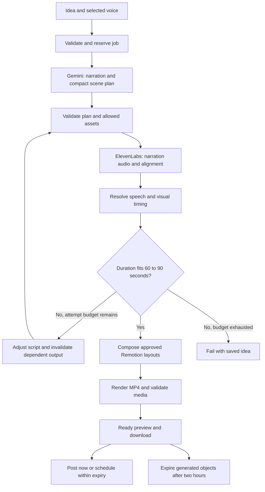

# ChitraBodh — Video Generation Pipeline Specification

**Version:** 1.0  
**Date:** 26 October 2026  
**Status:** Proposed implementation specification; no pipeline code or generated video delivered by this document  
**Baseline:** [Approved product requirements, V1.2](ChitraBodh-V1-PRD.md)  
**Companions:** [Technical design](ChitraBodh-Technical-Design.md) · [Prototype plan](ChitraBodh-Prototype-Plan.md)

## 1. Purpose and scope

Define the repeatable path from one idea to a validated educational video. The prototype must test real writing, narration, timing, and animation before investment in the full dashboard and publishing integration.

The creator experience remains idea → create → preview/share. The stages below are internal operations, not screens or approval steps.

Fixed output: vertical 1080 × 1920 MP4, 30 fps proposed, 60–90 seconds inclusive, synchronized ElevenLabs narration, and optional captions. Use the minimal text/icon, progressive-diagram, and comparison layouts. No brand customization, background music, voice cloning, or cinematic generation.

Working language: Indian-accented English. The launch catalog must include one tested male and one tested female voice. Hindi/Hinglish is not implicitly enabled by selecting an Indian accent.

## 2. Pipeline at a glance



Normal path: one structured planning call, one complete narration synthesis, application timing logic, and one render. Additional calls are bounded repairs or explicit user revisions. There is no multi-agent loop.

## 3. Input contract

This TypeScript sketch is an implementation contract proposal, not an SDK declaration or executable implementation.

```ts
type GenerationRequest = {
  requestId: string;          // Stable idempotency key for this submit action
  ownerId: string;            // Server-resolved identity; never trusted from browser
  projectId: string;
  topic: string;              // Trimmed, 1–2,000 characters
  voiceCatalogId: string;     // Enabled application catalog entry
  language: "en";
  captionsEnabled: boolean;
  parentVersionId?: string;
  revisionInstruction?: string; // Up to 1,000 characters
};
```

Server configuration supplies the fixed theme, dimensions, frame rate, allowed templates, available icon IDs, model ID, and attempt budgets. Users cannot submit arbitrary asset URLs, code, file paths, provider credentials, or animation expressions.

Only one generation request per user may be queued or active. Proposed internal-team worker configuration: one executing generation globally; other users' requests wait FIFO. Lightweight expiry/publication work remains responsive while rendering runs in a child process.

## 4. Planning contract

### 4.1 Responsibilities

Gemini proposes a coherent explanation and a compact plan. Application code owns the allowed vocabulary and validates every response. Use the configured candidate from the PRD, initially Gemini 3.8 Flash, after confirming account access and current model support.

The prompt supplies:

- The topic, intended beginner audience, and any explicit revision request.
- A goal of one clear explanation within 60–90 seconds; initial target approximately 75 seconds.
- Natural, concise Indian English without forced slang or stereotypes.
- A small catalog of permitted layout IDs, icon IDs, and motion actions.
- Instructions to avoid invented statistics, facts, or citations.
- The required output schema and examples of valid cue anchors.

Use approximately 140–190 spoken words as an initial planning heuristic, adjusted after voice benchmarking. This estimate is not duration validation; actual audio determines final length.

### 4.2 Proposed plan shape

```ts
type Plan = {
  schemaVersion: "1";
  title: string;
  learningObjective: string;
  language: "en";
  utterances: Array<{ id: string; text: string }>;
  scenes: Array<{
    id: string;
    layout: "icon_text" | "process_diagram" | "comparison";
    utteranceIds: string[];
    heading: string;
    nodes: Array<{ id: string; iconId: string; label: string }>;
    edges: Array<{ from: string; to: string }>;
    comparisonSides?: {
      leftNodeIds: string[];
      rightNodeIds: string[];
    };
    cues: Array<{
      id: string;
      utteranceId: string;
      phrase: string;
      occurrence: number;   // One-based within this utterance
      targetId: string;     // Scene node ID; edge IDs can be introduced by schema revision
      action: "reveal" | "highlight" | "draw_connections";
    }>;
  }>;
};
```

The backend concatenates utterance text in order and computes authoritative text offsets. The model does not provide character offsets, seconds, or frames. Cue phrases must appear within the referenced utterance, using the specified occurrence.

Layout-specific validation requires nonempty valid sides for comparisons and valid node references for process edges. Layouts automatically manage simple entrances and closing holds; model cues specify meaningful emphasis rather than every animation frame.

### 4.3 Illustrative plan fragment

This is one teaching beat, not a complete 60–90-second plan:

```json
{
  "utterance": {
    "id": "u_evaporation",
    "text": "The sun warms the water. Some of that water becomes vapor and rises into the air."
  },
  "scene": {
    "id": "s_water_cycle",
    "layout": "process_diagram",
    "utteranceIds": ["u_evaporation"],
    "heading": "Evaporation",
    "nodes": [
      {"id": "water", "iconId": "water", "label": "Water"},
      {"id": "vapor", "iconId": "vapor", "label": "Water vapor"}
    ],
    "edges": [{"from": "water", "to": "vapor"}],
    "cues": [{
      "id": "c_rising_water",
      "utteranceId": "u_evaporation",
      "phrase": "rises into the air",
      "occurrence": 1,
      "targetId": "vapor",
      "action": "draw_connections"
    }]
  }
}
```

The renderer knows how to draw permitted edges associated with the target node. No executable drawing instructions come from the model.

### 4.4 Plan validation

- Required keys, schema version, unique IDs, bounded counts/text lengths.
- All utterances assigned in order; no unassigned, duplicated, or rearranged narration.
- All cue anchors resolve uniquely by utterance and occurrence.
- All template/icon IDs exist and are licensed for use.
- Edge references, comparison sides, and target IDs are consistent.
- Headings/labels fit template limits; proposed initial heading limit 60 characters, node label limit 32 characters, with actual layout validation still required.
- Proposed bound of 4–8 scenes and up to 6 nodes per scene, revisable after prototype evidence. Reject excess rather than allowing unbounded render complexity.
- Check coherence, unsupported factual specificity, and compatibility with the supplied topic. Passing validation is not independent fact verification.

One automatic schema/plan repair is allowed. If repair fails, preserve the idea and stop before narration spending.

## 5. Speech generation

Resolve the catalog entry to a provider voice ID and compatible model. Send the entire normalized narration as one synthesis request to maintain voice continuity. Persist the chosen voice/model/configuration and text hash with the result.

Use ElevenLabs' speech-with-timing capability; it returns audio and character alignment, including a normalized alignment representation where available. Preserve the provider response shape in the adapter and convert it to the application's internal contract. [Official API documentation](https://elevenlabs.io/docs/api-reference/text-to-speech/convert-with-timestamps)

Persist generated audio and alignment under the job's generated-object manifest. Decode/probe the actual file to measure duration; do not use the model estimate or last token timestamp as the only audio-duration check.

If voice access disappears, stop and request another supported selection. Do not silently switch voices. A provider timeout after possible acceptance is an uncertain outcome: use a returned provider reference to reconcile where possible; otherwise one bounded retry can incur additional cost and must be recorded.

## 6. Speech-to-visual timing

### 6.1 One canonical time base

Use integer milliseconds in the internal timeline. Store original provider timing precision separately for diagnosis during the media window. Convert to absolute frame positions once when composing; do not round each scene duration independently and add them together.

```ts
type TimedVideo = {
  versionId: string;
  audioArtifactId: string;
  audioDurationMs: number;
  totalDurationMs: number;
  scenes: Array<{ id: string; startMs: number; endMs: number }>;
  words: Array<{ text: string; startMs: number; endMs: number }>;
  captions: Array<{ text: string; startMs: number; endMs: number }>;
  cues: Array<{
    id: string;
    sceneId: string;
    targetId: string;
    action: string;
    atMs: number;
    durationMs: number;
  }>;
};
```

### 6.2 Alignment procedure

1. Validate equal character/start/end array lengths, finite values, nonnegative times, start ≤ end, monotonic progression, and bounds against actual audio duration with an explicitly tested small tolerance.
2. Build offsets over Unicode code points in the exact synthesis input. Provider character arrays may contain more than one code point per element; map concatenated text explicitly instead of assuming JavaScript string length equals array length.
3. Compare returned alignment text to input. Apply a defined punctuation/whitespace normalization with a reversible span map; never normalize away the ability to locate cues.
4. When numbers, abbreviations, or symbols expand in spoken text, use raw and normalized alignment to map the original utterance to its spoken span. Test supported expansion patterns. If mapping is ambiguous, repair the narration to explicit spoken forms and synthesize again within budget.
5. Resolve each cue from its utterance and phrase occurrence to the aligned onset. Repeated words in other scenes cannot match accidentally.
6. Group aligned characters into words and phrase captions. Derive scene boundaries from assigned utterances, keeping captions and cues within the correct scene.
7. Reject unresolved cue anchors or materially invalid timings. V1 does not introduce an automatic secondary speech-recognition dependency.

Example: “AI” may be spoken as “A I.” A cue attached to that term must resolve through the map; it cannot assume two input letters equal the provider's two timing entries.

### 6.3 Captions and visual events

Proposed captions: no more than two lines, readable at 1080 × 1920, at least 48 px initial type size, and phrase boundaries favored over fixed word counts. Split a long phrase using measured text width. Caption timings follow actual speech; do not extend them across unrelated narration merely to enforce a minimum display time.

Use short reveal/highlight transitions, initially about 200–400 ms, clipped to scene boundaries. Process diagrams can remain on screen for several utterances while different nodes highlight. Keep one concept visually dominant at a time.

Captions off hides the overlay only. Narration and animation continue using the same canonical timeline. Render the selected caption variant on demand and verify it matches preview.

## 7. Duration fitting and rendering

Target actual final length from 60.000 to 90.000 seconds. Intro/outro holds count toward it. Use a modest internal margin, such as 61–89 seconds, while targeting about 75, to reduce encoding-boundary failures.

If the narration/hold combination will not fit, request a shorter or fuller coherent explanation. Do not truncate speech, pad with unrelated silence, or aggressively time-stretch narration. Any rewritten narration invalidates the prior audio, alignments, and render inputs.

Build the composition from validated plan/timeline data and bundled assets. Select the composition with actual dimensions, frame rate, and duration, then render an MP4. Remotion provides programmatic composition selection and rendering. [Composition selection](https://www.remotion.dev/docs/renderer/select-composition), [rendering](https://www.remotion.dev/docs/renderer/render-media)

Use a subprocess for rendering. Give it only the required artifact paths, approved assets, and serialized composition data; no provider tokens. Font/asset loading must finish before frame rendering. Rendering the same validated input should be deterministic with pinned templates/fonts and no ambient randomness or network asset changes.

## 8. Stage checkpoints and invalidation

| Stage | Checkpoint | Reusable on retry when… | Invalidate when… |
|---|---|---|---|
| Plan | Validated plan and prompt/model version | Brief and plan configuration unchanged | Topic, script request, schema, or template constraints change |
| Speech | Audio + alignment + text/voice hash | Exact script, voice, and configuration match | Narration or voice changes |
| Timeline | TimedVideo + audio checksum | Source audio and mapping version unchanged | Speech or anchor/layout assignments change |
| Render | MP4 + template/input hashes | Same timeline, template build, caption variant | Any relevant composition input changes |
| Ready | Validated artifact manifest and expiry | Artifact exists and has not expired | Media deleted, invalidated, or expired |

Visual-only revisions may reuse valid speech. Reused dependencies retain their original expiry. A revision cannot keep old media alive by repeatedly wrapping it in new versions.

## 9. Bounded work and failure behavior

Proposed initial budgets, to measure and tune:

| Limit | Initial value |
|---|---|
| Structured planning/repair calls | At most 4 dispatched Gemini calls per job, including transport retries and duration rewrites |
| Speech calls | At most 3 dispatched ElevenLabs synthesis calls per job, including retries |
| Automatic plan-format repair | At most 1, included in planning call cap |
| Duration-correction cycles | At most 2, subject to both provider call caps |
| Full render attempts | At most 2 from a validated timeline |
| Active generation deadline | 20 minutes after execution starts; FIFO waiting is separate |
| Parallel generations | 1 globally for the prototype |

All request attempts consume their counter before dispatch so process crashes cannot erase attempted spending. A denied request or a timeout may still consume an attempt. Once any cap/deadline is reached, stop and preserve the idea and minimal failure reason.

Transient network/429/5xx errors may retry with bounded backoff and provider retry guidance. Invalid credentials, missing voice access, explicit provider rejection, or schema errors require their specific recovery path rather than blind retries.

Public error categories: plan could not be prepared, narrator unavailable, narration timing invalid, duration could not fit, rendering failed, temporarily unavailable, cancelled, and media expired. Internal diagnostic records include stage and correlation IDs without secrets or retained media.

## 10. Final media checks

Before marking ready:

- Probe encoded video dimensions, frame rate, duration, codecs, and presence of audio/video streams.
- Confirm decode success at start, middle, and end; check for missing assets and font failures.
- Confirm timeline bounds, caption/cue coverage, and absence of unintended silent/black tails.
- Verify final speech finishes without being cut off.
- Confirm caption-on/off variant identity and private artifact ownership.
- Save checksum, measured properties, validation result, and expiry.

Automated checks cannot prove a diagram teaches the right idea or that narration is factually correct. Prototype review must include watching and listening to the real output.

## 11. Ready, expiry, and publication handoff

Proposed media window: two hours from first validated ready output. Generated voiceover, alignment, thumbnails, and caption variants share the same deadline. Unneeded intermediates are removed immediately. Failures/cancellation remove generated objects; work-in-progress is bounded by the active deadline.

The handoff record contains owner, version/artifact ID, checksum, duration, object key, and expiresAt. It never contains an already-expiring browser URL as the durable publication reference.

Scheduling is permitted from now + 10 minutes through expiresAt − 15 minutes, with the buffer proposed in the PRD. Post now requires a proposed 5-minute remaining window. Recheck at dispatch, not just when the user clicks. Do not extend retention or regenerate automatically to rescue a scheduled post.

At expiry, block access and explicitly delete generated objects. Keep only the permitted minimal idea/status/publication metadata. Local prototype files are subject to this policy too. Previously downloaded copies or provider-hosted published posts are outside application storage control.

## 12. Evaluation evidence

Keep a text-only run report: model/voice IDs, prompt/template version, stage durations, provider attempts and usage totals, final media properties, review scores, error codes, and cleanup result. Do not permanently retain generated scripts, timing JSON, screenshots, or media under an “evaluation” folder. Review live outputs during the media window; keep authored test topics and non-content metrics afterward.

The [prototype plan](ChitraBodh-Prototype-Plan.md) defines the topic set and pass/fail gates. The pipeline is proven only after real API calls and rendered media pass those checks.
