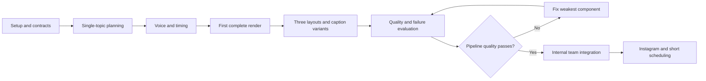

# ChitraBodh — Prototype Build and Evaluation Plan

**Version:** 1.0  
**Date:** 26 October 2026  
**Status:** Ready-to-implement plan; work has not been represented as completed  
**Dependencies:** [PRD V1.2](ChitraBodh-V1-PRD.md) · [Pipeline specification](ChitraBodh-Pipeline-Specification.md) · [Technical design](ChitraBodh-Technical-Design.md)

## 1. Outcome

Produce a real 60–90-second educational explainer from a single topic, using Gemini, a selected Indian-accented ElevenLabs voice, actual speech timings, and Remotion motion graphics. Validate that the video is worth building an application around.

The first subject is **“How does the water cycle work?”** It exercises explanation order, continuous diagrams, directional motion, labels, narration, and caption synchronization.

Success means a viewable MP4 produced by the actual pipeline with recorded quality/cost/latency evidence. A UI mock, manually animated reference video, or hardcoded pre-rendered clip does not prove automatic generation.

## 2. What is built first

Initial scope:

- A local command or localhost-only form accepting a topic, voice choice, and captions toggle.
- One sequential runner and a visible stage/status log.
- A validated structured scene plan.
- ElevenLabs narration and alignment.
- Timing conversion and semantic cue mapping.
- Three reusable minimal layouts, built incrementally.
- MP4 rendering, basic media validation, and expiry cleanup.
- Text-only evaluation summaries.

Deferred until the video-quality gate passes: full dashboard, authentication, MongoDB/R2 integration, durable team queue, Instagram connection/publishing/scheduling. These are staged implementation tasks, not removals from the approved internal V1 scope.

No billing, user tracking, brand customization, custom avatars, background music, or general-purpose editing timeline.

## 3. Prerequisites and decisions

| Item | Needed for | Action |
|---|---|---|
| Gemini API access | Real planning | Confirm configured model is available; use server/local secret configuration |
| ElevenLabs API access | Real voiceover with timings | Verify appropriate commercial rights and voice-library/API access |
| Indian male/female voice IDs | Narration selection | Audition both on the same short educational text; test timing endpoint compatibility |
| Node.js and rendering dependencies | Remotion/MP4 | Choose compatible stable versions, pin them, run a local render smoke test |
| Permitted font and icons | Consistent visuals | Bundle and record license/source; avoid remote asset dependency |
| Temporary local storage | Intermediate artifacts | Configure ignored directory, manifest, expiry checks and cleanup |
| API spending ceiling | Repeated live tests | Agree a small explicit run/batch allowance before unattended batch execution |
| MongoDB/R2/auth/Meta credentials | Later team phases only | Do not block local pipeline work on these |

Never ask for API keys in a committed document or source file. Set secrets outside version control. Missing credentials should not prevent building schemas/templates and tests with authored fixtures, but real provider integration remains unproven until credentials are configured.

No fixed delivery date or monetary budget is committed here. Estimate after the first integrated render reveals hardware and provider performance.

## 4. Work packages and dependency order



### P0 — Foundation and render smoke test

**Build:** repository scaffold, runtime/dependency pins, shared request/plan/timeline schemas, allowed asset catalog, local manifest, and a simple Remotion composition with a known static test graphic.

**Check:** render a short technical fixture to verify fonts, icons, encoding, audio muxing support, file permissions, and process cancellation. This short fixture is a tooling check, not a product output; real videos must still satisfy 60–90 seconds.

**Exit gate:** local render succeeds, schemas reject invalid inputs, secret files and generated media are ignored, and temporary objects can be cleaned up.

### P1 — Topic to validated plan

**Build:** Gemini adapter and one planning prompt that emits the pipeline schema. Start with the water-cycle topic and process-diagram layout. Validate narration coverage, available assets, cue anchors, and text constraints. Add one bounded format-repair path.

**Check:** the response explains evaporation, condensation, and precipitation coherently; the diagram components exist in the catalog. No hardcoded complete script is substituted for generated planning in the end-to-end path.

**Exit gate:** three consecutive live planning runs produce a valid plan, or specific failure evidence identifies what to repair before proceeding. Review factual correctness; schema validity alone is insufficient.

### P2 — Voice and timing

**Build:** ElevenLabs timing adapter; complete-script synthesis; audio probing; normalized-text mapping; word/caption segmentation; semantic cue resolution.

**Check:** audition both Indian-accented voice categories. Include a repeated phrase, abbreviation, and number in separate test narration. Verify each cue resolves to the intended occurrence rather than the first similar word anywhere in the script.

**Exit gate:** actual audio plays naturally, alignment passes validation, and cue onsets match sampled spoken phrases. Missing/invalid timing produces a bounded failure, not guessed timestamps.

### P3 — First complete water-cycle video

**Build:** process layout with water, sun, cloud, arrows, and rain representation; one continuous audio track; captions; frame-based cue playback; duration fitting; final media validation.

**Check:** watch from beginning to end on a phone-sized display. Evaporation arrows, condensation emphasis, and rainfall correspond to narration. The explanation closes naturally.

**Exit gate:** one real 1080 × 1920 MP4 lasting 60–90 seconds with working audio, meaningful diagram motion, and readable captions. Capture a text-only review before expiry. A manual patch to the generated plan must be disclosed as an intervention and cannot count as autonomous success.

### P4 — Reusable layouts and basic revisions

**Build:** icon/text and comparison layouts; deterministic caption-on/off variants; simple visual-emphasis and script-simplification revisions; dependency invalidation; previous-version handling until expiry.

**Check:** no topic-specific branches that bypass the schema, and no unlicensed image search. A caption toggle does not call TTS again. A narration revision regenerates speech and timings. A visual-only revision can reuse eligible media without extending retention.

**Exit gate:** three different topic/layout examples pass the quality rubric, both caption variants work, and a failed revision leaves prior unexpired output available.

### P5 — Batch quality, cost, and recovery evaluation

**Build:** a sequential evaluation command, stage timings, provider attempt counters, non-content run reports, and authored failure fixtures. Add the two-hour expiry/access behavior to the local prototype; use a shortened test clock for deterministic cleanup tests.

**Check:** run the benchmark below; compare candidate planners on the same inputs/schema. Most planner comparison can be text-only, with actual media rendering for representative outputs. Run API-backed video tests sequentially within the approved test budget.

**Exit gate:** pass the quality and reliability criteria in Sections 6–8. If not, fix the identified layer before adding the full application.

### P6 — Internal team integration

**Build:** Next.js composer/preview/status screens; proposed Better Auth and allowlist; MongoDB job/version records; one outstanding generation per user; single global generation slot; R2 media; always-on expiry cleanup. Keep one repository and one app/worker host.

**Check:** two users submit simultaneously; one executes, the other waits, and neither can access the other's media. Duplicate tabs from one user do not create a second request. A render crash does not block cleanup or permanently hold the queue.

**Exit gate:** invited team can generate and download without developer assistance. Expired media cannot be accessed, and cleanup results are verifiable. The unauthenticated prototype entry point is absent from the team deployment.

### P7 — Instagram publication and short-window scheduling

**Build:** official connection flow, profile identity display, Post to Instagram, schedule within retention, cancellation, token-error handling, and ambiguous-outcome reconciliation.

**Check:** only authorized team profiles; actual live test posts need the user's explicit publish action. Test both successful posting and safely simulated failures. Schedule validation enforces the remaining media window plus buffer, and no expired source is silently regenerated.

**Exit gate:** an authorized real post succeeds, a schedule executes with browser closed, and cancellation/timeout/expiry cases avoid false success and blind duplicates. Internal pilot release is now eligible for final review against the PRD.

## 5. Benchmark topics

| Topic | Main layout | What it tests |
|---|---|---|
| How the water cycle works | Process diagram | Multi-step continuity and phrase-triggered motion |
| RAM versus storage | Comparison | Distinct paired concepts and concise labels |
| What is an algorithm? | Icon/text + steps | Abstract explanation grounded in an example |
| How a traffic light controls an intersection | Process diagram | Ordered states and repeated labels |
| Evaporation versus boiling | Comparison | Similar concepts without misleading oversimplification |
| What is a food chain? | Process diagram | Arrows communicate the correct relationship |
| How binary represents numbers | Icon/text | Numbers, pronunciation, and text normalization |
| How a simple electric circuit works | Process diagram | Clear cause/effect with supported icons |
| What is the difference between weather and climate? | Comparison | Long-term versus short-term distinction |
| Why do seasons change? | Diagram | A harder accuracy test; reject an incorrect distance-based explanation |

Use prepared factual review notes for each topic. The last example may reveal that the initial layout catalog cannot explain the concept accurately; an honest unsupported result is preferable to a misleading diagram, but it does not count as a successful generated video.

Negative tests: empty/oversized topic, ambiguous “Explain it,” unsupported language, nonexistent icon IDs, repeated cue phrase, invalid timing arrays, zero-length audio, audio over 90 seconds, API 429, timeout after acceptance, lost worker heartbeat, expired media, and duplicate submission.

## 6. Quality rubric

Score each completed video from 1 (poor) to 5 (ready to share). These are proposed evaluation gates, not recorded outcomes.

| Dimension | Passing evidence |
|---|---|
| Educational clarity | One coherent takeaway, beginner-friendly explanation, useful example where appropriate |
| Factual/visual correctness | No substantive factual error; diagram communicates the right mechanism |
| Visual usefulness | Icons/arrows/highlights help understanding; not merely decoration or dense slides |
| Narration | Natural pacing, intelligible Indian-accented English, correct key-term pronunciation |
| Synchronization | Captions and important visual events align with intended speech |
| Mobile readability | Labels/captions legible without overlap or interface-safe-area problems |

Proposed batch gate: at least 9 of 10 topics produce valid automatic output within budgets; successful outputs average at least 4/5 per dimension, with no unresolved substantive factual error. Record unsupported topics and failures honestly. This small batch is a screening gate, not a statistical production reliability claim.

For the wider internal V1 release, run the PRD's larger supported-topic benchmark and its 95% completion target separately. Do not extrapolate a ten-topic sample into an unmeasured reliability promise.

## 7. Objective acceptance checks

- Every ready artifact is 1080 × 1920, contains playable video/audio, and lasts 60–90 seconds.
- At least 95% of sampled semantic cues and caption boundaries fall within ±250 ms of the intended speech point. Review at least five representative cues per video and document the sample method.
- No unexplained cumulative scene/audio drift or clipped final sentence.
- Initial processing targets: p50 ≤5 minutes and p95 ≤10 minutes after execution begins, measured on declared hardware; report queue wait and small-sample limits separately.
- No more than the configured provider/render attempt caps per job.
- One outstanding request per user; one active generation globally in the pilot configuration.
- Media access stops at expiresAt; cleanup is attempted within the next minute under healthy operation. Actual deletion is checked rather than assumed.
- No later-than-expiry schedules, false Published status, or blind retry after an ambiguous publish outcome.

Automatic media checks and timing checks support the rubric; they do not replace watching the output.

## 8. Failure and retention tests

| Test | Required result |
|---|---|
| Provider returns invalid plan | One bounded repair, then saved-idea failure |
| ElevenLabs returns invalid alignment | No guessed sync; bounded retry or clear failure |
| Caption variant changed | Reuse speech; correct rendered overlay; unchanged dependency expiry |
| Render process crashes | Resume validated stage within cap; old child cannot commit late |
| Two tabs submit | Same job or active-request response, not duplicate execution |
| Worker restarts | Reconcile lease/child state and sweep expired media before resuming |
| Clock advances to expiry | New access denied, objects deleted, minimal metadata preserved |
| Cleanup API fails | Access still denied; deletion-pending tracked and retried; operator alerted |
| Schedule too late | Rejected before saving, and rechecked at dispatch |
| Publish response lost | Outcome checked before retry; no false failure/success claim |

Use authored timing fixtures and mocked provider responses for failure branches. Live provider smoke tests are still necessary to establish actual integration behavior. Do not spend paid tokens repeatedly testing logic that deterministic fixtures can establish.

## 9. Evaluation record template

Store one text-only row per run:

```text
Run ID / test topic ID:
Date and operator:
Planner model / prompt version:
Voice/model IDs / template build:
Hardware and runtime versions:
Planning / speech / timing / rendering / total seconds:
Queue wait seconds:
Provider attempts / reported token or character usage:
Estimated cost basis and date, or unknown:
Final dimensions / duration / caption variant:
Schema and media validation result:
Sampled cue timing errors:
Rubric scores / substantive error notes:
Manual intervention required:
ReadyAt / ExpiresAt / actual deletion result:
Next corrective action:
```

Separate observed cost from estimates. Include retries and any billed thinking tokens when provided. Do not infer the entire video cost from planner tokens alone; narration and rendering matter too.

Generated audio, scripts, timing payloads, thumbnails, screenshots, and videos remain temporary. Test topics, authored fixture data, measured properties, and brief non-content evaluation notes can persist. Do not archive generated clips beyond the approved window without a new user decision.

## 10. Decision gates

**After P3:** Is a single real video clear and synchronized? If not, fix the script/diagram/timing issue before creating more screens.

**After P5:** Does the approach generalize across topics? Pick the planner based on measured quality and cost. If a template is the bottleneck, improve the template rather than automatically escalating to a larger model.

**Before P6:** Confirm hosting spend, auth/email provider, and always-on cleanup capability. Finalize schemas from the tested pipeline; avoid rewriting the PRD around untested implementation guesses.

**Before P7:** Verify Meta access for actual team profiles. No amount of local mock success substitutes for provider authorization and real account tests.

**Before internal release:** Reconcile results with the PRD, document known supported-topic limits, and resolve critical expiry, ownership, or duplicate-post defects.

## 11. First implementation session

1. Create the Node/TypeScript and Remotion scaffold with temporary storage and ignore rules.
2. Implement the request, plan, and timing validators plus the permitted icon catalog.
3. Render a small authored composition to confirm local rendering works.
4. Configure provider secrets and audition one Indian male and one Indian female voice.
5. Generate a real water-cycle plan and its narration/timings.
6. Connect the process-diagram composition and export the first full-length video.
7. Review it immediately, record measurements, and verify cleanup.

The next concrete deliverable is a working local generator and its first evaluated video, not a full SaaS application. These documents provide the build sequence; implementation is the next task.
