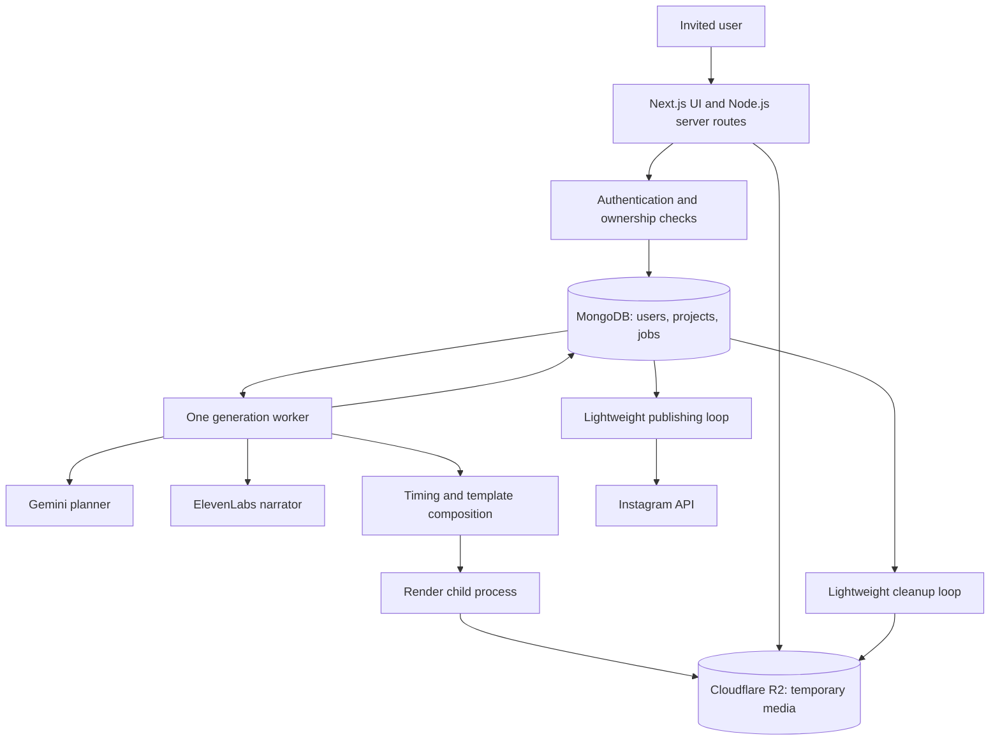

# ChitraBodh — Prototype and Internal Pilot Technical Design

**Version:** 1.0  
**Date:** 26 October 2026  
**Status:** Proposed technical design, pending prototype evidence  
**Product source of truth:** [V1.2 PRD](ChitraBodh-V1-PRD.md)  
**Related:** [Pipeline specification](ChitraBodh-Pipeline-Specification.md) · [Prototype implementation plan](ChitraBodh-Prototype-Plan.md)

## 1. Design intent

Build the smallest system that can produce convincing, synchronized explainers and then support the founder's internal team. Keep business rules in ordinary application code and validated data structures. The component names below are responsibilities, not separate microservices.

Confirmed stack: Next.js, Node.js, MongoDB, Cloudflare R2, Gemini planning, ElevenLabs speech/timing, and Remotion. Better Auth with MongoDB is proposed for the team phase. Model IDs and voice IDs must be tested and pinned at implementation time.

Confirmed product constraints: 60–90 seconds, vertical 1080 × 1920, Indian male/female narrator choices, optional captions, minimal diagrams/icons/text, no brand customization or billing, and no behavior tracking. Media expires after two hours. Instagram posting/scheduling must use a valid connected profile and fit inside media retention.

## 2. Two implementation stages

| Area | Local generation prototype | Internal team pilot |
|---|---|---|
| Entry point | CLI or local-only minimal form | Next.js sign-in, composer, preview, status |
| Identity | Explicit local test identity; bind UI to localhost | Invited email allowlist and verified session |
| Persistence | Filesystem run manifest and single-process queue | MongoDB projects, jobs, versions, connections |
| Generated media | Temporary local directory with expiry cleanup | Private R2 plus short-lived local render workspace |
| Generation | One Node.js runner, one job at a time | Same core runner behind durable job claiming |
| Publication | Deferred until core media quality passes | Post now and short-window scheduling for authorized team accounts |
| Deployment | Attended developer workstation | One always-on Node-compatible host plus MongoDB and R2 |

The local identity/storage adapters are prototype conveniences, not approved public security or retention bypasses. Do not deploy the unauthenticated local entry point for team use. On startup, the local runner sweeps expired files before serving anything; timely deletion while the machine is off cannot be guaranteed. The complete two-hour operational target requires the always-on team deployment.

## 3. Logical architecture



Deploy the UI/server and worker as two processes on one machine. The publishing and cleanup loops can live in the worker process but must not wait for its generation queue to finish. Render in a child process with bounded resource use. Limit parallel video generation, not ordinary status requests, login, cleanup, or provider status reconciliation.

No separate Express service, Redis, workflow framework, agent framework, or container orchestration cluster is necessary initially. Consider those only after measured bottlenecks justify them.

## 4. Suggested repository layout

This tree is proposed; these source files do not yet exist.

```text
app/                         Next.js UI and server entry points
src/auth/                    Session and allowlist checks
src/contracts/               Versioned plan/timeline/request schemas
src/pipeline/                Sequential generation stages and budgets
src/providers/               Gemini and ElevenLabs adapters
src/timing/                  Text normalization, alignment, cue mapping
src/video/                   Remotion compositions, layouts, assets
src/jobs/                    Commands, state transitions, leases
src/storage/                 Local/R2 artifact access and object manifest
src/publishing/              Instagram adapter and reconciliation
src/retention/               Expiry access checks and deletion workflow
worker/                      Generation/publication/cleanup entry point
scripts/                     Local prototype and evaluation commands
tests/fixtures/              Authored non-customer inputs and synthetic timing data
docs/                        PRD, pipeline, design, plan, evaluation summaries
.local-runs/                 Ignored temporary media and run manifests
```

Keep all Remotion packages on compatible pinned versions. Bundle a known font and licensed icon set. Record dependency and template versions in every run report. Avoid downloading arbitrary images/fonts during a render.

## 5. Internal module contracts

Define interfaces so local testing and the team app execute the same pipeline. Exact HTTP endpoint design is deferred until the UI integration phase; no additional API platform is required for this document.

| Operation | Input | Output | Boundary |
|---|---|---|---|
| submitGeneration | Authenticated identity + validated request | Existing or new job ID | Enforces ownership, idempotency, one outstanding request |
| planVideo | Topic, supported catalog, prompt config | Validated Plan | Only model provider adapter can access Gemini key |
| synthesizeNarration | Exact script + catalog selection | Audio and alignment references | Only speech adapter can access ElevenLabs key |
| buildTimeline | Plan + matching narration artifact | TimedVideo | Pure/testable logic where possible |
| renderVideo | TimedVideo + approved layout inputs | Candidate MP4 metadata | Child process, no provider keys |
| validateVideo | Candidate artifact | Pass/fail with measured properties | Does not publish |
| markReady | Validated artifacts + owned job lease | Ready version and expiry | Atomic acceptance of authoritative result |
| requestPublication | Selected ready artifact + account + description + time | Publish job | Explicit user intent and expiry preflight |
| expireMedia | Generated-object manifest | Deletion state | Idempotent, retryable, independent of UI |

The pipeline specification defines the scene and timing contracts in more detail. Provider SDK objects must not leak into UI or render templates.

## 6. MongoDB persistence and atomicity

### 6.1 Collections

| Collection | Main data | Retention |
|---|---|---|
| users / auth collections | Invited identities, sessions, verification records | Auth/account lifecycle |
| preferences | Selected voice, captions, timezone | Until changed/deleted |
| voiceCatalog | Curated voice metadata, compatibility, sample reference | Operator-maintained; licensed samples handled separately |
| projects | Owner, title, original idea, selected version | Minimal metadata until deletion, proposed |
| videoVersions | Content settings, plan reference, readyAt/expiresAt, status | Generated content purged at expiry; minimal status retained |
| generationJobs | Owner, state, stages, budgets, lease, fencing value | Minimal operational lifecycle |
| generatedObjects | Owner/version/job, key/path, type, checksum, expiry, deletion state | Remove content at expiry; minimal deletion evidence may remain |
| generationSlot | One global slot owner/lease/fencing counter | Operational singleton |
| instagramConnections | Owner, account identity, encrypted token reference/status | Until revoked/disconnected |
| publishJobs | Artifact/connection IDs, payload snapshot, due time, expiry, provider IDs | Remove content payload at expiry; retain minimal outcome/ID |

Do not put MP4/audio blobs in MongoDB. Large temporary plan/timeline/alignment documents can live in generated storage with MongoDB references. Do not allow database snapshots to preserve expired script/alignment payloads: either exclude generated-content collections from backups or keep those payloads exclusively in non-backed-up temporary storage.

### 6.2 Index and transaction requirements

- Unique `(ownerId, requestId)` on generation jobs for idempotency.
- Unique partial index on `ownerId` where `active = true` on generation jobs; queued and executing requests both hold this flag.
- Compound queue index on `(state, nextRunAt, enqueuedAt)`.
- Unique `(projectId, versionNumber)` on versions.
- Index generated objects by `(deletionState, expiresAt)`.
- Index publish jobs by `(state, scheduledAtUtc)`; unique `(ownerId, intentId)` for repeated submit actions.
- Use conditional updates that include expected state/revision/fencing values.

MongoDB supports atomic conditional single-document updates; cross-document changes require deliberate transaction design. Use a replica-set-capable deployment where transactions are needed. [MongoDB atomicity](https://www.mongodb.com/docs/manual/core/write-operations-atomicity/)

Do not implement one-request-per-user as “read active jobs, then insert” without a unique invariant. Concurrent browser tabs must not both pass admission. Handle duplicate-key conflicts by returning the existing authorized job.

For global generation concurrency, claim the singleton slot atomically before starting provider/render work; record its fencing token in the job. Claim and job association should be one transaction or have explicit recovery. Only the current token can commit results.

### 6.3 Worker recovery

Proposed lease: 90 seconds, heartbeat every 20 seconds. These are initial operational values, not a guarantee of safety by themselves.

- Run a single supervised worker instance; never start a replacement renderer while a previous child is still running.
- After restart, terminate/reconcile orphaned owned render children and invalidate old fencing tokens before resuming.
- A stale result cannot mark a project ready, even if a provider call returns late.
- Lease expiration does not cancel a provider's in-flight work. Record an uncertain outcome and reconcile where available before spending again.
- Terminal transitions release the per-user active flag and generation slot atomically, or through a tested reconciliation path.
- The external generation budget counters are incremented durably before calls.

## 7. Job and artifact lifecycles

```text
queued → planning → narrating → aligning → rendering → validating → ready
any active state → retry_wait → previous safe stage
any active state → failed or cancel_requested → cancelled
ready media → expired → deleting → deleted
```

Separate job completion from media availability. A successful job can still show “Completed — media expired” after two hours. A published post can retain its external link even after local media is deleted.

A worker persists each completed checkpoint with hashes and configuration versions. Resume only if dependencies still exist and are unexpired. Generation cancellation invalidates future commits and terminates the render child; provider calls already sent may finish, but returned artifacts must be removed.

Treat user revision as a new version/job. Full narration regeneration is acceptable initially; optimize only after correctness is proven. Referencing old media does not reset its expiry.

## 8. Storage and two-hour expiry

### 8.1 Object organization

```text
generated/{ownerId}/{projectId}/{versionId}/audio/...
generated/{ownerId}/{projectId}/{versionId}/alignment/...
generated/{ownerId}/{projectId}/{versionId}/render/...
generated/{ownerId}/{projectId}/{versionId}/preview/...
```

These paths are private object keys, not publicly exposed URLs. Register intended keys in the manifest before uploading, then finalize size/checksum/state. A crash after upload but before commit must leave discoverable cleanup work. Incomplete uploads and temporary local directories also need entries or a safely scoped sweep.

R2 supports scoped presigned access; keep credentials server-side. [R2 presigned URL documentation](https://developers.cloudflare.com/r2/api/s3/presigned-urls/)

### 8.2 Deadline semantics

- First complete validated output sets `readyAt`; default `expiresAt = readyAt + 2 hours`.
- All generated dependencies share that deadline. Unneeded intermediates are deleted sooner.
- Caption-only derivatives and media-reusing revisions use the earliest dependency expiry. Fully new synthesis/rendering can create a new window.
- At expiry, access checks deny new playback/download/revision/publication; existing signed URLs expire no later than the same instant.
- An already-running file download may complete, and previously downloaded copies cannot be recalled. No guarantee of deletion from third-party provider systems is implied.
- Delete expired R2/local objects with an explicit cleanup scan every minute; record and alert on delayed cleanup. No media backups or public caches.
- Failed/cancelled jobs purge generated material immediately; active work is bounded by a proposed 20-minute deadline.

Cloudflare's lifecycle processing is not a precise two-hour timer. Use application deletes as the primary mechanism. [Lifecycle behavior](https://developers.cloudflare.com/r2/buckets/object-lifecycles/)

### 8.3 Cleanup resilience

Deletion is idempotent: object-not-found is success. Retry transient storage errors with backoff while keeping access denied. Recheck job/version deletion state after upload and before exposing results. A late upload after cancellation/expiry must be deleted, not attached to the project.

On startup, reconcile expired manifests and abandoned local workspaces before accepting new generation. Keep minimal deletion status/error metadata long enough to confirm recovery. No raw voice responses or scripts in permanent logs.

## 9. Authentication and media access

In the team phase, use the proposed Better Auth MongoDB integration and verified email link, with an operator-managed allowlist. The email-delivery provider is still open. Check the allowlist when requesting sign-in and at account/session authorization boundaries; hiding the signup button is insufficient.

The backend derives owner identity from the verified session. Every operation checks project/artifact/connection ownership before returning data or signing a URL. Session presence in browser state is not proof of authorization.

Keep secrets in environment/host secret configuration, never in `NEXT_PUBLIC_*` values. Redact logs. Media access links are scoped and short-lived. Instagram authorization is separate from application login; connecting it grants the specific supported publishing capability, not application identity by itself.

No team role system is needed. Each invited member has private projects and their own connected profile. Shared publishing access is a future scope decision.

## 10. Instagram publication handoff

This integration follows after video quality, expiry, and durable jobs are validated. The prototype does not claim working Instagram publishing before a live authorized test.

Store a publish job with immutable artifact ID/checksum, connection ID, post description snapshot, due time, media expiry, and an idempotent user intent ID. Validate the profile identity on the confirmation surface.

```text
scheduled or queued_now → preparing → ready_to_publish → publishing → published
publishing → outcome_unknown → reconciled outcome
pending → cancelled / expired / needs_reconnection / failed
```

- Schedule only from now + 10 minutes through media expiry − 15 minutes, proposed buffers.
- Post now requires at least 5 minutes of remaining media validity, proposed.
- Persist provider media/container IDs as soon as known.
- Never publish early; never issue new publishing work after media expiry.
- Recheck cancellation, artifact state, expiry, and connection before dispatch.
- If the response is lost after provider acceptance, reconcile; do not blindly repeat publication.
- Rendering must not block publication polling or expiry cleanup.
- At expiry, remove application media even if a provider outcome is unresolved; retain provider IDs for reconciliation. Do not recreate the video automatically.

Validate the chosen Instagram login route and actual app/account permissions with Meta's current documentation and the team's profiles. The PRD records this external dependency. Public customer onboarding is out of scope for this internal pilot.

## 11. Configuration and operational limits

| Setting | Proposed initial value / source |
|---|---|
| Planner model | PRD candidate; confirmed by provider smoke test before use |
| Voice catalog | Two or more operator-accessible, timing-tested Indian-accented voices |
| Theme/layout build | Fixed light theme, three layouts, pinned font/icon versions |
| Duration/frame profile | 60–90 seconds; 1080 × 1920; 30 fps |
| Generation slots | 1 global, 1 outstanding per user |
| Active job timeout | 20 minutes |
| Attempt limits | Pipeline specification Section 9 |
| Media retention | 2 hours from ready; dependency reuse cannot extend expiry |
| Cleanup cadence | Every minute, plus startup reconciliation |
| Scheduling buffers | Minimum +10 minutes, latest expiry −15 minutes |
| Redacted operational logs | 7 days proposed, no generated content |

Provider/API fees are operator costs. No credit wallet or subscription system is introduced. Set a team-wide monthly spend alert and per-job call ceilings; choose actual monetary amounts with the founder before unattended generation.

## 12. Validation and design decisions

| Decision | Reason | Evidence needed to revisit |
|---|---|---|
| One complete speech request | Consistent voice and easier authoritative timing | Naturalness/latency tests show a need for segment synthesis |
| Template-driven visuals | Predictable diagrams, readable labels, safe rendering | Supported topics cannot be explained adequately |
| Explicit cue anchors | Connect meaning to narration | Measured alignment failure suggests changing anchor format |
| Local adapters first | Prove media quality without infrastructure setup | Ready to invite team members |
| One Node generation worker | Matches low-volume/no-concurrency goal | Queue delay becomes unacceptable |
| MongoDB job records | Reuses the chosen database | Measured reliability/throughput demands a queue service |
| Private R2 + explicit cleanup | Matches temporary-media requirement | Retention policy changes explicitly |
| Deferred full UI and publishing | Avoid building around unproven video output | Quality gates pass |

Remaining decisions: exact model/voice IDs after smoke tests, Hindi/Hinglish scope, authentication/email provider confirmation, always-on host and spending cap, and acceptance of proposed buffer/timeout values. These do not prevent designing or implementing the local pipeline with existing defaults.

## 13. Implementation boundaries

This document creates no infrastructure, credentials, live API requests, deployed application, or generated video. Follow the [prototype plan](ChitraBodh-Prototype-Plan.md) next. After real sample evaluation, record measured latency/cost and revise this design before internal deployment.
