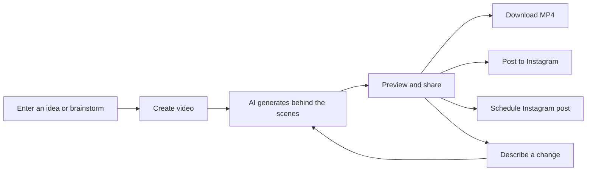
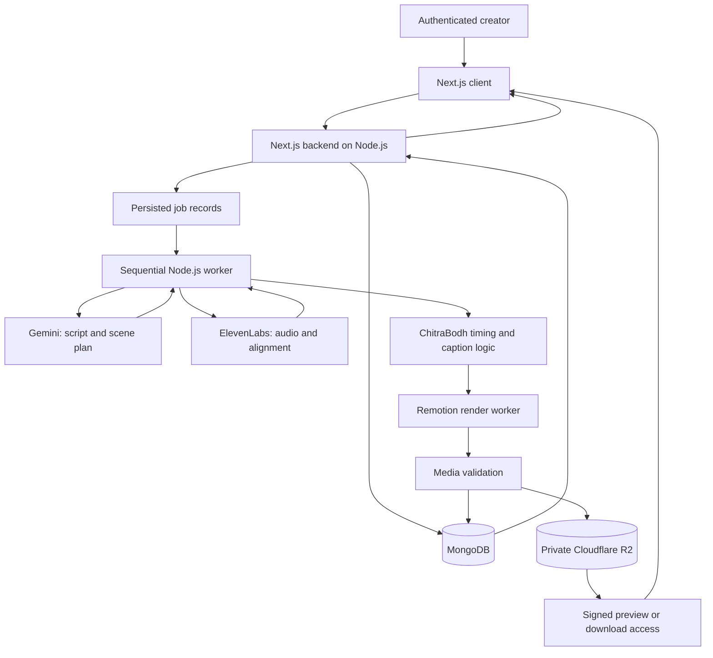
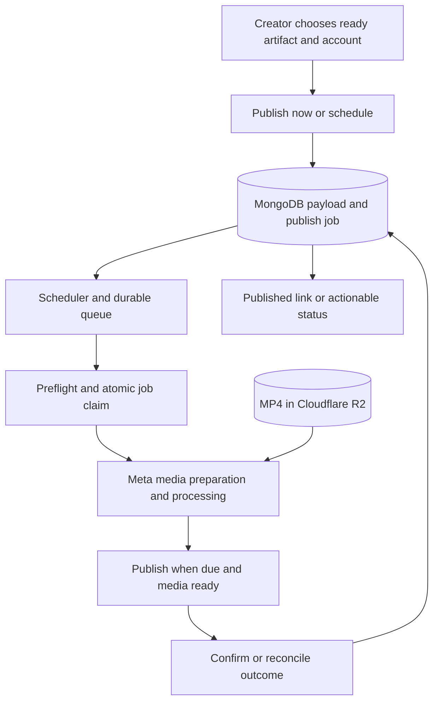

# ChitraBodh — V1 Product Requirements Document

**28 October visual-feature update:** [Motion-first core features](ChitraBodh-V1-Motion-Update.md) refines the visual scope below: explanatory process animation, a continuous water-cycle landscape, and speech-triggered actions take priority over dashboard expansion. The original simple creator flow and operating limits remain in place.

**Product:** ChitraBodh (चित्रबोध)  
**Tagline:** Ideas in motion. Made clear.  
**Document version:** 1.2  
**Prepared:** 26 October 2026  
**Status:** Detailed V1 baseline for product review and implementation planning  
**Audience:** Founder, product designer, engineers, and QA

**Implementation companions:** [Pipeline specification](ChitraBodh-Pipeline-Specification.md) · [Technical design](ChitraBodh-Technical-Design.md) · [Prototype build plan](ChitraBodh-Prototype-Plan.md). These are design/plan documents; they do not indicate that the pipeline has been implemented or benchmarked.

**Revision 1.1:** Incorporates founder feedback on selectable Indian-accented narration, Next.js/Node.js, MongoDB, Cloudflare R2, and minimal text/diagram/icon animation. Indian English is a working interpretation of the language request; Hindi/Hinglish remains an explicit open choice. Better Auth is a proposed authentication library, not a founder-confirmed selection.

**Revision 1.2:** Narrows launch to the founder and invited team members; confirms two-hour generated-media retention, scheduling only within that window, one outstanding generation request per user, and no V1 brand customization. Proposes one global generation worker for the small pilot and Gemini 3.8 Flash for writing/planning, subject to sample evaluation. This revision supersedes earlier long-term artifact retention and public-launch assumptions.

> Turn an idea into a clear, 60–90-second educational explainer with motion graphics and synchronized AI narration. Enter an idea, create the video, then preview and share.

**Quick navigation**

- [Goals and scope](#3-goals-exclusions-and-scope-boundaries) · [Core requirements](#5-core-feature-requirements)
- [Screens](#6-information-architecture-and-screen-behavior) · [User flows](#7-user-flows) · [Output specification](#8-input-defaults-and-output-contract)
- [Content quality](#9-educational-content-and-animation-quality) · [Generation and synchronization](#10-generation-pipeline-and-synchronization-design)
- [Data flows](#11-system-data-flows-and-architecture) · [Data model](#12-data-model-and-versioning) · [Job states](#13-job-state-machines-and-recovery-rules)
- [Instagram scheduling](#14-instagram-publishing-and-scheduling-details) · [Edge cases](#15-edge-cases-and-expected-responses)
- [Privacy and security](#16-privacy-security-and-content-boundaries) · [Quality targets](#17-reliability-performance-accessibility-and-observability)
- [Acceptance tests](#18-acceptance-and-test-plan) · [Delivery milestones](#19-delivery-milestones-and-release-gates)
- [Open decisions](#22-open-decisions-and-proposed-defaults) · [References](#23-dependency-references-and-verification-notes)

## 1. Document conventions and decision status

This document consolidates the product decisions agreed in the planning conversation. It also proposes implementation defaults where a decision is needed to make the requirements actionable. Proposed defaults are not represented as decisions already approved by the founder.

- **Confirmed:** explicitly agreed product scope or direction.
- **Proposed default:** a recommended starting behavior; collected in Section 22 for review.
- **P0:** necessary for a complete V1 release. Milestones may deliver subsets without claiming the full V1 is complete.
- **Acceptance criteria:** observable conditions used to validate an implementation.
- **External dependency:** something ChitraBodh cannot guarantee, such as a provider permission or availability.

Numerical reliability, performance, and quality thresholds below are proposed release targets, not measured results. Provider pricing, quotas, model IDs, and platform specifications must be rechecked during integration; they are not permanent product guarantees.

## 2. Product overview

### 2.1 Problem

Educational creators often know what they want to teach but must separately write a script, plan scenes, create visuals, record narration, synchronize animation, add captions, and publish. The number of decisions and tools makes consistent production difficult.

ChitraBodh automates these production tasks. A creator supplies an idea and receives a complete video that can be reviewed and revised through plain language.

### 2.2 Intended audience

Primary audience: independent educational creators, educators, and coaches explaining concepts to a social-media audience. Brands producing educational content can use the same workflow; brand-team collaboration is outside V1.

**Actual V1 access:** only the founder and invited team members. Use an operator-managed email allowlist with individual accounts and private projects; public self-service signup and organization/role management are not required. The broader audience describes the future product direction, not this pilot's launch population.

Representative job: “When I have a concept to explain, help me turn it into a clear, attractive short video without needing animation or editing skills.”

The creator is the account holder. Viewers of the exported video are not ChitraBodh users and are not tracked by this product.

### 2.3 Product principles

1. **Three creator stages:** idea, generation, preview/share.
2. **Automation by default:** writing and storyboarding happen behind the scenes.
3. **Clarity before decoration:** movement should help explain the concept.
4. **Speech determines timing:** use generated audio and alignment, not guessed timings.
5. **Good defaults:** voice, style, and captions have usable defaults; configuration is optional.
6. **Explicit publication:** generating or revising a video never publishes it automatically.
7. **Recoverable work:** failures preserve valid work and give a clear next action.

## 3. Goals, exclusions, and scope boundaries

### 3.1 V1 goals

- Produce an educational explainer from one topic without requiring script or storyboard editing.
- Deliver a finished video between 60 and 90 seconds, inclusive.
- Synchronize meaningful visual actions, narration, and optional captions.
- Produce vertical 9:16, 1080 × 1920 MP4 files suitable for Instagram Reels and manual YouTube Shorts upload.
- Support a simple preview-and-revise experience.
- Support Instagram posting now and scheduled posting to an eligible connected account.
- Make failures understandable without exposing provider jargon.

### 3.2 Confirmed exclusions

- Subscriptions, payments, billing, credit wallets, and customer usage dashboards.
- User behavior tracking, marketing analytics, session replay, or audience profiling.
- A required script editor or storyboard approval stage.
- A complex timeline editor or manual animation authoring.
- Direct YouTube publishing or YouTube scheduling.
- Landscape and square output.
- Videos shorter than 60 seconds or longer than 90 seconds.
- Brand customization, uploaded logos/fonts, and custom brand colors. Revisit in a later version.

### 3.3 Updated V1 boundaries and remaining defaults

- One personal workspace and one connected Instagram account per user.
- Selectable Indian-accented male and female ElevenLabs voices are confirmed. Working launch-language assumption: English with an Indian accent. Hindi and Hinglish are separate choices requiring language and timing validation.
- A minimal explainer style using short text, diagrams, icons, and purposeful motion is confirmed. Proposed default: one light visual theme with a small set of reusable layouts; additional themes can follow.
- Original topic entry and AI brainstorming; no PDF, URL, slide, or media imports.
- No voice cloning, avatars, photorealistic video generation, or arbitrary custom character animation.
- No background music initially, to simplify narration quality and media licensing.
- Invited team members can use individual accounts; no shared workspaces, roles, approval chains, public galleries, recurring campaigns, or multi-platform calendars.
- One built-in minimal visual treatment; voice and caption preferences remain included. User-directed brand styling is deferred.
- No external research or fact-verification service initially; see factual quality requirements in Section 9.

The initial animation system supports concepts that can be expressed through its scene types. It must not promise specialized scientific simulations or unlimited custom animation from any possible prompt.

### 3.4 Operational records versus user tracking

Accounts, projects, job statuses, provider request references, security logs, and publication records are necessary to deliver the service. Retain these for operation and recovery. Do not add engagement tracking or a hidden customer credit system under the label of observability.

Aggregate reliability measurements may be derived from operational jobs. Qualitative usefulness and ease of use should be assessed through opt-in pilot interviews and task observations, not tracking SDKs.

## 4. Confirmed technology direction and external dependencies

| Responsibility | V1 direction | Decision status |
|---|---|---|
| Brainstorming, educational writing, scene planning, interpreting revisions | Gemini 3.8 Flash (`gemini-3.8-flash`) with structured output validation | Recommended default for evaluation; not yet benchmarked on ChitraBodh |
| Narration and speech alignment | ElevenLabs speech-with-timing API | Confirmed |
| Word grouping, caption segmentation, animation cue resolution | ChitraBodh application logic | Confirmed |
| Motion graphics, preview, and video rendering | Remotion with application-owned templates | Agreed architecture direction; license eligibility to confirm |
| Speech recognition or secondary alignment service | Not required in initial stack | Derived from ElevenLabs timing decision |
| Instagram publishing | Official Meta integration with a durable scheduler | Confirmed capability; auth route and permissions to validate |
| Frontend | Next.js with React and TypeScript | Next.js confirmed; TypeScript recommended |
| Backend | Next.js server routes on Node.js, plus a Node.js background worker | Next.js/Node.js confirmed; one web app plus worker recommended |
| Application database | MongoDB for users, preferences, projects, versions, and jobs | Confirmed; hosting choice open |
| Media storage | Private Cloudflare R2 buckets | Confirmed |
| Authentication | Better Auth with MongoDB adapter; verified email link remains proposed | Library/sign-in method proposed; MongoDB alone is not an authentication system |
| Background execution | Simple sequential job runner with persisted checkpoints and scheduling | Recommended simplification; no multi-agent or workflow-framework dependency |
| Application/worker hosting | One modest always-on Node-compatible machine for web app and worker; MongoDB and R2 remain external | Simplest proposed team deployment; actual host and spend cap open |

MongoDB stores authentication records as well as product data; an authentication library must still handle login verification and sessions. Better Auth documents both [Next.js integration](https://better-auth.com/docs/integrations/next) and a [MongoDB adapter](https://better-auth.com/docs/adapters/mongo). The proposed email-link flow also needs a transactional email provider; selecting MongoDB does not provide email delivery.

Cloudflare R2 stores MP4s, audio, thumbnails, previews, and larger timing documents. Database records hold object keys and metadata. Use private buckets and scoped access URLs; R2 is storage and does not itself run the Node.js rendering worker. [R2 overview](https://developers.cloudflare.com/r2/how-r2-works/), [presigned access](https://developers.cloudflare.com/r2/api/s3/presigned-urls/)

ElevenLabs documents a speech endpoint that returns audio and character-level alignment, including normalized alignment. Model and voice compatibility must be tested before choosing the launch catalog. [Official timing API](https://elevenlabs.io/docs/api-reference/text-to-speech/convert-with-timestamps)

Gemini supports structured output based on a supplied schema. ChitraBodh must still validate content and business rules before using it. [Official structured-output documentation](https://ai.google.dev/gemini-api/docs/structured-output)

ElevenLabs' free plan excludes commercial use. Commercial demonstrations and customer output require appropriate rights; this is an operator expense, not a subscription feature in ChitraBodh. [Official usage terms](https://elevenlabs.io/docs/help-center/legal/can-i-publish-the-content-i-generate-on-the-platform)

Remotion has eligibility rules for its free license, including team size. Confirm the actual organization and collaboration setup before relying on it. [Official license FAQ](https://www.remotion.dev/docs/license/faq)

Meta documents publishing for professional Instagram accounts. The exact selected login flow, access level, and permissions must be validated for customer accounts, not just a developer-owned account. Meta's directly hosted publishing page was inaccessible during this research; this document does not claim that its complete current requirements were independently verified. Use Meta's official collection as supporting evidence and complete a platform validation milestone. [Meta's official collection](https://www.postman.com/meta/instagram/documentation/6yqw8pt/instagram-api?entity=request-23987686-af579d08-121e-4897-8f45-5fd41ace49df)

For this internal pilot, verify the actual team members and their Instagram profiles are permitted by the Meta app's configured access mode. Do not require a public SaaS rollout to finish the internal demo, but do not assume inviting someone to ChitraBodh automatically grants them a Meta app role or publishing permission.

### 4.1 Writing and planning model recommendation

Use **Gemini 3.8 Flash** for brainstorming, the complete narration, and a compact structured scene plan in one generation call. Its official model page lists a stable model and structured-output support. This is a suitability recommendation, not a measured claim that it is the best scriptwriter. [Model documentation](https://ai.google.dev/gemini-api/docs/models/gemini-3.8-flash)

Evaluate **Gemini 3.5 Flash-Lite** as a lower-cost alternative using the same prompt and output schema. Avoid adding automatic multi-model routing to the pilot. Select one model after comparing factual clarity, natural Indian English, visual relevance, schema validity, latency, and total request cost on 10 representative topics. [Alternative model](https://ai.google.dev/gemini-api/docs/models/gemini-3.5-flash-lite)

As checked on 26 October 2026, the pricing page lists a free tier for both, subject to account/model limits. Standard paid Flash pricing is $0.75 per million input tokens and $3.75 per million output tokens through 31 December 2026; Flash-Lite is $0.30 and $2.50 respectively. Thinking tokens count toward output billing. Recheck pricing before use; free-tier data handling may be unsuitable for confidential team material. [Pricing](https://ai.google.dev/gemini-api/docs/pricing)

The scene plan contains narration text, allowed layout/icon IDs, short labels, and narration-linked visual cues. Gemini does not supply authoritative audio timestamps. ElevenLabs timings remain the synchronization source. No external tool use or autonomous agent loop is needed for this task.

## 5. Core feature requirements

All features in this section are P0 for the complete V1, except choices explicitly marked proposed.

| ID | Feature | Required behavior | Acceptance criteria |
|---|---|---|---|
| FR-01 | Account access | Invited founder/team members sign in, sign out, and return to owned projects. Proposed auth: verified email link with an operator-managed email allowlist. | Non-invited identities are rejected server-side; unauthenticated users cannot read projects; expired links have a resend path. |
| FR-02 | Dashboard | Show drafts, processing work, unexpired videos, expiry countdown, and publication states. | Expired media has an explicit label and no playback/download/post action; failed revisions preserve prior output only until its own expiry. |
| FR-03 | Own idea | Accept a topic or explanation brief in a single text box. | A valid idea can start generation with defaults and no mandatory extra forms. Empty or oversized input receives an inline explanation. |
| FR-04 | Brainstorming | Offer a short AI conversation and selectable topic suggestions. | Selecting a suggestion fills the idea; user can refine it or generate immediately; chat failure preserves existing text. |
| FR-05 | Automatic production | Generate script, scene plan, speech, timings, motion graphics, and video. | No manual script/storyboard approval is required. Only validated output becomes ready. |
| FR-06 | Educational animation | Use short text, simple diagrams, consistent icons, and restrained motion in a minimal explainer layout. | Every explanatory scene contains a visual tied to its teaching point; labels remain readable; no complex character narrative is needed. |
| FR-07 | Narration synchronization | Use ElevenLabs audio and timings to schedule visual events. | Tested cues follow their intended spoken phrase; missing timings never silently fall back to invented word timestamps. |
| FR-08 | Duration | Select an appropriate length within 60–90 seconds automatically. | The final encoded artifact passes a duration check, including intro/outro and pauses. |
| FR-09 | Captions | Provide automatic captions with on/off control. | Captions match speech and are readable. Off removes caption overlays from the output without disabling synchronization. |
| FR-10 | Voice preferences | Provide a dashboard-accessible ElevenLabs voice picker with Indian-accented male/female options, audio previews, and saved default; allow a per-video override. Use the fixed V1 visual style. | At least one validated voice in each requested category is selectable. Preview identifies language/accent correctly; later preference changes do not alter existing work. |
| FR-11 | Preview and revisions | Play the output and accept a plain-language change request. | The system makes a new version and preserves the previous ready version. The user can revert to it. |
| FR-12 | Download | Provide the exact ready version as an MP4. | Downloaded content matches the selected output, has working audio/video, and can be opened in common players. |
| FR-13 | Instagram connection | Connect, display identity, reconnect, and disconnect. | Failed or cancelled connection does not lose the project; ineligible accounts receive an actionable message. |
| FR-14 | Post now | Publish a ready version after an explicit user action. | The account and output are visible before posting; success is shown only after provider confirmation; duplicate clicks do not create duplicate jobs. |
| FR-15 | Schedule | Schedule, inspect, reschedule, and cancel only within the selected video's remaining two-hour retention window. | Reject times beyond expiry minus a processing buffer; no silent retention extension; execution works with the browser closed. |
| FR-16 | Status and recovery | Show truthful stages, errors, and next actions. | Retry resumes from a safe checkpoint; uncertain publication outcomes are not presented as definite failures. |
| FR-17 | Project lifecycle | Save work, rename/delete it, and automatically expire generated media after two hours. | Expired/deleted media is inaccessible; cleanup purges owned objects; pending work cannot revive expired artifacts. |

## 6. Information architecture and screen behavior

### 6.1 Main navigation

Keep navigation limited to **Dashboard**, **Create video**, and **Settings**. Scheduled items can be filtered within the dashboard; a separate calendar application is not required.

### 6.2 Screen specifications

| Screen | Primary content | Primary action | Secondary actions and states |
|---|---|---|---|
| Sign in | Product identity, invited email field, link-sent state | Continue | Non-invited identity denied; resend link; invalid/expired link; return to intended project after authentication |
| Dashboard | Project cards/list with title, thumbnail, creation date, generation and publishing labels | Create video | Compact preferred-voice selector with previews; open, rename, delete; scheduled filter; empty/loading states |
| Idea composer | Topic box; “Help me find an idea”; optional compact preferences | Create video | Saved voice/captions; fixed minimal visual style |
| Brainstorm panel | Short messages and a few topic suggestions | Use this idea | Refine, request more suggestions, return to own idea |
| Generation view | Title, current stage, preserved idea | View video when ready | Cancel; retry on recoverable failure; return to dashboard |
| Preview/share | Vertical player, duration, expiry countdown, caption choice, current version | Download or Post to Instagram | Ask for a change; schedule within expiry; restore an unexpired version; playback controls |
| Publication panel | Account identity, selected video, editable post description, timing choice | Post now / Schedule post | Connect account; cancel; explicit timezone |
| Settings | Saved voice/caption defaults, timezone, Instagram connection | Save | Reconnect, disconnect, sign out, account-deletion request/action |

“Captions” means on-video subtitles. “Post description” means text accompanying the Instagram post. Use distinct labels throughout the UI and data model.

Do not expose AI model names, JSON, provider credits, storyboard steps, or rendering configuration in the creator flow. Settings must not be an onboarding prerequisite.

### 6.3 Voice selection experience

- Display a compact “Narrator” control on the dashboard and idea composer. Open a small picker rather than a separate required setup step.
- Each voice card contains its curated display name, language, accent, male/female category, short tone description, and Play sample action.
- The launch catalog must contain at least one Indian-accented male and one Indian-accented female voice, validated with the selected ElevenLabs model and timing endpoint.
- Choosing a default saves it for future videos; a composer override applies only to that video. Existing versions and schedules retain their voice snapshot.
- Use a curated catalog available to the operator's ElevenLabs account. Users do not need their own ElevenLabs login or API key. Do not expose the entire provider marketplace in V1.
- Reuse permitted provider previews or cached sample narration where rights permit, rather than synthesizing on every preview click.
- Keep language and accent separate: an Indian English voice is not automatically a Hindi/Hinglish narration feature.
- Catalog lookup or sample-playback failure must not erase the selection. Removed voices are disabled for new generation, while completed media remains available.

ElevenLabs documents language/accent and gender filtering, but actual voice IDs, quality, and availability must be verified on the selected account. Voice Library API access is unavailable to free-tier users. [Official Voice Library documentation](https://elevenlabs.io/docs/eleven-creative/voices/voice-library)

## 7. User flows

### 7.1 Primary three-stage flow



Account setup and optional Instagram authorization are supporting flows, not extra mandatory production stages.

### 7.2 UF-01: First video from an existing idea

**Preconditions:** User has an account and can sign in; no Instagram connection is required.

1. User opens Create video and enters “Explain how the water cycle works.”
2. The saved/default Indian-accented narrator, minimal style, and captions are already selected. User may preview another narrator and override it without leaving the composer.
3. User clicks Create video once.
4. The system saves a project and starts an asynchronous job; UI immediately acknowledges it.
5. UI shows truthful stages: Planning, Creating narration, Animating, Finishing.
6. The finished version opens in preview. The user can leave and return while work runs.
7. User downloads or opens the Instagram publication panel.

**Success:** A ready 60–90-second video exists and can be downloaded. Generating the video has not published anything.

### 7.3 UF-02: AI-assisted idea discovery

1. User selects Help me find an idea and gives a niche or interest.
2. AI offers a few short, distinct educational topics.
3. User selects one or briefly refines it in chat.
4. The selected topic appears in the composer; user clicks Create video.
5. Continue with UF-01 from generation.

AI should infer a reasonable focus when possible. Ask at most one essential clarification at a time; do not turn brainstorming into a survey. Preserve the conversation and selected idea in the project draft.

### 7.4 UF-03: Revise a finished video

1. User previews unexpired version 1 and enters “Use a simpler example and highlight each step as it is explained.”
2. The system interprets the request, identifies affected content, and creates version 2.
3. Version 1 stays available while version 2 is processed, until version 1's expiry.
4. Successful version 2 becomes the selected preview; user may restore version 1.
5. A failed revision keeps version 1 selected with a useful retry message if still unexpired; otherwise show Media expired.

A visual-only change should reuse validated audio and alignment. A narration change must regenerate affected speech and recalculate all dependent timings. V1 may regenerate the full narration for coherence; selective scene audio regeneration is not a launch requirement.

If a scheduled post exists, show “Your scheduled post still uses the earlier version.” Offer a deliberate replace-version action. Never silently change an already scheduled payload.

### 7.5 UF-04: Download for YouTube Shorts

1. User selects a ready version and caption setting.
2. If that caption variant is not rendered, create it and show progress.
3. Download the selected MP4 with a safe filename.
4. User uploads manually through YouTube.

No YouTube credentials are requested. ChitraBodh guarantees its export profile, not platform acceptance or audience reach. YouTube documents vertical/square uploads within its Shorts duration rules. [Official upload guidance](https://support.google.com/youtube/answer/12779649)

### 7.6 UF-05: Connect Instagram and publish now

1. User selects Post to Instagram on a ready video.
2. If disconnected, authorize through the official provider flow; return to the same project.
3. Show the connected account identity, selected video/version, and editable post description.
4. User clicks Post now. This action authorizes publication of this exact payload.
5. ChitraBodh validates readiness, stores the publish job, and performs the provider processing/publish sequence.
6. Show Publishing until confirmed; then show Published and a link when available.

If authorization is cancelled or fails, preserve the video and description. If the account is ineligible, retain download and explain that a supported professional account is required.

### 7.7 UF-06: Schedule a post

1. User selects Schedule from a ready video.
2. The publication panel shows the account, video version, post description, date, time, and named timezone.
3. Validate the chosen time against the artifact expiry and processing buffer; show the final scheduled date/time and media expiry explicitly.
4. User clicks Schedule post, authorizing this payload for that time.
5. Store the immutable artifact reference, media expiry, UTC instant, and original timezone. Scheduling does not extend media retention.
6. Show the scheduled state on the project and dashboard.
7. A background scheduler publishes at the due time; the browser does not need to remain open.

The user may edit the description/time or replace the ready video before the job enters dispatch. Rescheduling a missed post requires a new explicit action.

### 7.8 UF-07: Failure, cancellation, and deletion

- Generation failure: preserve input and reusable artifacts; offer retry from a valid stage.
- Generation cancellation: request cancellation, stop future work, and prevent late callbacks from marking it ready. Already incurred provider work cannot necessarily be stopped or refunded.
- Cancel scheduled post: atomically cancel before dispatch. If dispatch has started, say that publication may already be underway and reconcile its outcome.
- Delete project: if pending schedules exist, clearly state that deletion cancels them. Do not claim that deleting a project removes a post already on Instagram.
- Disconnect Instagram: cancel pending schedules for that connection and remove its tokens; reconnecting does not silently reactivate cancelled jobs.

## 8. Input, defaults, and output contract

### 8.1 Input rules

Proposed defaults:

- Topic/brief: non-empty text, up to 2,000 characters. Short meaningful topics such as “DNA” are valid.
- Revision instruction: up to 1,000 characters; reject empty instructions.
- Brainstorming context: bound stored and provider-sent history; summarize older messages when needed.
- Default audience: curious beginners; infer a more specific audience if the idea names one.
- Default duration target: approximately 75 seconds, adapted within the allowed range.
- Default captions: on.
- One outstanding generation/revision request per user, counting queued and active work. Additional attempts return the existing job until it completes, fails, or is cancelled; this is not one lifetime video per user.
- Proposed team-wide simplification: one generation worker with concurrency set to 1. Other team members' single requests wait in a FIFO queue. Publishing, expiry checks, and cleanup remain lightweight operational tasks so rendering cannot prevent timely deletion or posting.
- Broad ideas are automatically narrowed to one teachable point. Display the resulting title; the user can request a different focus.

Unsupported language or an irreducibly ambiguous prompt should produce a concise explanation rather than spending generation resources on unusable output.

### 8.2 Video output contract

| Property | Requirement |
|---|---|
| Orientation | Vertical, 9:16 |
| Dimensions | 1080 × 1920 pixels |
| Duration | 60–90 seconds inclusive, verified on the encoded artifact |
| Frame rate | Proposed constant 30 fps |
| Container/codecs | Proposed MP4, H.264 video, AAC audio; compatibility-tested and within the selected platform's current requirements |
| Audio | One intelligible AI narrator; no accidental clipping, missing segments, or abrupt truncation |
| Captions | Burned-in overlay only when enabled; switching off requires the corresponding output variant |
| Essential text | Readable on mobile; kept within tested safe regions |
| End state | Complete sentence and takeaway; no black tail or filler used to meet minimum duration |
| Watermark | No ChitraBodh watermark by default; provider/asset disclosures still honored where applicable |
| Filename | Sanitized project title and version/variant identifier |

File-size and bitrate limits are validated against the active publishing integration, not assumed to remain constant. Maintain a platform export profile that can be adjusted without redesigning the creator interface.

## 9. Educational content and animation quality

### 9.1 Educational structure

The AI should explain one core idea directly: name the concept, explain its key parts or steps, provide a concrete example when useful, and finish with a short takeaway. A hook is optional. Do not introduce fictional characters, a dramatic narrative, or elaborate scene changes by default. Avoid unsupported statistics, invented quotes, fabricated references, and claims of external verification.

For the initial pilot, favor evergreen concepts. Requests depending on current facts or high-stakes individualized advice should be narrowed to general educational explanation or returned with a specific limitation. This is a content-quality boundary, not a claim that an LLM can certify factual accuracy.

An automatic second review can detect contradictions and incomplete explanations, but it is not independent fact checking. Human evaluation of a benchmark set is required before launch. No mandatory script review is introduced into the user flow.

### 9.2 Scene library

Proposed initial scene types:

| Scene type | Examples | Motion requirements |
|---|---|---|
| Concept introduction | Title plus an illustrative icon | Purposeful reveal, readable title hold |
| Process/cycle | Water cycle, order of operations | Highlight or animate each step as named |
| Comparison | Two approaches, before/after | Reveal differences without obscuring labels |
| Labeled illustration | Components of a cell or machine | Labels and emphasis follow the explanation |
| Takeaway | Summary of the concept | Stable concluding message with sufficient reading time |

The first technical demonstration should implement three core layouts: icon with short text, step-by-step diagram, and side-by-side comparison. Introduction and takeaway can reuse the text/icon layout. Labeled diagrams can extend the process layout. Start with one consistent light theme; a dark or whiteboard treatment can follow in another version. Templates allow system-controlled variations in labels, positions, and supported icons within a fixed palette. User-controlled colors, logos, and brand styling are deferred.

### 9.3 Quality requirements

- Aim for approximately 5–8 scenes where appropriate; scene count is not a user input or a hard cap that harms the explanation.
- A semantic cue must identify what is animated and the narration phrase that motivates it.
- Avoid irrelevant perpetual movement and slides consisting only of dense paragraphs.
- Layout validates text bounds, collisions, and unsupported glyphs before export.
- Proposed minimum caption font size: 48 px at full-resolution output, no more than two lines; test on a small phone display.
- Safe areas are a configurable layout constraint, validated against current Reels/Shorts interfaces rather than advertised as universal pixel guarantees.
- Readability, voice consistency, and explanation correctness take priority over elaborate transitions.

### 9.4 Minimal visual direction

Recommended default: **Clean Diagram Explainer**. Use a white or warm off-white background, charcoal text, one main accent color, a secondary highlight when needed, and consistent simple vector icons. Keep one main teaching point on screen at a time. Captions occupy their own safe area; explanatory labels should not duplicate the entire spoken script.

| Treatment | How it works | V1 recommendation |
|---|---|---|
| Icon + short text | An icon appears beside a brief label; one key word highlights during narration | Core layout; useful for definitions and takeaways |
| Progressive diagram | Nodes, arrows, or cycle steps appear and highlight in explanation order | Core layout; recommended signature visual |
| Comparison cards | Two simple cards reveal differences with matching icons and concise labels | Core layout for comparisons |
| Whiteboard line drawing | Lines and labels draw onto a plain canvas | Optional later treatment using the same scene data |

Use a small animation vocabulary: fade/slide in, line draw, highlight, and a subtle scale change for emphasis. Avoid decorative spinning, constant camera movement, animated presenters, and unnecessary 3D effects. These are visual design recommendations intended to keep rendering and comprehension predictable.

Example: “How the water cycle works” starts with a sun, water, and cloud diagram. During evaporation, arrows rise from the water; during condensation, the cloud highlights; during precipitation, rain strokes appear. Short labels identify the steps while the voice explains them. The diagram stays on screen and changes progressively instead of requiring a new illustrated scene for every sentence.

### 9.5 Simple generation implementation

Gemini produces a short script and a small structured list of layout choices, text, icon IDs, and narration-linked cues. ElevenLabs returns speech and timings. Application code maps the cues to timings, and reusable Remotion components animate the result.

Use one sequential background job with saved checkpoints. The detailed stages in Section 10 describe responsibilities and recovery points, not separate agents or services. No agent framework, complex narrative planner, or general-purpose workflow orchestrator is required for V1.

## 10. Generation pipeline and synchronization design

### 10.1 Pipeline stages

| Stage | Input | Work performed | Durable output/checkpoint |
|---|---|---|---|
| 1. Validate | Idea, settings, user/session | Authorization, length, language, concurrency, request deduplication | Project draft and job |
| 2. Plan | Validated brief | Generate title, learning objective, narration, scenes, asset references, semantic cues | Versioned content plan |
| 3. Check plan | Content plan | Validate schema, template compatibility, text limits, educational coherence and duration estimate | Validated plan or bounded repair |
| 4. Narrate | Approved internal narration, voice config | Call ElevenLabs supported speech-with-timing endpoint | Audio, raw alignment, normalized alignment when present, provider reference |
| 5. Resolve timing | Script and actual speech data | Map normalized text, group words, segment captions, resolve cues, measure duration | Canonical timed timeline |
| 6. Correct duration | Measured duration and plan | Revise content and regenerate if necessary | New plan/audio attempt or actionable failure |
| 7. Compose | Valid timeline and template catalog | Build Remotion composition from validated data | Versioned composition input |
| 8. Render | Composition, audio, caption variant | Produce MP4 and thumbnail in background worker | Candidate artifact |
| 9. Validate artifact | Encoded media | Verify duration, dimensions, decodability, stream presence, alignment bounds, black/silent-tail checks | Ready artifact or failure |
| 10. Present | Ready artifact | Persist ready status and issue private playback access | Preview/download availability |

### 10.2 Structured scene plan

The plan is application data, not executable model-generated code. Use a versioned schema with:

- Topic, audience, learning objective, title, language, and narration text.
- Stable scene IDs and narration span identifiers.
- An allowlisted template ID and validated asset IDs per scene.
- On-screen labels and bounded style settings.
- Animation cues linked to a narration span, not just a repeated keyword.
- A script-duration estimate used only for planning.

Do not execute arbitrary JavaScript, HTML, shell commands, or remote URLs returned by the model. Approved templates interpret the plan.

### 10.3 Canonical timing rules

1. Preserve raw audio and alignment returned by ElevenLabs for the selected version.
2. Validate arrays, finite timestamps, ordering, bounds, and correspondence to audio duration.
3. Account for normalized speech: “2026,” “AI,” punctuation, or symbols may be spoken differently from input text. Maintain an explicit mapping between displayed text and spoken alignment.
4. Convert character timing to word spans, then to readable caption segments.
5. Resolve each animation cue against its specific narration span and occurrence. Duplicate words must not trigger the wrong scene.
6. Derive scene boundaries from cue/audio positions, adding only intentional holds and transitions.
7. Use one shared timeline for preview, captions, animation, and final export.
8. Preserve seconds as canonical timing; use a consistent conversion to frame indices. Rounding must not accumulate across scenes.

An illustration: a cue referencing the phrase “water vapor cools” triggers cloud formation at the resolved onset of that phrase. The audio provider supplies speech timing; ChitraBodh supplies the visual meaning.

### 10.4 Duration enforcement

Measure actual narration plus intended visual holds. If the candidate is outside 60–90 seconds, rewrite the script to fit and synthesize again. Do not pad with unrelated silence or truncate words. Minor supported speech-speed adjustments may be used only within tested natural-sounding bounds.

Proposed attempt budget: one initial synthesis and at most two automatic content/duration correction attempts per generation job. Other provider retries share a job-wide cost ceiling, so nested retry loops cannot create unlimited calls. If fitting still fails, preserve the draft and return a retryable error. A new user retry creates a new attempt record.

### 10.5 Caption behavior

- Captions use the authoritative narration/alignment and reasonable phrase boundaries.
- Display punctuation without inventing audible words; numbers and acronyms must remain understandable.
- Avoid rapid single-word flashing by default; use phrase captions.
- An on/off toggle affects overlay rendering, not narration or animation timing.
- If the caption variant changes after preview, ensure the exported variant matches it before enabling publication.
- Manual caption editing and separate subtitle-file export are outside V1.

### 10.6 Timing failure policy

Invalid alignment receives a bounded retry. If timing remains unusable, fail with an explanation and preserve the draft. Do not ship visibly unsynchronized output or silently introduce WhisperX as an unapproved dependency. A future secondary aligner can be evaluated if this failure mode is frequent.

## 11. System data flows and architecture

### 11.1 Logical components

| Component | Responsibility |
|---|---|
| Next.js web client | Idea entry, narrator selection, status, preview, revisions, and explicit publishing actions |
| Next.js backend on Node.js | Authentication, ownership, validation, project/version commands, signed access |
| MongoDB | Projects, immutable versions, job states, preferences, publication schedules, authentication records |
| Durable job records | Proposed MongoDB job collections with indexed due times, atomic claims, retry scheduling, and leases |
| Sequential job runner | Ordinary Node.js code for provider calls, validation, saved checkpoints, and attempt budgets |
| Render worker | Remotion composition and media verification within the same Node.js worker deployment |
| Cloudflare R2 | Audio, alignment/timeline documents, previews, thumbnails, final video artifacts |
| Scheduler/publishing worker | Due-post scanning, preflight, provider processing, publishing and reconciliation |
| Provider adapters | Gemini, ElevenLabs, Meta; centralize model/version/configuration handling |

Implementation direction: one Next.js application for the frontend and Node.js server routes, MongoDB for application data, Cloudflare R2 for media, and one separately running Node.js worker process for background generation/rendering and scheduled publishing. Keep code in one repository and share schemas/types. A separate Express service, Redis installation, agent framework, or workflow platform is not required for the initial design.

The component table describes logical responsibilities, not a mandate for a microservice per row. Long render jobs must not rely on keeping a browser request or short-lived web function open. One always-on machine can run the Next.js app and worker for the internal team. Rendering runs in a child process so it cannot block publication checks or expiry cleanup. Restrict generation execution to one job globally; keep MongoDB and R2 as the shared durable services. No autoscaling, multi-region deployment, or team-administration UI is required.

An existing workstation is sufficient for attended rendering experiments, but sleeping/offline machines cannot enforce timely cleanup or scheduled posting. Use an always-on host for the complete team pilot. Choose a host after benchmarking one render; hosting vendor and a monthly spending cap remain open, and no unsupported zero-cost promise is made.

Proposed minimal job implementation: persist jobs in MongoDB, index status/next-run time, atomically claim eligible work with a lease and expected state, and renew/recover leases. Each claim gets a fencing/version value so stale workers cannot commit results. Store a job request before acknowledging it. Do not rely on in-memory timers or MongoDB TTL cleanup to trigger publication. Replica-set transactions may be used for related writes; critical dispatch/cancel decisions must share an atomic job record. [MongoDB atomicity documentation](https://www.mongodb.com/docs/manual/core/write-operations-atomicity/)

For R2, issue scoped presigned access from the backend, configure permitted browser origins, and test media seeking and Meta's media fetch behavior. Generate publish URLs near processing time with sufficient validity. R2 keys/credentials remain server-side; the worker uses temporary local disk for render intermediates and uploads validated media to R2.

### 11.2 Creation data flow



### 11.3 Publishing data flow



### 11.4 External data disclosure

| Recipient | Data sent | Data that should not be sent |
|---|---|---|
| Gemini | Idea, necessary brainstorm context, selected settings, revision instruction, relevant prior plan | Instagram tokens, unnecessary account identifiers, private playback URLs |
| ElevenLabs | Narration text, voice/model settings | Instagram credentials, unrelated user profile, full project history |
| Meta | Authorized account token, selected publication media, post description and required metadata | Unpublished project history or unrelated drafts |
| Storage/render infrastructure | Media and validated composition data required to render/serve | Plaintext provider credentials inside composition payloads |

A privacy notice must explain provider processing. Do not promise zero provider retention unless the actual selected provider agreement supports it. Access keys remain server-side.

## 12. Data model and versioning

This is a logical data model for MongoDB collections; exact document schemas and API contracts belong to implementation design. Enforce application-level schema validation, ownership, unique idempotency/version indexes, and relationship integrity. Store large media/timing objects in R2 with references in MongoDB rather than embedding binary audio/video in project documents.

| Entity | Key fields | Invariants |
|---|---|---|
| User | id, auth subject, verified email, timezone, created_at, deletion state | Tenant boundary for all owned records |
| Preferences | user_id, language, accent, voice_id, style_id, captions_enabled | Catalog references validated; changes affect future projects unless explicitly applied |
| VoiceCatalog | provider_voice_id, display_name, language, accent, gender_label, tone, preview_reference, compatible_models, enabled, last_checked_at | Curated operator-accessible voices; minimum validated Indian male/female selection; availability rechecked before use |
| Project | id, user_id, title, original_idea, selected_version_id, created_at, deleted_at | Original idea retained; selected version belongs to project |
| BrainstormMessage | id, user_id/project_id, role, content, sequence | Bounded history; private to owner |
| VideoVersion | id, project_id, version_number, parent_version_id, revision_instruction, settings_snapshot, script, scene_plan, schema/template/model versions, state | Immutable once ready; never overwrite content referenced by a scheduled post |
| NarrationArtifact | id, version_id, object_key, raw/normalized alignment keys, duration, provider request reference, voice/model/config hash | Audio and timings belong to the same synthesis result |
| Timeline | version_id, scene boundaries, word spans, caption segments, cue timings, validation result | Every timing references the correct audio version |
| RenderArtifact | id, version_id, caption_variant, object_key, thumbnail_key, checksum, duration, dimensions, codec, validation_state, ready_at, expires_at, deleted_at | Only validated, unexpired artifacts are downloadable/publishable |
| GeneratedObject | id, version_id, object_key/local_path, type, created_at, expires_at, deletion_state | Covers audio, captions/timelines, thumbnails, previews, temporary files and outputs; reuse never silently extends original expiry |
| GenerationJob | id, version_id, idempotency_key, stage, attempt, lease, timestamps, error_code, provider references, cancel_requested | One active owner/lease; retries preserve valid checkpoints |
| InstagramConnection | id, user_id, provider_account_id, display identity, encrypted token reference, expiry, status, permissions snapshot | Connection belongs to user; token never returned to client |
| PublishJob | id, user_id, artifact_id, connection_id, description_snapshot, scheduled_at_utc, media_expires_at, timezone, state, idempotency_key, lease, provider container/media IDs, published_at, permalink | Exact artifact/account pinned; no dispatch past expiry; final outcome reconciled before duplicate action |
| OperationalEvent | job_id, stage, error category, timestamp, duration, correlation ID | Minimal diagnostics; no session replay or behavioral profile |

### 12.1 Version and artifact rules

- Revisions make a new VideoVersion; caption variants can be separate RenderArtifacts for the same content version.
- A scheduled post references one RenderArtifact and a snapshot of the post description.
- A ready video remains usable while a new version is processing or fails, only until that video's original expiry.
- A “replace scheduled video” command changes the pending job atomically and only before dispatch.
- Cached reuse is allowed only when content, audio settings, template version, and relevant configuration hashes match.
- Do not share private scripts, audio, or render caches between users. Common licensed template assets may be shared.
- Store object keys rather than expiring signed URLs. Generate access URLs when needed.
- Caption-only variants and revisions that reuse old audio inherit the earliest expiry of their dependencies. A full new generation can receive a new two-hour window, but cannot extend retention of old objects.
- After media expiry, a retained idea can be explicitly regenerated as a new job. Do not promise that the regenerated video will be identical, and do not regenerate automatically for a scheduled post.

## 13. Job state machines and recovery rules

### 13.1 Generation/version states

```text
draft -> queued -> planning -> narrating -> aligning -> rendering -> validating -> ready
ready -> expired -> media_deleted
             any active stage -> retry_wait -> resume same or dependent stage
             any active stage -> failed
             any active stage -> cancel_requested -> cancelled
```

The public UI may collapse these into fewer labels. Internally, record each stage to resume safely. A failed job never changes a separate previously ready version into a failure.

### 13.2 Publication states

```text
scheduled -> preparing -> ready_to_publish -> publishing -> published
queued_now -> preparing -> ready_to_publish -> publishing -> published
scheduled/preparing -> cancelled, where cancellation wins before dispatch
preparing/publishing -> retry_wait, only when safe to retry
preparing -> needs_reconnection or failed
publishing -> outcome_unknown -> published or failed/needs_attention
scheduled -> missed, when the permitted lateness window has passed
```

Preparation may begin shortly before the due time, but the publish request must never be sent early. A prepared container must remain valid until use; current provider expiry rules are integration configuration, not a hardcoded assumption in this PRD.

### 13.3 Idempotency and retries

- Deduplicate create/revise/publish commands using server-side idempotency keys, not only disabled buttons.
- Use atomic state transitions and worker leases to prevent concurrent ownership.
- Reconcile stale leases after worker crashes; accept callbacks only for the current valid job/version.
- Persist provider request/container IDs as soon as available.
- Use bounded backoff with jitter for transient failures and honor provider retry guidance.
- Do not retry invalid credentials, unsupported content, or exhausted provider allowance as if they were short network interruptions.
- If a provider request times out after possible acceptance, reconcile it first. Do not assume a timeout means no work occurred.
- Do not promise end-to-end exactly-once delivery across an external API. The requirement is deduplicated local intent, persisted evidence, and safe handling of ambiguous outcomes.

## 14. Instagram publishing and scheduling details

### 14.1 Integration contract

- Use the official Meta API and a supported authorization flow.
- Prefer Instagram Login if it meets the verified requirements; confirm the route before implementing scopes. Do not mix token types or permissions from different login flows.
- Request only permissions needed for identity and publishing; analytics, DMs, and comment management are outside V1.
- Separate application login from authorization to publish to Instagram.
- Validate account eligibility at connection and again when required by provider responses.
- Obtain necessary production permissions for external customers before advertising general availability.

### 14.2 Preflight and dispatch

Before publication, validate ownership, connection health, current permission, selected artifact readiness, media availability and remaining retention, platform export profile, description constraints, job cancellation state, and schedule deadline. The button can read “Post to Instagram”; clicking it on the preview authorizes posting the selected artifact to the visibly identified connected profile. No manual upload is required after that action.

Provide media to Meta through a supported access mechanism. If using a fetchable URL, it must be accessible for the full processing period without exposing other files. Generate it near dispatch with an appropriate lifetime; do not persist a short-lived browser URL in a long-term schedule.

Persist media preparation/container identity, wait for readiness, then publish. Confirm the returned outcome and record the media ID and permalink where available. Respect current provider processing, expiry, and rate-limit rules.

### 14.3 Schedule semantics

Proposed defaults:

- Schedule at least 10 minutes ahead and no later than the selected artifact's expiry minus a proposed 15-minute processing buffer. The founder confirmed scheduling only within the retention window. If the remaining window is too short, disable Schedule and explain why.
- Store UTC for execution and the original IANA timezone for display/audit.
- Reject nonexistent daylight-saving times and ask the user to choose between ambiguous occurrences.
- Changing profile timezone does not change an existing scheduled instant. Display its timezone explicitly.
- Dispatch at or after the scheduled instant; never earlier.
- Retry transient problems only until the earlier of 15 minutes after the scheduled time and media expiry. After that, mark Missed/Expired and require a new explicit action rather than publishing late or silently retaining objects longer.
- Editing a post's time/payload increments its revision; stale queue messages cannot execute the previous revision.
- If a queued-now or scheduled post for the same artifact/account is active, show the existing job instead of creating another. Reposting an already published artifact requires a new deliberate user action.
- Post now also needs sufficient time for media transfer; proposed minimum remaining validity is 5 minutes. If expired or too close to expiry, ask for a new generation rather than extending the old objects' life.
- The buffer reduces risk but cannot guarantee completion during a provider outage. Expiry takes precedence: stop new provider work and clean up; reconcile any call already sent using persisted provider IDs. A confirmed Instagram post is unaffected by deleting ChitraBodh's copy.

### 14.4 Revision, deletion, and authorization races

| Race | Required result |
|---|---|
| User revises video after scheduling | Scheduled artifact remains unchanged; replacement is explicit |
| User replaces video while scheduler claims job | Atomic state check either accepts replacement before dispatch or reports it is too late |
| User cancels during external publish call | Do not claim cancellation succeeded; reconcile and show actual outcome |
| User disconnects while publishing | Stop future dispatch; reconcile the in-flight call where possible; show uncertainty if verification is no longer possible |
| Account token expires before due time | Enter needs_reconnection; do not publish to a different connected account |
| App restarts after publish succeeded but before DB update | Reconcile persisted provider identity before any retry |
| Project deletion during rendering | Mark deletion/cancellation first; late worker results cannot restore the project |

## 15. Edge cases and expected responses

| ID | Situation | Expected behavior | User-visible recovery |
|---|---|---|---|
| EC-01 | Empty or whitespace topic | Reject before provider call | “Enter a topic to explain.” |
| EC-02 | Very broad topic | Choose one coherent subtopic and title; ask a concise clarification only if essential | Edit idea or request a different focus |
| EC-03 | Prompt exceeds input limit | Preserve text and show limit | Shorten the brief |
| EC-04 | Unsupported language | Detect/validate before synthesis; no silent unwanted translation | Choose supported language or rewrite |
| EC-05 | Double-click Create or duplicate network request | Reuse same command result | Open existing job |
| EC-06 | Browser closes, refreshes, or loses network | Server job continues; state reloads on return | Reopen project |
| EC-07 | AI returns malformed plan or unavailable template | Validate; one bounded repair before failure | Retry or simplify topic |
| EC-08 | Plan contains conflicting facts or incoherent explanation | Internal review attempts repair; never claim verified correctness | Revise topic or retry if unresolved |
| EC-09 | Topic demands unsupported custom graphics | Choose an honest simpler supported representation or stop | Explain limitation and suggest a narrower topic |
| EC-10 | Voice removed or unavailable | Preserve work; do not silently replace voice on existing output | Choose another supported voice |
| EC-11 | Narration has numbers, acronyms, repeated phrases | Normalize and map spans explicitly | Correct pronunciation through plain-language revision if needed |
| EC-12 | Missing, nonmonotonic, or out-of-range timing | Reject timing, bounded retry, no guessed alignment | Retry generation |
| EC-13 | Audio is too short/long | Automatic script correction within job budget | Clear duration-fitting failure if exhausted |
| EC-14 | Text overflows or glyph missing | Fit/reflow within readability bounds or regenerate labels | Do not expose broken ready output |
| EC-15 | Caption toggle after render | Render/reuse matching variant; keep prior variant available | Wait for variant before download/post |
| EC-16 | Provider rate limit | Retry with backoff within limits | Show delayed processing, not a fabricated percentage |
| EC-17 | Provider allowance exhausted or authentication invalid | Stop futile retry; operator alert | “Generation is temporarily unavailable. Your idea is saved.” |
| EC-18 | Worker crash or render timeout | Resume from valid checkpoint; bound re-render attempts | Retry if recovery fails |
| EC-19 | Storage write failure or corrupt MP4 | Do not mark ready | Retry final render/storage stage |
| EC-20 | Revision fails | Preserve original ready video | Download old version or retry change |
| EC-21 | Instagram authorization denied | Preserve video/description | Reconnect later or download |
| EC-22 | Personal/ineligible Instagram account | Block API posting with a specific explanation | Use an eligible account or download |
| EC-23 | Token expired/revoked | Mark connection unhealthy and job needs_reconnection | Reconnect and explicitly resume/reschedule |
| EC-24 | Schedule time in past or invalid DST time | Reject invalid local time before saving | Choose valid date/time |
| EC-25 | Scheduler outage | Catch up only within allowed lateness; otherwise mark missed | Reschedule |
| EC-26 | Media fetch URL expires during processing | Refresh/reprepare only when safe; preserve identifiers | Retry or needs_attention |
| EC-27 | Meta response lost after publish call | Mark outcome_unknown, reconcile first | “Checking whether your post was published.” |
| EC-28 | Post succeeds but permalink unavailable | Record confirmed publication; retry link lookup separately | Published status, link pending |
| EC-29 | Platform rejects media or description | Preserve artifact; show actionable category | Edit description or regenerate compliant export |
| EC-30 | Two tabs edit same pending schedule | Use revision check; reject stale overwrite | Reload the latest schedule |
| EC-31 | Deletion requested with pending schedules | Clearly disclose and cancel pending work before deletion | One explicit delete confirmation |
| EC-32 | User requests deletion of already published content | Do not imply local deletion unpublishes it | Direct user to manage the Instagram post |
| EC-33 | User tries another user's project/artifact URL | Deny before returning data or signed URL | Generic not-found/access response |
| EC-34 | AI provider accepts request but times out | Reconcile when supported; bounded retry may incur cost | Preserve job; no unlimited synthesis loop |
| EC-35 | Voice sample fails to play or catalog is temporarily unavailable | Preserve selected voice; show only cached voices with known validity or disable selection until refreshed | Retry sample; continue with a validated saved voice if available |
| EC-36 | Requested Indian-accented voice is not accessible under the operator's plan | Disable it before generation; never substitute without notice | Choose an available supported voice; operator resolves provider access |
| EC-37 | Two-hour media window expires while preview is open | Revoke new playback/download access, mark expired, and purge associated objects | Regenerate from the retained idea or use a previously downloaded copy |
| EC-38 | Requested schedule exceeds expiry or lacks processing buffer | Reject it server-side as well as in the picker | Choose an earlier eligible time or post now if still eligible |
| EC-39 | Provider processing overlaps expiry | Stop further dispatch/retries, delete ChitraBodh objects, reconcile existing provider IDs without recreating the video | Show confirmed result or outcome_unknown; never claim successful posting without evidence |
| EC-40 | Same user submits another generation while queued/active | Return current job; do not add a second job or start parallel generation | Wait or cancel current request |
| EC-41 | Another team member starts a video during an active render | Queue that member's one request; run FIFO with generation concurrency 1 | Show queued status and position where reliable |
| EC-42 | Expiry cleanup process is interrupted | Deny access based on expires_at, persist deletion-pending state, retry cleanup on recovery | No false claim that bytes were deleted; alert operator if overdue |

## 16. Privacy, security, and content boundaries

### 16.1 Required controls

- Enforce ownership on every project, version, artifact, job, and connection read/write.
- Keep Gemini, ElevenLabs, and Meta secrets out of browser bundles, URLs, composition files, and logs.
- Encrypt stored connection tokens and restrict access to the publishing backend.
- Protect authorization callbacks against forged state; use the chosen provider's required authentication safeguards.
- Keep storage private by default. Use authorized signed access for preview/download and narrowly scoped media access for publishing.
- Treat prompts, provider output, and revision text as untrusted data. Validate against schemas, allowlisted assets, and templates.
- Escape rendered text and disallow arbitrary provider-supplied URLs or code execution.
- Apply operational rate/concurrency controls against accidental floods and abuse without adding a credit-based product feature.
- Separate development and production credentials and test accounts.

### 16.2 Content and asset responsibility

Use licensed voice access, fonts, icons, and illustration assets. Store asset provenance/license metadata with the catalog. Do not introduce scraping, third-party stock imports, or music without a separate licensing decision.

Requests rejected by provider policy should produce a clear, nontechnical message and preserve editable input. Do not repeatedly retry the same rejected prompt. Voice cloning and impersonation tooling are outside V1.

### 16.3 Two-hour media retention and deletion

**Confirmed:** generated videos and associated generated objects are temporary, with a two-hour retention window. No 30-day media archive or media backups are part of the pilot.

Proposed clock semantics: the two-hour viewing/posting window starts when a new video's first validated output is ready. All associated audio, timing files, thumbnails, and caption variants share that deadline; derivatives do not reset it. Unneeded render intermediates are deleted immediately on completion. Failed/cancelled jobs purge generated objects immediately; a proposed 20-minute active-job deadline bounds abandoned work before ready. Queued jobs create no generated media.

Implementation requirements:

- Persist expires_at and show an “Available until” timestamp/countdown on preview and scheduled items.
- Deny playback, download, revision reuse, and new publishing work at expiry. Signed URLs cannot outlive that deadline, and private media must not be left in a public CDN cache.
- Run an explicit cleanup task at least once per minute. Delete generated R2 objects, local render files, multipart-upload remnants, and application caches. Target deletion within one minute of expiry under healthy operation; retain deletion-pending state and alert on failures. Do not promise physical deletion succeeded before it is verified.
- R2 lifecycle rules alone are insufficient for precise two-hour cleanup: Cloudflare describes deletion as typically occurring within 24 hours of the expiration value. Use explicit deletes; lifecycle rules may only be a backup safeguard. [R2 lifecycle behavior](https://developers.cloudflare.com/r2/buckets/object-lifecycles/)
- Scheduling, browser activity, and replaying a preview do not extend retention. Honor the scheduling buffer in Section 14.3.
- On manual deletion, revoke access and request immediate object cleanup using the same mechanism. Late worker results must not recreate deleted media.
- Keep reusable built-in icons/fonts/templates separate from generated user objects; they are application assets, not a user's retained video.
- Proposed metadata policy: retain account/preferences/connection records and minimal project title, original idea, job status, and publication ID/link until deletion. Remove generated script/scene/timing payloads when media expires; raw media must not survive inside MongoDB documents, logs, snapshots, or backups. Minimal redacted operational logs may be retained for 7 days; this metadata duration remains proposed.
- Existing sessions and provider tokens have their own lifecycle; the two-hour media policy does not force users to sign in or connect Instagram every two hours.
- Deleting ChitraBodh's copy does not delete a user's downloaded file or an already published Instagram post. Provider-side data retention is governed by the selected provider agreement; do not claim the application can guarantee two-hour deletion there.

## 17. Reliability, performance, accessibility, and observability

### 17.1 Proposed service targets

These targets require benchmarking on the selected deployment; they are not promises of model or platform latency.

| Area | Proposed acceptance target |
|---|---|
| Create/revise acknowledgement | Within 2 seconds at p95, excluding external sign-in |
| Normal generation | Within 5 minutes at p50 and 10 minutes at p95 after execution starts, measured with one active generation; report FIFO queue wait separately |
| Progress freshness | Changes visible within 5 seconds of backend state update |
| Duration/profile compliance | 100% of ready artifacts meet 60–90 seconds and 1080 × 1920 output contract |
| Speech/visual timing | At least 95% of sampled semantic cues within ±250 ms of intended phrase onset; no unexplained cumulative drift |
| Caption timing | Sampled caption boundaries within ±250 ms of intended speech boundaries; normalized text differences reviewed |
| Controlled benchmark completion | At least 95% of supported test topics produce ready output within bounded automatic attempts |
| Scheduled dispatch | No early dispatch; at least 95% begin within 60 seconds after due time when system and provider are healthy |
| Failure integrity | No known duplicate publish caused by local retries; no known cross-user data exposure; zero false Published states in test suite |
| Media expiry | Access denied at two hours; all generated objects targeted for deletion within the next one-minute cleanup cycle under healthy operation; failures visible to operator |
| Generation concurrency | At most one outstanding generation per user and, under proposed pilot configuration, one executing generation across the team |

Actual post visibility may lag dispatch because of platform processing. Report these separately in testing.

### 17.2 Accessibility and usability

- Keyboard-accessible controls, visible focus, descriptive labels, and screen-reader status announcements.
- Progress/errors must not rely on color alone.
- Player has play/pause, mute/volume, and seek controls; avoid unexpected audible autoplay.
- Mobile layout supports the three-stage flow without horizontal overflow.
- Caption text uses strong contrast and tested sizing; exported animation avoids rapid flashing.
- Respect reduced-motion preferences for application UI; video motion remains part of the created content.

### 17.3 Operational monitoring without user tracking

Record stage duration, attempt count, provider status/error category, queue delay, render failure category, and publish outcome. Link records to job IDs for support and recovery. Do not collect clickstreams, session recordings, or third-party behavioral identifiers.

Alert operators on sustained provider authentication errors, exhausted allowance, stuck queues, render failure spikes, and unresolved publication outcomes. This can use ordinary operational tooling; a customer analytics dashboard or custom admin console is not required.

## 18. Acceptance and test plan

### 18.1 Product acceptance scenarios

| Test ID | Requirement coverage | Scenario and pass condition |
|---|---|---|
| AT-01 | FR-01–03 | An invited team member signs in and generates from one idea without mandatory preferences/script/storyboard screens; a non-invited identity is denied. |
| AT-02 | FR-04 | User brainstorms, selects an idea, and creates without manually copying AI output. |
| AT-03 | FR-05–08 | A representative topic produces a valid vertical explainer; teaching points, visuals, and audio agree. |
| AT-04 | FR-07/09 | Normalization cases including dates, abbreviations, and repeated words produce correct cue and caption timing. |
| AT-05 | FR-08 | Too-short/long candidate audio triggers bounded correction; out-of-range final output cannot become ready. |
| AT-06 | FR-09/12 | Captions-on and captions-off files differ only in intended overlay/render effects; both match the selected preview. |
| AT-07 | FR-10 | Indian-accented male/female voices can be previewed and selected from the dashboard; a per-video override works; changing defaults does not modify a previous or scheduled version. |
| AT-08 | FR-11 | Visual-only revision reuses compatible speech; narration revision updates timings; failed revision preserves old output. |
| AT-09 | FR-12 | MP4 plays with correct audio/video streams on desktop and mobile; manual test upload to Shorts is accepted. |
| AT-10 | FR-13/14 | Eligible Instagram account connects and a ready artifact publishes; cancelled OAuth preserves the project. |
| AT-11 | FR-15 | A schedule within the retention window runs with client tabs closed; UTC/timezone is correct; no early publish occurs; an after-expiry schedule is rejected. |
| AT-12 | FR-15 | Reschedule/cancel/version-replacement races produce one authoritative payload and state. |
| AT-13 | FR-14/16 | Simulated lost publish response and worker restart do not cause a blind duplicate post. |
| AT-14 | FR-16 | Network, rate-limit, timeout, and invalid alignment failures result in bounded recovery and actionable messages. |
| AT-15 | FR-17 | Deletion stops future execution, blocks access, and respects the declared artifact purge policy. |
| AT-16 | FR-01/12/13 | Cross-user ID/URL attempts cannot expose projects, files, or connection credentials. |
| AT-17 | All scope | No billing UI, credit wallet, behavior-tracking SDK, mandatory script review, or direct YouTube publish flow is present. |
| AT-18 | FR-06 | An icon/text, a progressive diagram, and a comparison example each explain the topic with restrained motion and no complex character narrative. |
| AT-19 | FR-02/12/15/17 | Simulated time reaches expires_at: playback/download stop, generated objects are purged, and published Instagram IDs/links remain; no generated copy remains in DB/logs/backups. |
| AT-20 | FR-05/16 | Two requests from one user deduplicate/block; different users queue; only one generation executes; cleanup and publishing remain responsive during a render. |

### 18.2 Test layers

- **Unit:** timing normalization/mapping, cue resolution, caption grouping, duration validation, timezone conversions, state transition rules.
- **Integration:** provider response parsing, invalid output repair, storage access, job resumption, version snapshots, idempotency, token lifecycle.
- **End-to-end:** create, brainstorm, revise, caption variant, download, connect, publish, schedule, cancel, delete.
- **Fault injection:** 429/5xx responses, timeout after request acceptance, expired credentials, worker termination, queue redelivery, unavailable storage, unknown publish outcome.
- **Visual/audio review:** mobile legibility, scene relevance, narration pronunciation, caption alignment, pacing, and transition quality.
- **Live provider smoke tests:** demonstrate actual ElevenLabs alignment, selected Gemini schema behavior, Remotion rendering, and authorized Instagram test-account publishing. Mocks alone do not establish platform readiness.

### 18.3 Proposed benchmark set

Use at least 20 supported educational topics spanning processes, comparisons, concepts, and simple labeled diagrams. Include “How the water cycle works,” “RAM versus storage,” “What is an algorithm?”, “Why do seasons change?”, and a pronunciation-heavy topic. Include broad, ambiguous, oversized, unsupported-language, and adversarially structured prompts as separate negative tests.

Review all benchmark outputs for factual accuracy and meaningful visual explanation. A serious unresolved factual error or misleading diagram blocks that topic/template from the supported launch set, even if the render succeeds.

### 18.4 Pilot validation

Pilot participants: the founder and invited team members, each attempting several videos with their own ideas. Ask whether they can finish without assistance, whether the explanation is useful, and whether the two-hour window is practical for reviewing and posting. Use direct feedback to refine defaults; no behavioral tracking is required. External creator recruitment is deferred.

## 19. Delivery milestones and release gates

No delivery dates are committed until infrastructure, team capacity, and provider access are known.

| Milestone | Deliverable | Exit condition |
|---|---|---|
| M0 — Provider and rendering feasibility | One topic through Gemini, Indian-accented male/female ElevenLabs voice samples and timings, and a local Remotion render; validate R2 media access and Meta access path early | Both voice categories validated; correct audio/timing, 60–90-second MP4, documented provider/model/license decisions and Meta access requirements |
| M1 — Generation demonstration | Composer, background generation, three initial scene templates, preview, caption variants, download | Five sample topics work end to end; failures preserve input; no mocked finished-video claim |
| M2 — Creator workspace | Auth, dashboard, persistence, saved preferences, brainstorming, plain-language revision and versioning | AT-01–09 and ownership checks pass |
| M3 — Instagram workflow | Connection for authorized team profiles, post now, scheduling within expiry, cancel/reschedule, reconciliation | Live team-account publishing and expiry/race/failure cases pass |
| M4 — Internal V1 pilot | Invited-team access, two-hour cleanup, serial generation, quality review | Benchmark and team review complete; internal launch risks resolved or explicitly accepted |

Validate Meta publishing for the actual authorized team accounts before declaring the internal workflow complete. Public SaaS access approval is a future rollout concern; an app's development/test restrictions still apply to this pilot. An export-only demo is partial if direct team-profile posting is not working. The complete pilot uses always-on execution for scheduling and two-hour cleanup.

### 19.1 Full V1 release checklist

- All P0 features and critical acceptance scenarios pass.
- Final media meets output contract and sampled timing/visual quality targets.
- Gemini model, ElevenLabs model/voices, and Remotion version/license are pinned and documented.
- Production rights cover commercial narration and all bundled assets.
- Instagram authorization/publishing access is verified for every intended pilot account under the configured Meta app mode.
- Schedules survive restarts, fit within media retention, and have tested cancellation/reconciliation behavior.
- Two-hour media cleanup and one-request-per-user behavior are tested; public signup and brand customization are absent.
- Operational alerts, credential rotation, data deletion, and restore procedures have owners.
- No unresolved critical security, duplicate-publishing, factual-integrity, or data-loss defects.
- Creator interface remains the agreed three-stage experience.

## 20. Risks and mitigations

| Risk | Product impact | Mitigation / release decision |
|---|---|---|
| Motion graphics look like generic slides | Weak educational value and differentiation | Prioritize a small number of explanatory templates and human review of semantic motion |
| Narration timing cannot map reliably | Captions and visuals drift | Test normalized alignment early; fail invalid timing; deterministic mapping tests |
| Model produces plausible but wrong explanation | Creator trust is harmed | Evergreen pilot scope, quality checks, factual benchmark review, easy revision; no “fact verified” claim |
| Topics exceed template capabilities | Misleading or dull output | Advertise supported styles honestly; narrow topic or return limitation instead of fabricated visual detail |
| Provider costs grow through retries | Demo becomes unexpectedly expensive | Job-wide attempt/cost ceilings, artifact reuse, operator alerts; no user billing feature required |
| Meta app access does not cover a team profile | That profile cannot post from ChitraBodh | Verify app roles/access and account eligibility in M0; distinguish partial export demo from working team publishing |
| Ambiguous external publish outcome | Duplicate or confusing posts | Persist provider references; reconcile before retry; explicit needs_attention state |
| Free/preview provider access changes | Interruptions | Configurable adapters and pinned catalog; do not silently switch voices/providers in existing projects |
| Local rendering is slow | Long waits and abandoned demos | Benchmark early, show actual stages, provision a dedicated worker if necessary |
| Cleanup fails or publishing runs past expiry | Objects persist too long or a post misses its window | Explicit cleanup with alerts, expiry checks, processing buffer, and reconciliation; no silent retention extension |

## 21. Cost and operational assumptions

ChitraBodh V1 has no monetization implementation. The operator still bears model, narration, rendering, storage, bandwidth, authentication, and hosting costs.

For each demo sample, record aggregate provider requests and audio/render duration from job records to estimate the cost of a successful video including retries. This is internal engineering measurement, not a customer usage tracker or credit system.

Do not budget a public product on expiring promotional credits or free noncommercial output. Local rendering reduces hosted compute expense but depends on available hardware. Exact per-video cost remains an experiment result, not a number promised by this PRD.

## 22. Open decisions and proposed defaults

These decisions should be settled before the relevant implementation milestone. They do not require redesigning the three-step creator flow.

| Decision | Proposed default | Needed by |
|---|---|---|
| Launch language | Working interpretation: Indian-accented English. Confirm whether Hindi or Hinglish is also intended before promising either | M0 |
| Narration model and voices | Indian male/female options confirmed; select actual accessible, licensed, timing-compatible voice IDs and model | M0 |
| Gemini model | Gemini 3.8 Flash recommended; compare Gemini 3.5 Flash-Lite on 10 topics before pinning | M0 |
| Animation catalog | Three core layouts: icon/text, progressive diagram, comparison; one light minimal theme initially | M1 |
| Authentication | Better Auth with MongoDB adapter and verified email link proposed; choose email delivery provider; no mandatory profile questionnaire | M2 |
| Default captions | On, with one toggle | M1 |
| Instagram auth route | Prefer Instagram Login, contingent on verified requirements and account support | M0/M3 |
| Connected accounts | One Instagram account per user | M3 |
| Scheduling limits | Within two-hour retention confirmed; propose at least 10 minutes ahead and 15 minutes before expiry; never retry beyond expiry | M3 |
| Concurrency | One outstanding request per user confirmed; one team-wide active generation with FIFO queue proposed | M1/M2 |
| Infrastructure providers and budget | Next.js/Node.js, MongoDB, R2 confirmed; recommend one always-on app/worker machine; choose host and monthly spending cap | M0/M3 |
| Background job mechanism | Sequential Node.js worker with MongoDB-backed job records proposed; benchmark and test lease recovery | M1/M3 |
| Retention | Two-hour generated-media window confirmed; ready-time start, one-minute cleanup target, and minimal metadata/log policy proposed in Section 16.3 | M2 |
| Brand customization | Excluded from V1; reconsider next version | M1 |
| Background music | Omit initially | M1 |
| Quality targets | Section 17 thresholds, refined from M0/M1 evidence | M4 |
| Launch audience | Founder and invited team members only, confirmed; no public signup | M4 |

## 23. Dependency references and verification notes

The requirements and architecture in this document are original product specifications. The links below support provider capabilities and external constraints, not a guarantee that every integration has already been tested.

| Source | What it supports | Verification note |
|---|---|---|
| [ElevenLabs speech with timing](https://elevenlabs.io/docs/api-reference/text-to-speech/convert-with-timestamps) | Audio plus character alignment; normalized alignment response | Read 26 October 2026; actual chosen voice/model still needs a live test |
| [ElevenLabs commercial usage terms](https://elevenlabs.io/docs/help-center/legal/can-i-publish-the-content-i-generate-on-the-platform) | Free-plan commercial-use restriction | Read 26 October 2026; use applicable account agreement at launch |
| [Gemini structured outputs](https://ai.google.dev/gemini-api/docs/structured-output) | Schema-constrained planning data | Read 26 October 2026; application validation remains required |
| [Remotion license FAQ](https://www.remotion.dev/docs/license/faq) | License eligibility and automation considerations | Read 26 October 2026; confirm actual team/collaboration setup |
| [Meta's official Instagram collection](https://www.postman.com/meta/instagram/documentation/6yqw8pt/instagram-api?entity=request-23987686-af579d08-121e-4897-8f45-5fd41ace49df) | Professional account and publishing overview | Official collection available; it does not replace verification of the chosen login route |
| [Meta Instagram publishing guide](https://developers.facebook.com/docs/instagram-platform/instagram-api-with-instagram-login/content-publishing) | Target reference for current publishing rules | Direct page inaccessible during research; integration verification remains open |
| [YouTube Shorts upload help](https://support.google.com/youtube/answer/12779649) | Manual vertical-video upload guidance | Reviewed 26 October 2026; V1 has no YouTube API integration |
| [ElevenLabs Voice Library](https://elevenlabs.io/docs/eleven-creative/voices/voice-library) | Language/accent/gender selection and API plan restriction | Reviewed 26 October 2026; actual launch voices not yet selected or auditioned |
| [Better Auth MongoDB adapter](https://better-auth.com/docs/adapters/mongo) and [Next.js integration](https://better-auth.com/docs/integrations/next) | Proposed authentication layer for the selected stack | Reviewed 26 October 2026; library choice remains proposed |
| [R2 presigned URLs](https://developers.cloudflare.com/r2/api/s3/presigned-urls/) | Scoped private-object access | Reviewed 26 October 2026; playback and publishing paths still need testing |
| [MongoDB atomicity](https://www.mongodb.com/docs/manual/core/write-operations-atomicity/) | Conditional atomic document updates for job claims | Reviewed 26 October 2026; complete job reliability requires application logic and tests |
| [Gemini 3.8 Flash](https://ai.google.dev/gemini-api/docs/models/gemini-3.8-flash) and [Gemini 3.5 Flash-Lite](https://ai.google.dev/gemini-api/docs/models/gemini-3.5-flash-lite) | Current model capabilities and candidate IDs | Reviewed 26 October 2026; no ChitraBodh benchmark completed yet |
| [Gemini pricing](https://ai.google.dev/gemini-api/docs/pricing) | Free-tier availability and dated paid rates | Reviewed 26 October 2026; verify account access and current rates before integration |
| [R2 lifecycle behavior](https://developers.cloudflare.com/r2/buckets/object-lifecycles/) | Lifecycle deletion is not a precise two-hour timer | Reviewed 26 October 2026; explicit cleanup is required |

## 24. Definition of done

ChitraBodh V1 is complete when the founder or an invited team member can sign in, enter or discover an idea, click Create video, receive a clear synchronized 60–90-second vertical explainer, optionally request a plain-language change, and download or directly publish/schedule the selected version to an authorized Instagram profile within its two-hour media window. One outstanding generation per user is enforced. Generated media expires and is cleaned up automatically. The implementation must preserve the three-stage experience while passing the quality, recovery, privacy, and publication-integrity criteria in this document.

No subscriptions, billing, user behavior tracking, public signup, brand customization, mandatory script/storyboard editing, or direct YouTube publication are part of that definition.
