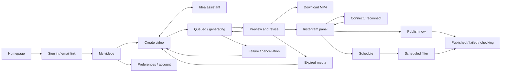

# ChitraBodh V1 application screen inventory

Updated 4 November 2026. Design review phase; not implemented product functionality.

Source of truth: [system design](../ChitraBodh-Dashboard-System-Design.md), [API design](../ChitraBodh-API-Design.md), [PRD](../ChitraBodh-V1-PRD.md). Later application/API contracts supersede older PRD details where noted. Visual system: [DESIGN.md](DESIGN.md).

Stitch project: https://stitch.withgoogle.com/u/1/projects/16810763223132817674?pli=1

## Review inventory

Generation status: all 24 numbered application screens/boards are present in Stitch, verified on 4 November 2026. Screens 01–18 cover desktop flows and states; 19–24 cover mobile flows and state specimens. A consistency pass corrected creation/progress copy, revision export details, scheduling boundaries and publication recovery. State insets are design alternatives, not simultaneous product states. All remain subject to user review and implementation validation; prototype navigation and live integrations have not been verified.

Review scope: this is the complete V1 design coverage set, not 24 new application routes. Several boards contain alternative states or dialogs. Existing homepage/demo and brand boards remain in the same project. Samples still use the fixed 3 November scenario for coherent scheduling examples. The live application must derive dates and eligibility from server state.

| ID | Screen | Route/surface | Required behavior |
|---|---|---|---|
| 01 | Sign in | /sign-in | Invite-only email link, no public signup |
| 02 | Check your email | /sign-in | Generic confirmation, resend, change email, expired/used link |
| 03 | My videos | /dashboard | All/scheduled, load more, separate generation/media/publication states |
| 04 | My videos empty | /dashboard | First action and layout-matched loading skeleton |
| 05 | Create video | /create | Topic, idea help, voice, captions, saved draft, 2000-character limit |
| 06 | Idea assistant | /create panel | Up to three suggestions, select without generating, recoverable errors |
| 07 | Creating your video | /projects/[id] | Real stages, queued/running, leave page, cancellation |
| 08 | Video ready | /projects/[id] | Vertical player, download, revise, share, exact expiry |
| 09 | Revision and versions | Project panel | Previous ready output, immutable versions, pending caption variant |
| 10 | Generation failed and expired | Project states | Retry/edit, expired access denied, new generation, cancellation |
| 11 | Share to Instagram | Project panel | Explicit account, artifact/version/variant, description, publish intent |
| 12 | Schedule Instagram post | Project panel | Eligible time interval, timezone and expiry, explicit confirmation |
| 13 | Scheduled posts | Dashboard scheduled filter | Edit/cancel pending post, exact pinned version, no calendar expansion |
| 14 | Publication results | Project states | Publishing, published, failed, unknown outcome, reconnect |
| 15 | Preferences | /settings | Default voice sample, captions, timezone, save/failure/conflict |
| 16 | Instagram connection | /settings | Connect, connected identity, reconnect, cancelled/ineligible OAuth |
| 17 | Account and destructive actions | Settings/dialogs | Sign out, disconnect, project deletion, account deletion and fresh sign-in |
| 18 | Application recovery states | Shared states | Validation, busy, network stale, unavailable voice, session expiry, 404 |
| 19 | Mobile dashboard | /dashboard | One column, status/expiry, navigation and pagination |
| 20 | Mobile create and ideas | /create | Topic and suggestions without horizontal overflow |
| 21 | Mobile generation | /projects/[id] | Stages, queued/cancel states and back navigation |
| 22 | Mobile video review | /projects/[id] | Vertical player, versions, revision and caption variant controls |
| 23 | Mobile publishing | Project sheet | Post/schedule, account identity, expiry, errors |
| 24 | Mobile settings and sign-in | Settings/auth | Narrow-screen preferences, connection and auth states |

## Shared constraints

- Keep creator stages to idea → generation → preview/share. Script and storyboard are generated behind the scenes.
- Private projects per invited user; no organization, role management, public signup, billing, credits, tracking, brand editor, timeline editor or direct YouTube publishing.
- One outstanding generation-related job per user, including revisions/caption variants. Global worker serializes generation; other users wait.
- Target 60–90 seconds, accept complete lessons of 40–90 seconds. Output 1080×1920, 30fps MP4. No duration slider required.
- First ready media starts two hours of availability. Revisions/reused variants cannot extend that deadline. Expired artifacts cannot play/download/publish.
- Caption variants are rendered outputs. Preview, download and publishing refer to the same selected ready artifact.
- Voice names/catalog are provisional until API access and accent are validated. Never imply that unavailable library voices are usable.
- Publishing is explicit, never automatic after generation. Schedules pin a particular version and caption variant.
- UI labels in design are illustrative, not live account identities or performance metrics.

## Scheduling example and validation

Use one coherent example: 3 November 2026, Asia/Kolkata, first ready at 14:00, current time 14:30, expires 16:00. API default schedule interval is 14:40–15:45 (ten minutes ahead through expiry minus fifteen minutes); example post at 15:00. Actual UI must use server-returned eligibility, not hard-coded buffers. Post-now needs at least five minutes remaining. Date/timezone labels are explicit; invalid or ambiguous local times need correction.

## Critical transitions

- Sign-in → generic link sent → verified dashboard, or invalid link → request new link.
- Topic/draft → queued → planning → narration → animating → finishing → ready; failures offer safe recovery.
- Revision queued/running → new ready version or failure with previous unexpired version preserved.
- Caption choice → pending render → selected ready variant; no export of a variant that is still rendering.
- Ready + connected account → publish now/schedule → publishing → published, failed, needs reconnection or unknown outcome.
- Unknown publication outcome → reconcile/check status; do not offer blind retry that could duplicate a post.
- Pending schedule → edit/cancel. Dispatch begun → cancellation cannot be guaranteed.
- Disconnect cancels pending posts and blocks new publishing; in-flight work may still finish. Deleting a local project does not remove an Instagram post.
- Expiry removes access to media; metadata may remain. New generation from the original idea is a new action, not restoration of expired media.

## Review and implementation boundary

Review visual hierarchy, consistency and state wording in Stitch first. Navigation hotspots, audio/video playback, auth, generation, expiry and publishing must be implemented and tested in the coding phase. Do not treat a generated screen or tool completion message as a verified backend integration. No live emails, account connections or Instagram posts are part of this design task.

### Copy and visual quality gates

Use “Create a video”, “Your idea”, “Narrator”, “Captions”, “Available until”, and “Share to Instagram”. Avoid research-console jargon, system identifiers, invented infrastructure regions, hardware-token/SSO promises, provider diagnostics, guessed completion estimates, or institutional licensing. Application navigation stays My videos / Create video / Settings. Do not add style, typography, duration or script-authoring controls.

Posters must illustrate the actual topic with simple shapes, labels and correct relationships. In water-cycle specimens, condensation is caused by cooling to the dew point and does not require subzero temperatures. Keep app posters consistent with the light theme. Screens that demonstrate different job states must label them as alternatives rather than implying concurrent revisions and caption rendering for the same user.

Design examples may show timestamps and sample accounts, but those are static review data. Availability, schedules, progress stages, voice accessibility and actual playback controls must be driven by backend state during implementation. Example rendered videos must meet the 40–90 second policy and 30fps output contract. Do not add background music, replace-image tools, public share links, voice-model names, or 60fps promises.

## Suggested review order

1. Review 03 → 05 → 07 → 08 as the everyday creation flow; confirm visual density, primary actions and video prominence.
2. Review 06 and 09 for optional idea assistance and revision controls; neither should add mandatory steps.
3. Review 11 → 12 → 13 → 14 for publishing intent, selected account/version, expiry and uncertain outcomes.
4. Review 01–02, 04, 10 and 15–18 for access, empty/error states and preferences.
5. Review 19–24 at phone size for readable captions, reachable actions, state messages and consistent navigation.

Keep visual review separate from production verification. The coding phase must supply the real media, auth/session handling, API state, scheduling eligibility and error recovery behind these designs.
